Suite à différents articles déjà parus dans cette rubrique, voici mon résultat final pour automatiser un aiguillage LEGO 9V.

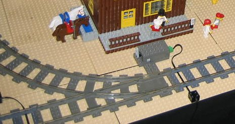

_Avertissement : certaines images peuvent heurter la sensibilité des AFOLs dont la vue cutter en contact avec de l’ABS est un attentat. Enfants, ne faites pas la manipulation vous-même._

Pour commencer il faut un moteur assez puissant et assez petit pour faire bouger l’aiguillage.

Par économie il est possible de récupérer ce moteur sur des vieux lecteurs de CDrom (merci Pierrick) ou de s’en procurer dans les [magasins d’électronique par exemple](http://www.electronique-diffusion.fr/product_info.php?cPath=543_1121_1122&products_id=24714).

On lui ajoute un axe Technic de 3 tenons de long percé en son centre (attention aux doigts).

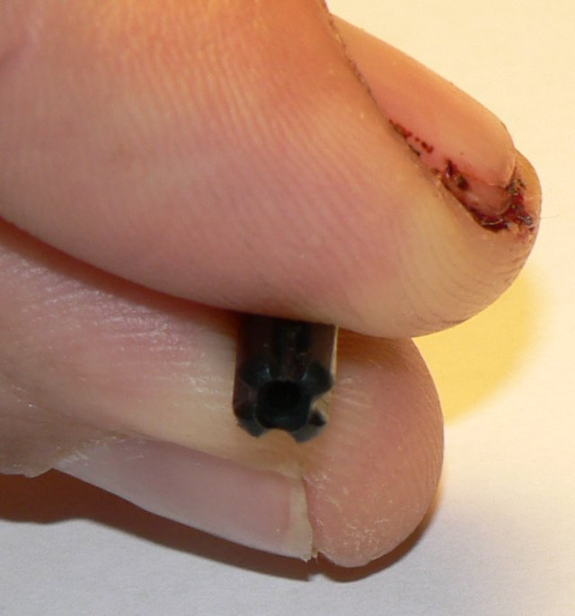

et on glisse sur l’axe un [engrenage 8 dents](http://www.peeron.com/inv/parts/3647).

Le tout collé sur deux tiles 2x2 avec un bout de connecteur (de votre choix, celui-ci n’est pas définitif) et ça vous fait un super moteur LEGO.

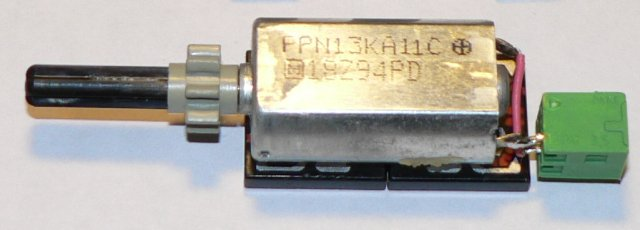

Ensuite on adouci l’aiguillage « version barbare » et c’est là qu’il faut fermer les yeux pour certains : on enlève tout ce qui gène :  
**–** coupure des deux support du levier jaune  
**–** coupure de l’arrêt arrière du levier jaune pour se retrouver comme sur la photo suivante :

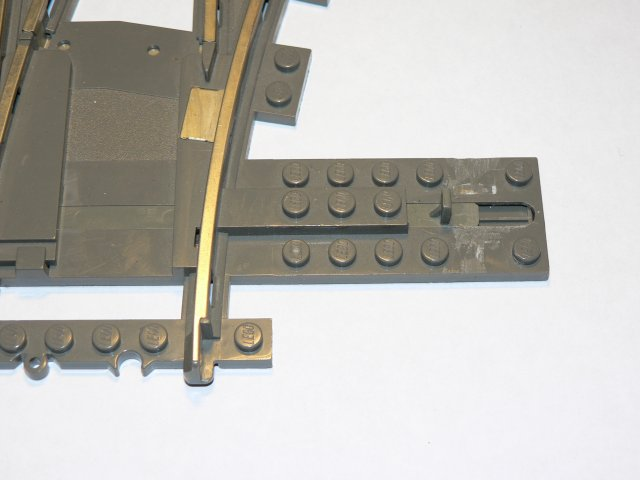

Un dernier coup de cutter sur une crémaillère juste au milieu et avec quelques pièces on va enfin pouvoir monter notre aiguillage.

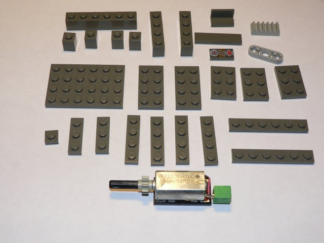

Etape 1 (le tile 1x2 noir n’est pas présent sur la photo précédente)

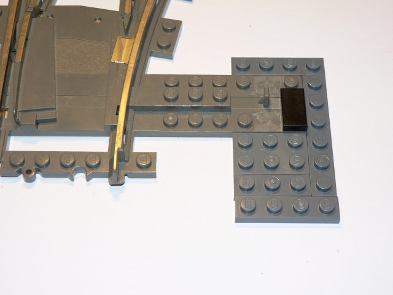

Etape 2

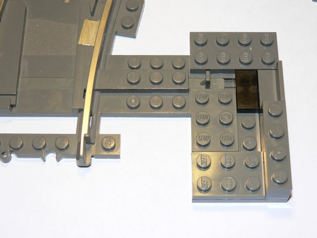

Etape 3

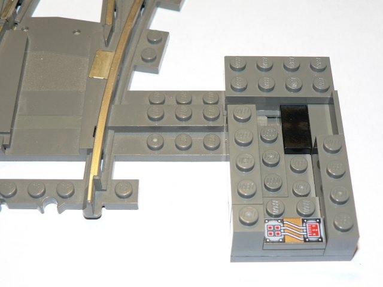

Etape 4

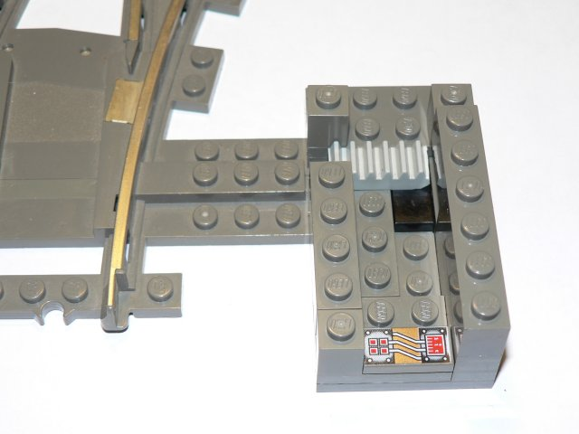

Etape 5

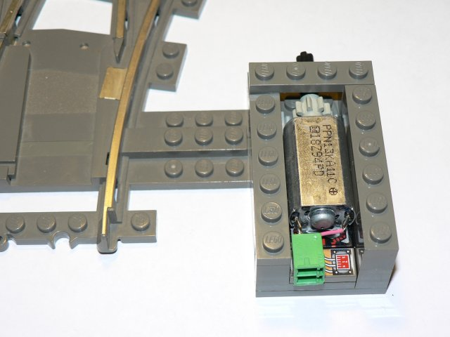

Etape 6

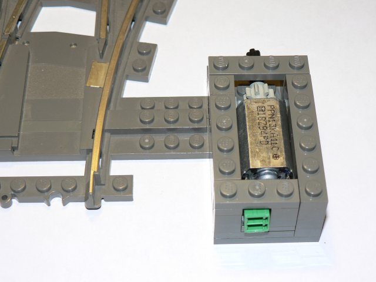

Etape 7

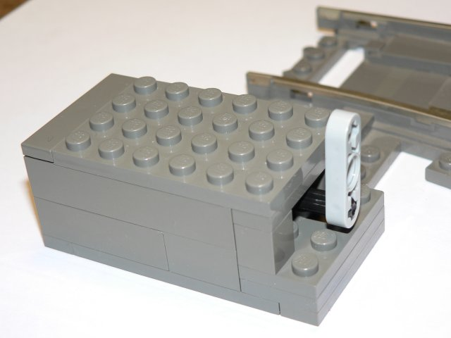

C’est fini ? Déjà ? et bien vous voilà avec un super aiguillage motorisé.

Le petit levier Technic sert à contrôler l’aiguillage manuellement (en cas de coupure de courant).

Pour alimenter le moteur, on peut [utiliser une alimentation 9V LEGO avec un inverseur](/articles/un-levier-modulaire-pour-commander-les-aiguillages-9v/) ou un système plus personnel mais ça c’est pour un prochain épisode....

[Galerie BS](http://www.brickshelf.com/cgi-bin/gallery.cgi?i=3081675)

Brikolego ! Du briko et du LEGO !
