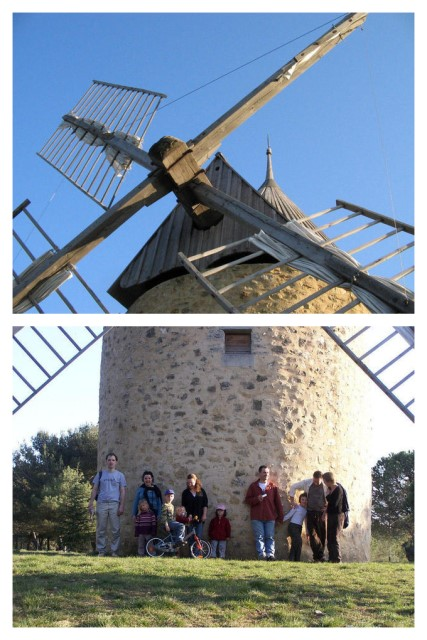
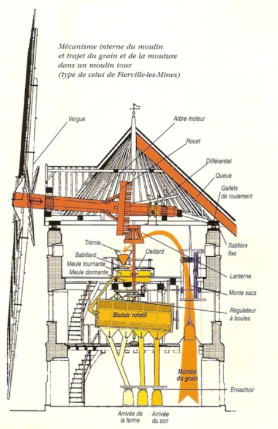
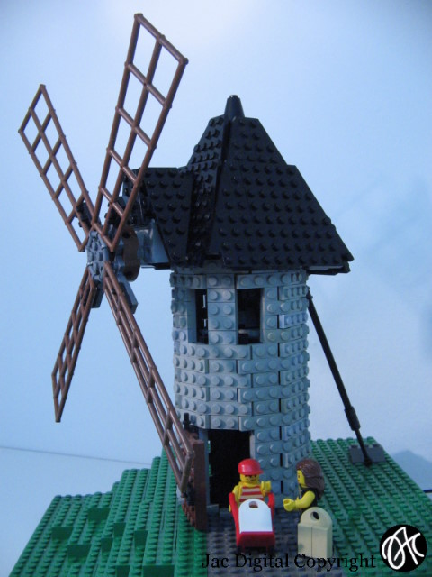
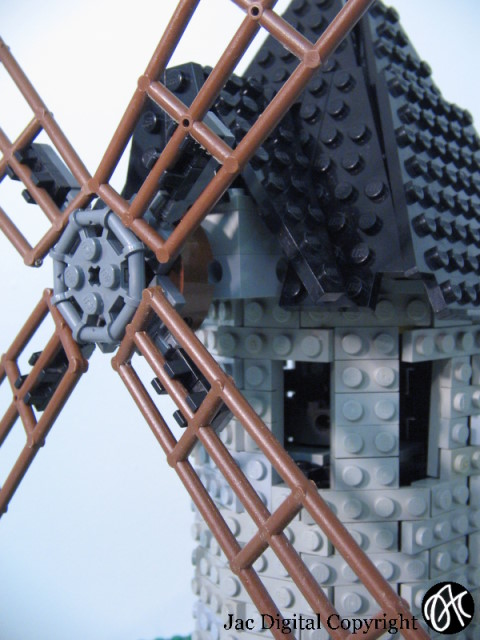
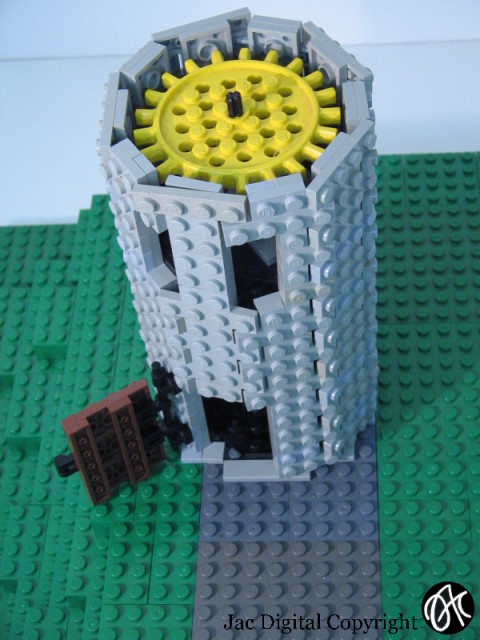
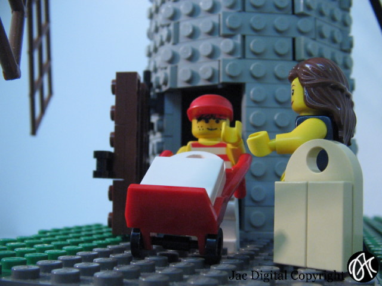

Dans le temps, les meules qui servaient à broyer les graines (blé, seigle, lentilles, châtaignes...) étaient entraînées par la force de l’eau ou du vent. Pour notre séjour en Normandie, lors de la REF 2010, nous avions à construire un moulin.

Pour notre Rencontre Estivale de l’Association ([REF2010](/articles/la-ref-2010-a-domjean/)), nous avions organisé un concours de création sur le thème des anciens moulins. Ce qui nous a donné l’idée, c’est le fait que des briques LEGO soient présentes sur une brochure d’un moulin normand.

En Auvergne, du fait de la présence de nombreuses rivières, les moulins sont principalement entraînés par l’eau. Soit avec une roue à aubes, soit avec une turbine à eau, cette dernière étant plus puissante.

J’ai choisi de reproduire un moulin à vent, peut être à cause des souvenirs que j’ai du moulin de Daudet et plus récemment du moulin de Venéjan. Mais c’est surtout parce que Brigitte m’a cédé une petite brochure sur [le moulin à vent du Cotentin](http://www.cotedesisles.com/site_moulin_communaute_de_communes_de_la_cote_des_Isles.php), qui possède un atelier pédagogique, illustré par une photo de brique LEGO (voir en milieu de la page de présentation).

**Le moulin de Vénéjan avec des afols fous !**

Donc, en réalité et dans le schéma du moulin que j’ai voulu reproduire, on a une tour en pierre, une toiture mobile sur son axe pour prendre au mieux le vent, une barre qui permet d’orienter le moulin et enfin des palles avec une voilure réglable.

Pour le fonctionnement, les palles entraînent directement une roue dentée qui engrène sur une petite roue (la lanterne) placée à l’horizontale sur le haut du moulin. Tout est en bois. Par l’axe central on entraîne une meule de pierre qui va broyer les grains par pression sur une meule fixe. Par un jeu de courroie, le mouvement est transmis à une bluterie qui permettra de séparer la farine du son. Le meunier surveille le débit du moulin, il l’alimente en grain et il ensache la farine.

**Schéma fonctionnel d’un moulin a vent.**

Ce schéma a pu être scanné et présenté grâce à l’aimable autorisation de Cécile, guide du moulin de Fierville les Mines.

L’avènement de l’électricité sonnera la fin de ces moulins, mais ce n’est pas la seule en cause. Ces constructions sont victimes des caprices de la nature avec les inondations pour les moulins en bord de rivière et la foudre ou les fortes tempêtes pour les moulins à vent placés en haut des collines.

C’est donc en haut d’une butte que j’ai construit mon moulin en LEGO. Par une technique simple, j’ai réussi à construire un mur circulaire donnant l’illusion du croisement des pierre. Le plus compliqué a été de placer le toit mobile et de faire une reproduction des meules.

**Le moulin.**

Les palles sont orientables. J’ai imaginé qu’avec ce système on pouvait régler la vitesse du moulin suivant la force du vent. En fait ça se fait aussi en fonction de la surface de voilure, comme sur un voilier.

**Détail des palles et de la meule.**

Pour le fonctionnement de la maquette, j’ai dû tricher un peu. C’est un moteur Technic caché sous le décor qui entraîne les palles. Une vieille grande roue dentée Technic permet de faire tourner l’ensemble à vitesse réelle sans que ça soit un ventilateur. Dans l’espace réduit de la tour, j’ai pu simplement placer la meule.

**Le moulin sans le toit....**

Par contre, la minifig-meunier peut faire pivoter le toit comme elle le souhaite pour prendre au mieux le vent. Elle nous présente aussi quelques sacs de farine toute fraîche. Reste plus qu’à confier cela au boulanger pour qu’il nous fasse de bonnes miches !

**Sac de farine contre sac de blé !**

[Galerie photo.](http://photos.freelug.org/main.php/v/JAC/Concour/MoulinRef2010/)
