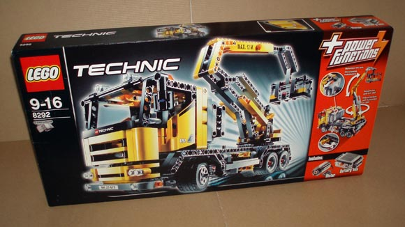
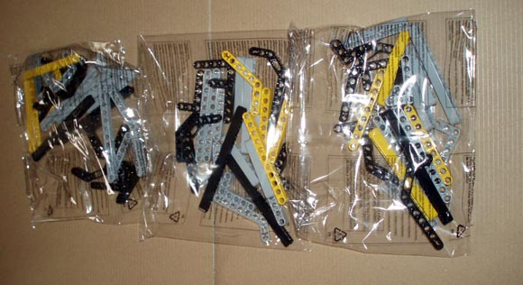
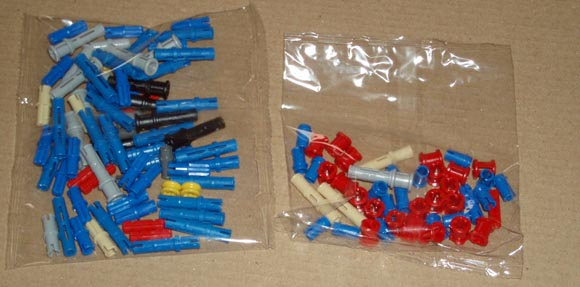
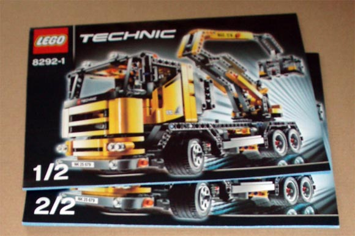
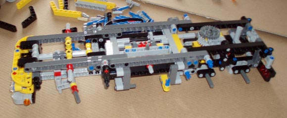
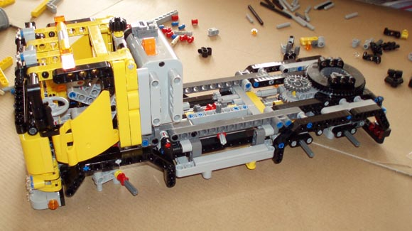
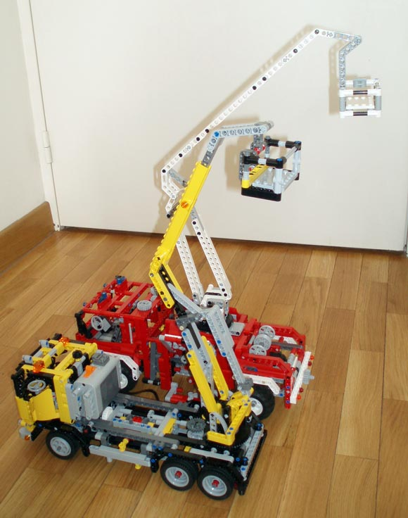
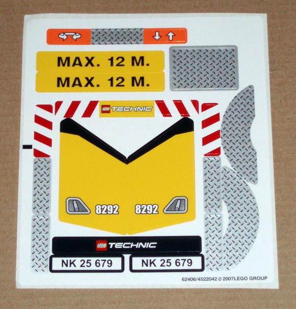
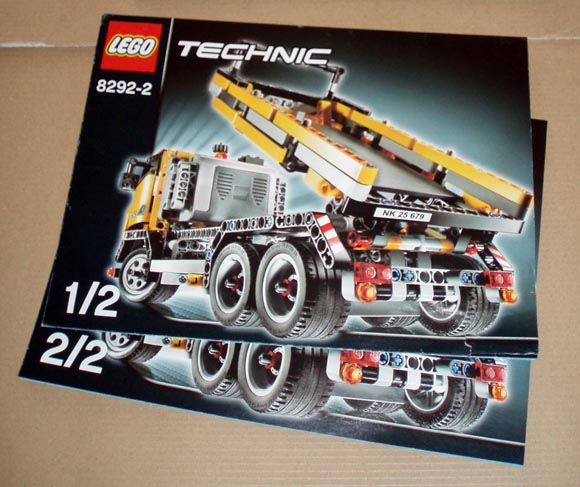

L’apparition l’année dernière du système [Power Functions](http://technic.lego.com/en-US/powerfunctions/default.aspx) avec le [bulldozer](http://shop.lego.com/ByTheme/Product.aspx?p=B8275&cn=57&d=70) annonçait finalement la généralisation de la motorisation électrique même dans des modèles Technic de plus petites tailles.

Le camion à nacelle élévatrice [8292](http://shop.lego.com/ByTheme/Product.aspx?p=B8292&cn=57&d=70) en est aujourd’hui la preuve. Faites avec nous une petite revue de détails.

Globalement on retrouve les fondamentaux du Technic des années 2000. Comme le montre l’inventaire ([Peeron](http://www.peeron.com/inv/sets/8292-1)), la part belle est faite au pièces dites "studless" (sans tenons). Le jaune est ici à l’honneur - rien d’étonnant c’est, avec le rouge, la couleur dominante de la marque danoise (presque une marque de fabrique).

On retrouve aussi le code couleur pour les axes (gris impairs - noirs pairs), les chevilles avec frottements (bleu) ou sans (tan), les roues dentées (gris foncé - dentures droites, noir denture - biseautée), etc.

De nouvelles pièces ? Presque rien puisque l’on (re)trouve de nouveau que ce [petit connecteur](http://www.peeron.com/inv/parts/x1835) déjà présent dans deux autres sets Technic de 2008.

Le montage n’a rien de passionnant pour les constructeurs chevronnés. Tout au plus seront-ils agacés par la difficulté à différencier le noir du gris foncé dans les notices de montages.

Les petits nouveaux, eux, n’auront pas trop de mal et devraient achever le montage dans la journée. D’ailleurs même si les sachets de pièces ne sont pas numérotés, le montage s’effectue en trois grosses étapes : châssis, cabine et nacelle. De quoi occuper trois soirées.

Une fois construit, et si vous avez déjà le [camion de pompier](/articles/camion-de-pompier-8289/), vous ne pourrez vous empêcher de les comparer (c’est surprenant que la société LEGO commercialisent ces sets avec si peu d’écart dans le temps - cela pourrait nuire au succès du second). Cela pourrait être décevant : pour un prix très similaire le camion nacelle est plus petit, la nacelle s’élève moins haut et il manque les bêches d’ancrage. Il lui reste toutefois la direction, incontournable.

Notez que l’on pourrait aussi le comparer au camion tout terrain [8273](http://shop.lego.com/ByTheme/Product.aspx?p=8273&cn=57&d=70)

Mais voila que le moteur [Power Functions](http://shop.lego.com/ByTheme/Product.aspx?p=8883&cn=57) fait toute la différence. C’est un régal que de jouer avec la nacelle qui tourne et s’élève sans avoir à actionner manuellement ces fonctions (mis à part le sélecteur qui permet avec le moteur unique de commander les deux mouvements de nacelle).

Jusqu’à présent, les modèles Technic étaient sans vie. Voici que la société LEGO nous proposent des modèles "moteur(s) inclus" - les fans adultes apprécieront tout autant que les plus jeunes cette évolution qui se faisaient attendre.

Niveau modification ; la motorisation du véhicule entier ou de sa direction me semble réalisable même sur ce modèle de taille moyenne. Il profiterait aussi de la commande à distance disponible avec le [Power Functions System](http://shop.lego.com/ByTheme/Product.aspx?p=8884&cn=57).

Encore plus :

**–** La planche d’autocollants :

**–** Le modèle alternatif

**–** Deux vidéos pour voir les mouvements motorisés

Video Player

[Vidéo de la publication d’origine](https://www.freelug.org/IMG/mov/Complet.mov)

Video Player

[Vidéo de la publication d’origine](https://www.freelug.org/IMG/mov/Nacelle_tourne.mov)

**–** [Revue très complète sur SeTechnic](http://www.setechnic.com/review-lego-technic-8292.html)
