Lors de la visite des copains pour l’[exposition StarWars à Cusset](/articles/13e-generation-sw-a-cusset-03/), j’ai eu la surprise et la joie de trouver cette boîte dans mon frigo ! Comme promis, voilà le descriptif du montage.

-   Prix : environ 30 Euros
-   Disponibilité : Dans les magasins avec un bon rayon jouets.
-   Taille de la boîte : 38x26 cm
-   Nombre de pièces : 223
-   Gamme : Ninjago
-   Contenu : Un dragster et 3 minifigs.
-   Temps de montage : environ une heure et demie.

L’enfer dans mon frigo, est-ce possible ? Oui, mais avec la porte ouverte !

La boîte est magnifique, je trouve le design autour du thème Ninjago vraiment bien fait. L’image verso est presque identique à l’image recto. Un moment, j’ai cru que c’était les mêmes... Par contre, en regardant sur l’image de la face avant, j’ai cru qu’il y avait des toupies dans la boîte. Les 2 ninjas en pleine rotation, ça porte un peu à confusion, même si elles ne sont pas du tout signalées sur le restant de la boîte.

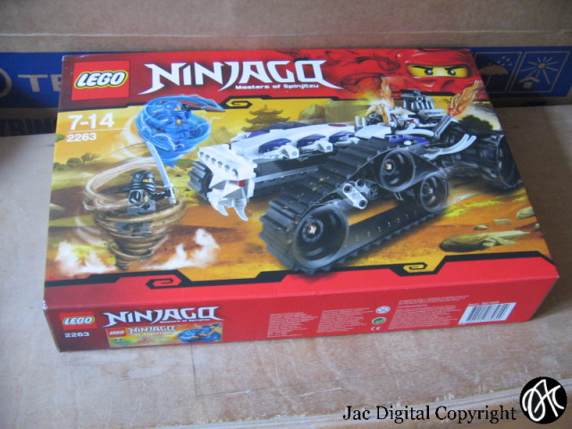

**La boîte**

A l’ouverture, on trouve une boîte bien pleine avec 2 chenilles, 4 grandes roues noire, 3 sachets numérotés et la notice en 2 parties. Cette dernière n’étant pas protégée.

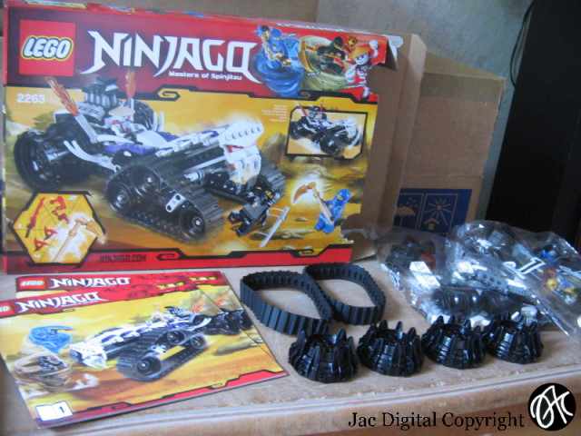

**Le contenu**

Il n’y a pas de planche d’autocollants. On retrouvera avec joie, euh, c’est suivant l’humeur, une belle "tile" blanche, sérigraphiée d’une tête de mort rouge, au crâne fendu...

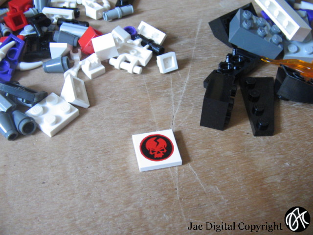

**Wouah, un crâne rouge fendu !!!**

Respectant mes procédures, je mélange toutes les pièces, mais en faisant tout de même deux tas, différenciant légèrement la taille des pièces. En fait, c’est suivant les sachets. Le contenu des gros sachets est mis en tas d’un côté. Puis, je prends les petits sachets qu’ils contiennent et je fais un tas différent.

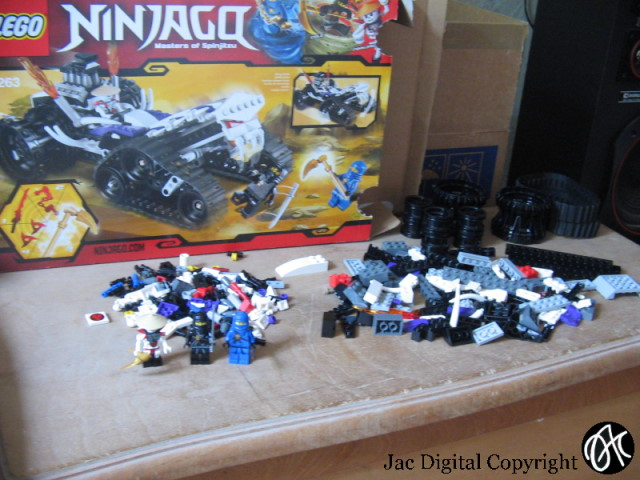

**Les tas...**

Le montage commence par les minifigs, qui sont au nombre de trois, un squelette avec des godasses (!!) et 2 ninjas(Go !!). On trouve aussi une des nombreuses armes disponibles dans cette gamme, pour le squelette et un superbe sabre pour l’un des ninjas. Enfin, moi, je le trouve superbe, même s’il est banalement gris foncé. Déjà de bons moments de jeu, rien qu’avec ces 3 minifigs, vous verrez...

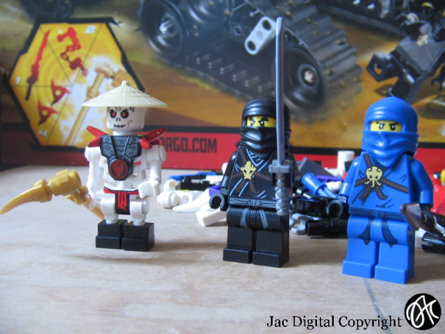

**Les 3 minifigs**

En commençant par le chassis, on prends connaissance du système qui fait toute l’attraction de ce modèle, la gueule du serpent qui s’ouvre. Ah, c’est pas un serpent ? Enfin, peu importe, ça rajoute une touche spéciale à ce modèle effrayant.

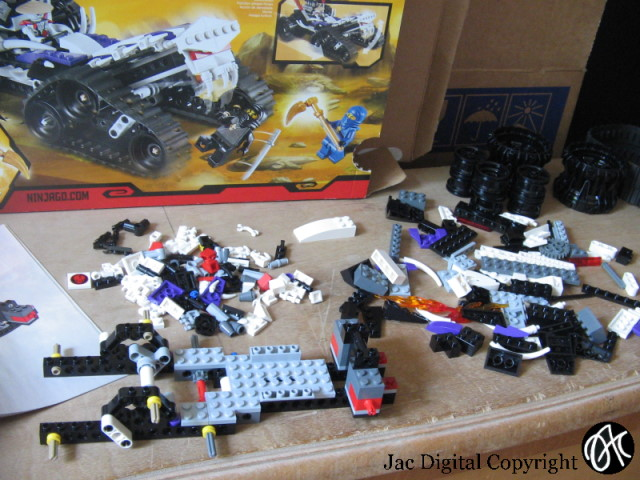

**Montage du chassis**

Il y a une petite erreur sur la notice, pour le montage de la pièce lisse imprimée. Vous vous souvenez, le crâne fendu ? Bin, elle est placée à l’envers sur le dessin. Moi je la vois plus dans le sens, avec mâchoire vers le bas. Surtout que c’est comme ça sur les photos. Enfin, je le monte comme ça et ça correspond à ce que je fais, jamais un modèle n’est monté comme sur la notice. Pour le reste, y’a rien à dire.

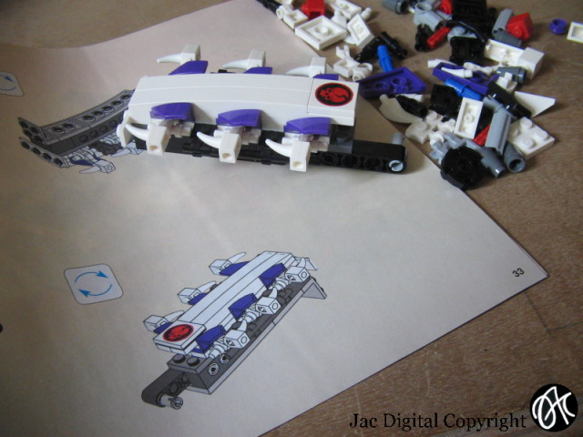

**Légère erreur**

Par la suite, on assemble le cockpit de contrôle. Il faut y placer le squelette, mais c’est pas facile quand il n’y a pas de tenons. En plus, ses bras n’ont pas les "mains" dans le bon sens, du coup, impossible de l’agripper au guidon. Il faut simplement le caler sur son siège. L’arceau par contre est une super idée.

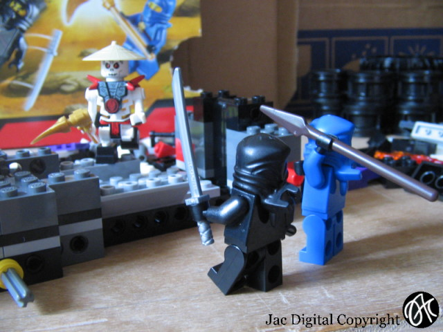

**Les "mains" du squelette**

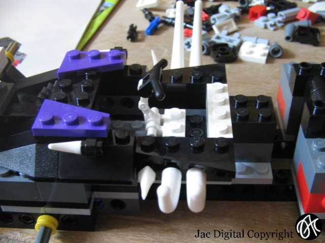

**Le cockpit**

J’adore la conception de l’arrière. Je trouve ça très bien fait.

Le moteur est impressionnant, placé très haut il est prévu pour envoyer de grandes flammes dans les pots d’échappement. Ca passe très près du squelette. Mais bon, aucun souci vu qu’il doit venir de l’enfer !

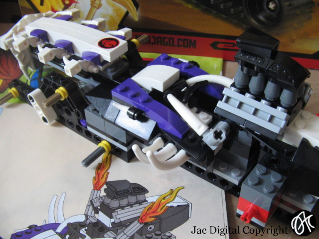

**Le terrrrrible moteur**

Pour l’ouverture de la gueule, il faut de l’adhérence aux chenilles, sinon, ça ne fonctionne pas bien. J’aurais pensé aussi que ça se lève plus vite... Parce que, même en le poussant très vite, il faut de la longueur pour arriver à avoir 2 ou 3 actions.

Au final on obtient un beau modèle, qui me plait beaucoup ! Le look est ravageur et il faut réellement 2 Ninjago bien entraînés pour arrêter notre squelette dans sa monture ! Je l’aurais bien acheté celui-là. En plus on peut bien jouer avec les minifigs... Euh, là c’était pendant le montage !

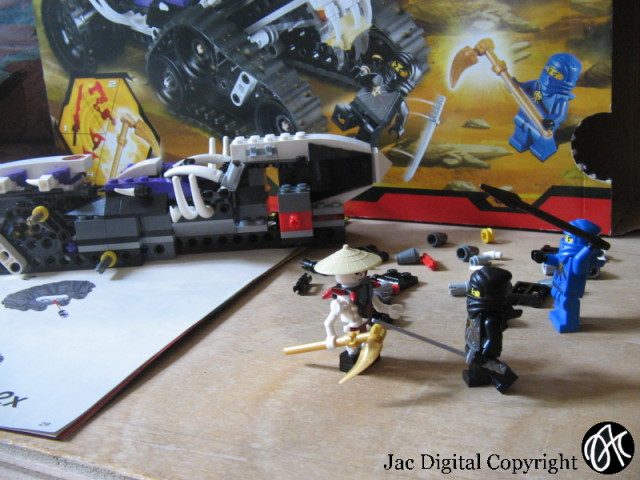

**Un combat acharné...**

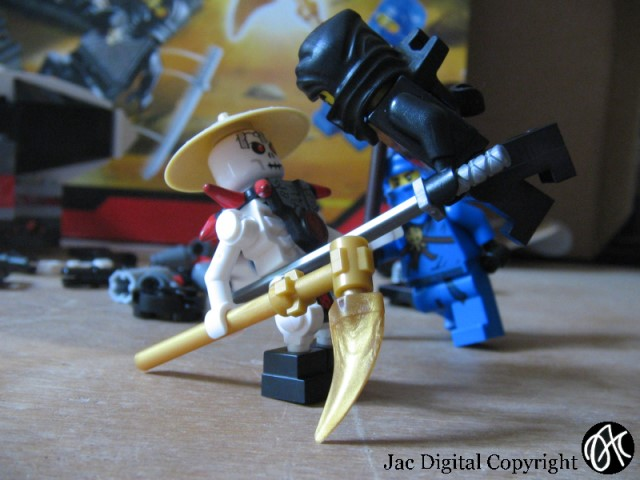

**sans toupie !**

Un beau cadeau, vraiment merci les super copains !

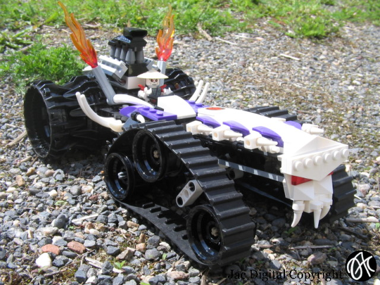

**En pleine action...**
