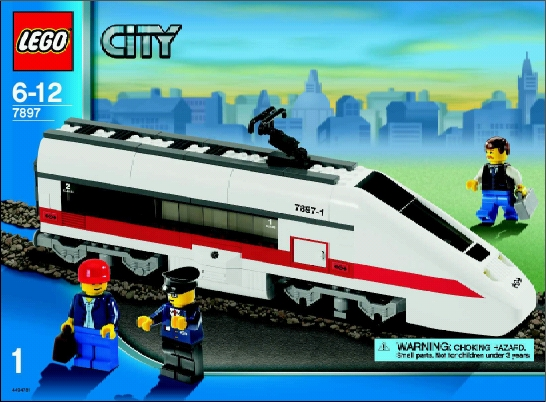
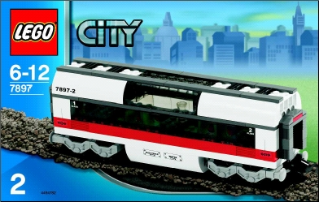
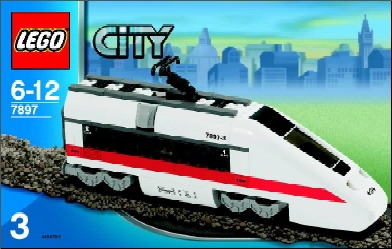
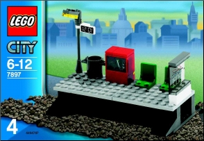
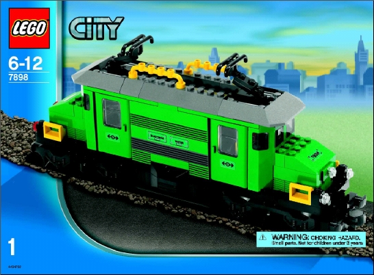
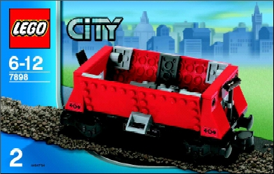
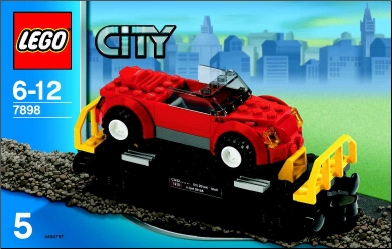
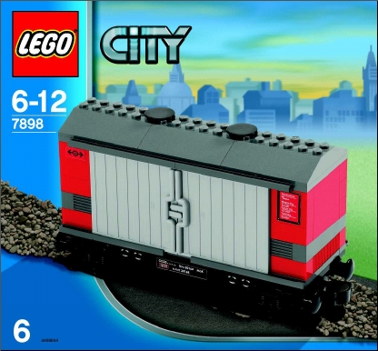
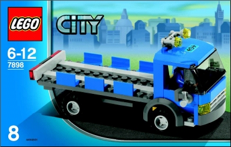

Depuis très peu de temps, les notices des nouvelles boites de train 7897 et 7898 sont disponibles sur le site de téléchargement de LEGO®.

Concernant les élements moteurs, seuls les versions _North American_ sont actuellement en ligne.

Probablement du au fait que ces deux boites sont en vente au Canada et Etats-Unis d’Amérique avant l’Europe.

Pour vous permettre de découvrir ces deux nouvelles boites, voici donc les liens vers les notices.

La boite 7897 comprend 4 notices tandis que la boite 7898 en comprend 7 (8 étapes).

Patience, en attendant ces boites dans les rayons.

Attention, les fichiers peuvent s’avérer lourds (plusieurs Mo). Voici les liens direct :

[7897-1](http://assets.lego.com/bigdownloads/buildinginstructions/4494781.pdf)

**[http://assets.lego.com/bigdownloads/buildinginstructions/4494781.pdf](http://assets.lego.com/bigdownloads/buildinginstructions/4494781.pdf)**

[7897-2](http://assets.lego.com/bigdownloads/buildinginstructions/4494782.pdf)

**[http://assets.lego.com/bigdownloads/buildinginstructions/4494782.pdf](http://assets.lego.com/bigdownloads/buildinginstructions/4494782.pdf)**

[7897-3](http://assets.lego.com/bigdownloads/buildinginstructions/4494785.pdf)

**[http://assets.lego.com/bigdownloads/buildinginstructions/4494785.pdf](http://assets.lego.com/bigdownloads/buildinginstructions/4494785.pdf)**

[7897-4](http://assets.lego.com/bigdownloads/buildinginstructions/4494787.pdf)

**[http://assets.lego.com/bigdownloads/buildinginstructions/4494787.pdf](http://assets.lego.com/bigdownloads/buildinginstructions/4494787.pdf)**

[7898-1](http://assets.lego.com/bigdownloads/buildinginstructions/4494792.pdf)

**[http://assets.lego.com/bigdownloads/buildinginstructions/4494792.pdf](http://assets.lego.com/bigdownloads/buildinginstructions/4494792.pdf)**

[7898-2](http://assets.lego.com/bigdownloads/buildinginstructions/4494794.pdf)

**[http://assets.lego.com/bigdownloads/buildinginstructions/4494794.pdf](http://assets.lego.com/bigdownloads/buildinginstructions/4494794.pdf)**

[7898-3+4](http://assets.lego.com/bigdownloads/buildinginstructions/4494795.pdf)

**[http://assets.lego.com/bigdownloads/buildinginstructions/4494795.pdf](http://assets.lego.com/bigdownloads/buildinginstructions/4494795.pdf)**

[7898-5](http://assets.lego.com/bigdownloads/buildinginstructions/4494797.pdf)

**[http://assets.lego.com/bigdownloads/buildinginstructions/4494797.pdf](http://assets.lego.com/bigdownloads/buildinginstructions/4494797.pdf)**

[7898-6](http://assets.lego.com/bigdownloads/buildinginstructions/4498844.pdf)

**[http://assets.lego.com/bigdownloads/buildinginstructions/4498844.pdf](http://assets.lego.com/bigdownloads/buildinginstructions/4498844.pdf)**

[7898-7](http://assets.lego.com/bigdownloads/buildinginstructions/4497757.pdf)

**[http://assets.lego.com/bigdownloads/buildinginstructions/4497757.pdf](http://assets.lego.com/bigdownloads/buildinginstructions/4497757.pdf)**

[7898-8](http://assets.lego.com/bigdownloads/buildinginstructions/4494801.pdf)

**[http://assets.lego.com/bigdownloads/buildinginstructions/4494801.pdf](http://assets.lego.com/bigdownloads/buildinginstructions/4494801.pdf)**
