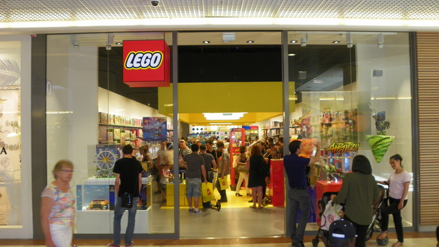
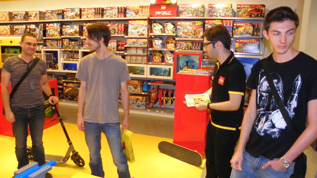
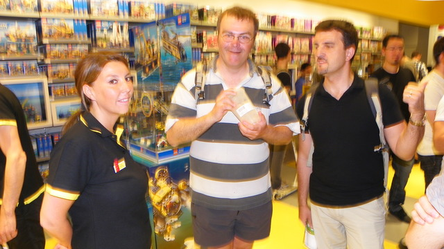
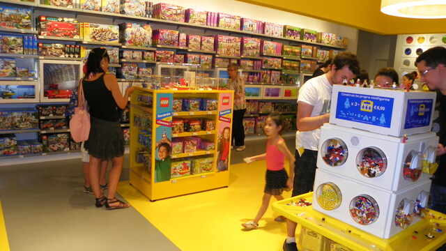
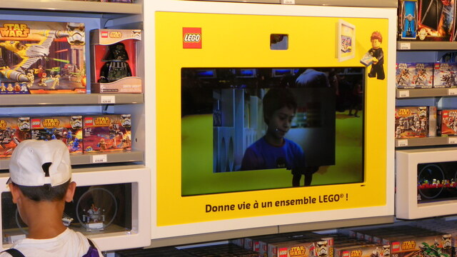
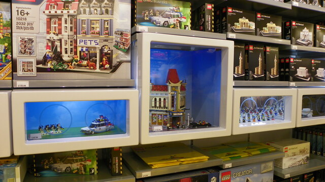
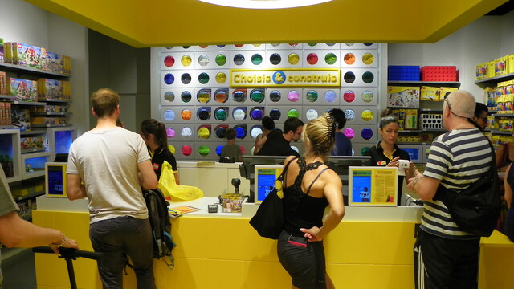

Le nouveau LEGO Store récemment installé à Lyon était attendu. Il a ouvert ses portes ce 17 Juillet au niveau 0 du Centre Commercial La Part-Dieu, à proximité immédiate d’une des gares les plus fréquentées d’Europe.

Idéalement placé à côté du McDonalds (nous pourrons faire des combos Resto LEGO / AFOL Days), le LEGO Store de Lyon est similaire en tout point à ceux que vous avez déjà visité à Clermont-Ferrand, Lille, Levallois ou Marne la Vallée.

FreeLUG a effectué un repérage et vous présente les lieux en détails.

Devant la vitrine, vous retrouvez tout les codes de la société, à l’image du cube rouge au nom de la marque qui est un phare ou, plutôt comme une lumière attire les moustiques, un repère qui attire les AFOLs. [^1]

Le LEGO Store : "Chewie, we’re home"

Sans surprise, il y avait déjà du monde et des visages connus. Outre les AFOLs déjà présents, certains employés des LEGO Store de France étaient venus quelques jours auparavant pour aider la nouvelle équipe à monter le magasin.

Jérôme, au centre, est déjà en charge d’effectuer l’inventaire du Pick a Brick du LEGO Store de Lyon. Heureux comme une brique 2x4 dans un set Star Wars.

On retrouve au centre du magasin les différentes pôles comme l’atelier Minifig qui permet de créer ses propres Minifigs, un bac Duplo pour les plus petits, un stand de jeu ou de construction pour tester les produits.

En périphérie les étagères présentant les sets, toujours avec le même agencement que dans les autres magasins - pas de dépaysement, vous saurez ou se trouve les "Technic", à côté des "Architecture" avec les "Cuusoo".

Toujours en périphérie, d’autres pôles de curiosité, comme l’écran de réalité ’virtuelle’ augmentée et les différentes vitrines alternant entre sets en présentation et scénettes "Miniland".

Au fond du magasin, les caisses avec en fond le mur "pick a brick", récemment renommé "choisis et construis" pour le public français.

FreeLUG souhaite le succès à toute l’équipe du LEGO Store de Lyon et la remercie pour son accueil souriant et enthousiaste (et surtout un grand merci pour la clim dans la magasin en cette période de canicule)

[^1]: Non, rassurez-vous, les AFOLs ne transmettent pas le chikungugna même si parfois ils démangent
