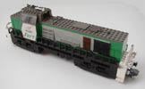
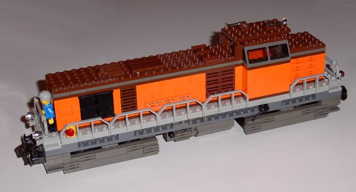
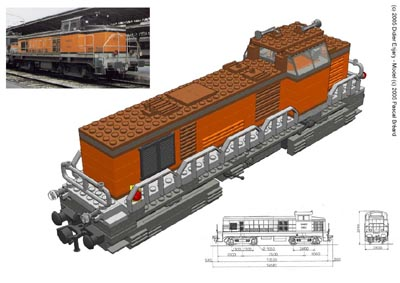

Il y a plus d’un an, en février 2004, Pascal nous présentait une de ses créations : Une motrice diesel BB63000 en livrée Fret, motrice populaire qui fait incontestablement parti du paysage ferroviaire français.

Depuis Pascal a retravaillé cette création et un an plus tard (février 2005) nous présentait une version en livrée Arzens de cette même motrice :

Comme vous le constatez ce nouvel habit fait la part belle à des couleurs plus ou moins inhabituelles en LEGO® : le marron et surtout l’orange.

C’était là un objet de choix pour créer une notice qui vous permettra de remonter chez vous cette maquette, notice disponible sur [Brickshelf](http://www.brickshelf.com/cgi-bin/gallery.cgi?f=119428)  
et [FreeLUG](http://photos.freelug.org/main.php/v/6studs/BB63000/).

Certes vous ne disposez peut être pas des briques nécessaires mais sachez que vous pouvez choisir de recréer d’autres schémas de couleur comme le jaune ([livrée "Infra"](http://users.skynet.be/trainminiature/BB63000infra.html), une BB63000 étant l’une des seules à l’avoir réellement reçu), ou le vert ([livrée "Fret"](http://users.skynet.be/trainminiature/BB63000fret.html)). Les plus audacieux se servirons du vert foncé de la [BNSF](http://guide.lugnet.com/set/10133) pour recréer la première livrée des 63000 : la [livrée verte](http://users.skynet.be/trainminiature/BB63000verte.html).

Par ailleurs la motorisation 12V qu’a choisi Pascal sera facilement remplacée par une motorisation 9V plus accessible aujourd’hui...attention toutefois à motoriser les deux essieux à cause du poids élevé de l’engin.
