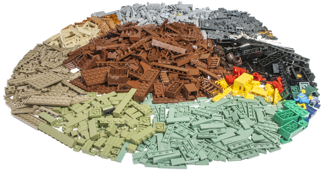
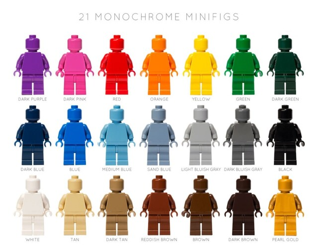
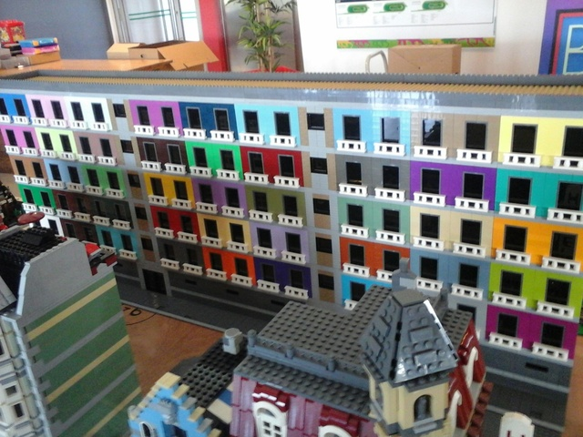
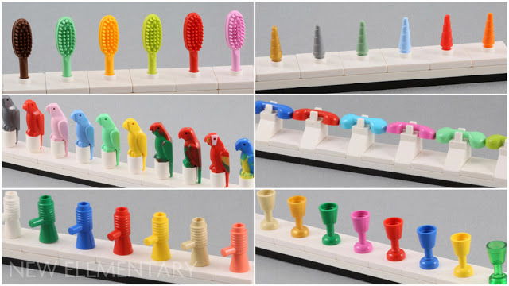
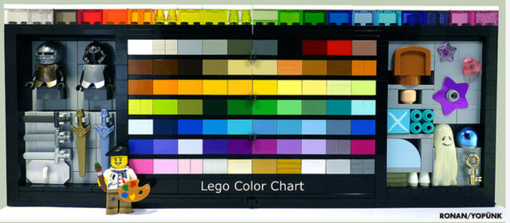
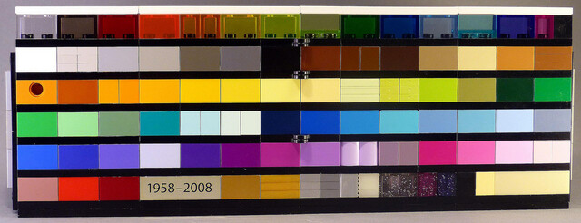
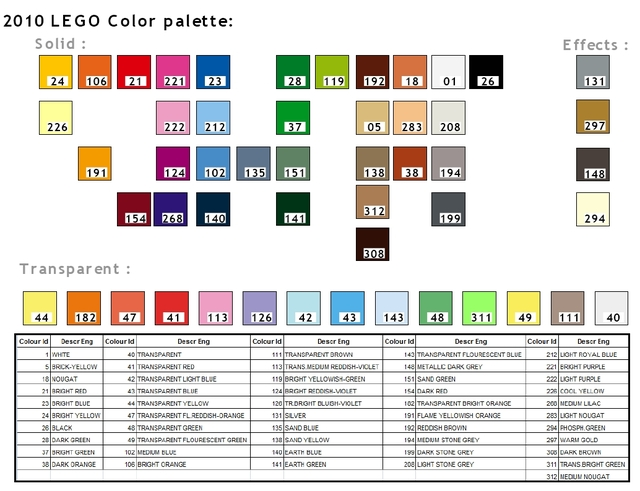
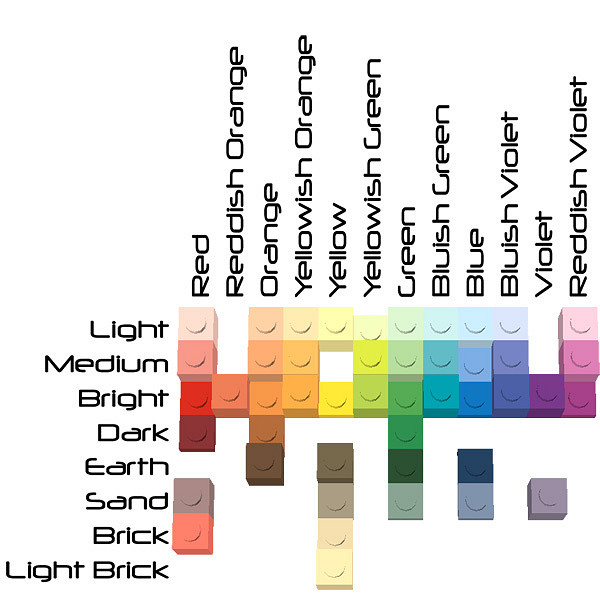
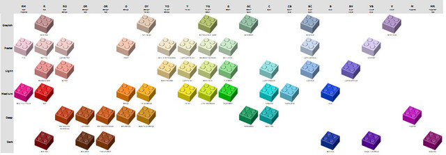

Créer un nuancier avec des pièces est devenu un incontournable et ce pour plusieurs raisons.

Tout d’abord il faut expliquer pourquoi il est nécessaire de le faire avec des pièces. Car on peut imaginer imprimer un nuancier des couleurs LEGO ou même tout simplement se contenter d’aller sur les différents sites qui en proposent en ligne.

Malheureusement les technologies actuelles - non professionnelles - prennent très mal en compte le rendu des couleurs. En fonction de votre écran et de son réglage, de l’éclairage ambiant et/ou de votre imprimante et de la qualité du papier et des encres...le résultat sera au mieux décevant et au pire complètement trompeur - mais jamais fidèle.

D’autant plus que jamais un écran ou une imprimante ne rendra compte des effets de matières comme l’éclat, la brillance, les transparence, les reflets, etc.

Nous sommes donc d’accord, pour être fidèle aux couleurs, il faut des échantillons, des morceaux de matières, tout comme les botanistes et minéralogistes ne se contentent pas de dessins, de photos ou de descriptions mais prélèvent aussi des spécimens.

Mais à quoi sert un nuancier ? Pour certains c’est simplement un nuancier _étalon_ qui leur permettra sous n’importe qu’elle source de lumière de déterminer la couleur d’une pièce externe. Pour d’autres, le nuancier à un usage de palette de couleur leur permettant de définir leur _planche de tendance_ (mood board). On peut aussi, pour une pièce spécifique, créer un nuancier à simple fin d’_inventaire_. Enfin, le nuancier peut représenter un _exercice_ de déclinaison de couleur pour un ensemble plus complexe de pièces comme les figurines monochromatiques. Dans tout les cas le caractère esthétique du nuancier est recherché, en particulier dans une recherche d’harmonie et de concordance des couleurs.

## _Ensemble des pièces du Old Fishing Store reflétant la planche de tendance définie par Robert Botenbal, concepteur du modèle._

## _Minifigurines monochromatiques parfois dénommées "monofig", en référence au site marchand "monofigs.com"._

## _Un beau nuancier sous la forme de façade par Laurent._

Elspeth De Montes a écrit [une série d’article](http://www.newelementary.com/search?q=colourtastic) au sujet des nuanciers inventaires, fascinantes expositions de pièces aux couleurs variées parfois très rares.

## _Exemples de nuanciers par Elspeth De Montes._

Il n’ y a pas de réponse définitives à la création d’un nuancier de couleur LEGO car il n’existe pas de nuancier parfait. Mais on peut présenter quelques idées directrices. Parfait ne veux rien dire, mais on peut suggéré un nuancier parfaitement adapté à l’usage que l’on souhaite en faire. Entre autre on peut souhaiter qu’il soit portable, exhaustif (toute les couleurs), ordonné, complet (avec le nom des couleurs), etc. On peut aussi imaginer un nuancier complet et exhaustif mais non portable (pour le bureau) et un nuancier ultra portable pour la poche avec les couleurs difficiles (proches, rares,...).

Un critère important toutefois concerne la taille des échantillons. La surface de la pièce doit être suffisante pour que sa couleur puisse être facilement comparée. Par exemple la tranche d’une plaque 1x1 est très largement insuffisante (0.256cm²). Le minimum correspond à la tranche d’une brique 1x2 (1.54 cm²). Le meilleur rapport facilité de lecture / encombrement est certainement la plaque lisse 2x2 (2.56 cm²). On utilisera de plus de préférence des surfaces sans rugosité (lisses).

On fera aussi attention au fait que les couleurs environnantes et donc en particulier celle d’un éventuel support, va impacter la perception de la couleur de l’échantillon.

Ensuite, si l’on n’est pas collectionneur pathologique, je déconseille la recherche de l’exhaustivité. Les raisons sont multiples. Tout d’abord aucune pièce n’existe dans toutes les couleurs. Votre nuancier sera donc très hétérogène.

## _Un très beau nuancier par Ronan/Yopunk mais aussi très hétérogène._

Ensuite votre poursuite d’exhaustivité se heurtera au coût rédhibitoire de pièces à la couleur très rare.

De plus, dans votre élan, vous avez peut être perdu de vue votre objectif : créer un nuancier étalon ; Est-il utile d’inclure dans votre collection des couleurs rares et/ou disparues ? Peut-être est il utile de se consacrer aux seules couleurs que vous pouvez raisonnablement rencontrer ? Quelque soit le cas, le reste de la discussion peut vous intéresser.

Car de toute façon il est nécessaire d’ordonner les couleurs que vous allez retenir. Très probablement, votre nuancier séparera les couleurs "solides" (opaques et unies, sans effet) des transparentes, elles-mêmes séparées des autres effets (chrome, phosphorescente,...). Les couleurs solides sont, de loin, les plus nombreuses. Nous nous concentrons sur celles-ci.

## _Zoom sur les couleurs solides du nuancier de Ronan/Yopunk_

Naturellement, les nuanciers sont ordonnés en rassemblant des couleurs similaires en suivant les couleurs de l’arc-en-ciel. Le problème réside dans le fait qu’une seule dimension - la teinte - ne permet pas de reproduire toute les couleurs. L’espace de couleur comporte deux dimensions supplémentaire : la saturation et la luminosité.

Un nuancier de briques LEGO devrait donc comporter 3 dimensions, ce qui n’est, avouons le, pas pratique et dans les faits, les nuanciers comportent deux dimensions. Etudions quelques exemples.

## _Nuancier LEGO officiel_

Ce nuancier présente un ordre assez sommaire. Les couleurs solides semblent organisées suivant une logique arc-en-ciel mais il n’y a pas de logique suivant les rangées. De plus les couleurs désaturés (beiges) sont mises en dernières colonnes alors qu’elles auraient leur place avec les rouge orangés. Les gris, le noir et le blanc sont placé à part hors de toute logique.

## _Nuancier par TigrOO de Ch’tiLUG_

## _Nuancier LUGNET_

Ces deux nuanciers, très proches, sont le meilleur compromis que l’on puisse faire en deux dimensions. Les colonnes représentent les teintes avec dans l’ordre le rouge, l’orange, le jaune, le vert, le bleu et le violet et toutes les combinaisons intermédiaires (rouge orangé, bleu-vert, etc). Le [nuancier LUGNET](http://guide.lugnet.com/color/) est encore plus précis en rajoutant le cyan (entre le bleu et le vert) et le magenta (entre le rouge et le violet). Cela représente donc jusqu’à 16 nuances différentes.

Les lignes devraient correspondre soit à une variation de luminance soit à une variation de saturation. Les nuanciers font le choix de définir deux ensembles de saturation :

**–** Les couleurs saturées, généralement qualifiées de "bright" (brillante, lumineuse, vive) dans les dénominations de la société LEGO,

**–** Les couleurs non saturées, généralement qualifiées de "sand",, "earth", "brick" ou en "-ish" (terreuse, grisonnante, pastel...).

qui varient elle même en luminance jusqu’à 5 niveaux (avec les qualificatifs comme "light", "medium" ou "dark").

Ces variations suivants trois vecteurs nous conduisent à un potentiel de 320 nuances largement suffisantes pour notre nuancier qui devrait plafonner largement en dessous des 100 couleurs.

Cela montre d’ailleurs que les nuanciers sont largement "troués". On réduit généralement le nombre de niveau de luminance quitte à décaler certains échantillons sur une colonne adjacente.

Dans ce système, les gris purs (incluant le blanc et le noir), totalement désaturés n’ont pas leur place et doivent être placé à part. Mais les gris "bleutés" ont leur place dans la colonne du bleu, dans les lignes des couleurs non saturées. C’est dommage car en fait les gris, très proches, méritent d’être placés côte-à-côte. Nous sommes amenés à faire des concessions.

Il ne vous reste plus qu’à nommer les couleurs (par exemple en imprimant les noms dans un tableau représentatif de votre nuancier). Plusieurs dénominations existent, mais je conseille plutôt les dénominations BrickLink. Il existe de toute façon des tableaux récapitulant les noms dans les différents systèmes comme sur [Peeron](http://www.peeron.com/inv/colors), [Rebrickable](https://rebrickable.com/colors/) ou [BrickOwl](http://www.brickowl.com/colors).

Bien organisé, le nuancier étalon permet non seulement d’identifier rapidement une couleur inconnue mais aussi de choisir des couleurs pour une création. Par exemple, le "mood board" du Old Fishing Store est composé majoritairement de couleurs désaturées et de faible luminance (sombre) : olive green, sand green, brown, dark tan, dark blueish grey - qui toutes se retrouvent groupées en ligne dans votre nuancier alors même que leurs teintes de base sont variées (vert, rouge-orangé, jaune).

Pour conclure, je ne vous présenterais donc pas "mon" nuancier, car il n’y en a pas un seul. Les fans de figurines s’interesseront par exemple à des variations de couleurs comme les "nougat" et autres "flesh", certains s’intéresseront au couleurs vives, d’autres aux pastels ou à des exotiques commes les violets et "azure". Il y a de quoi s’amuser, rien que pour les couleurs solides, [BrickLink](https://www.bricklink.com/catalogColors.asp?utm_content=subnav) recense 80 couleurs différentes dont, par exemple, 12 verts et 15 bleus.
