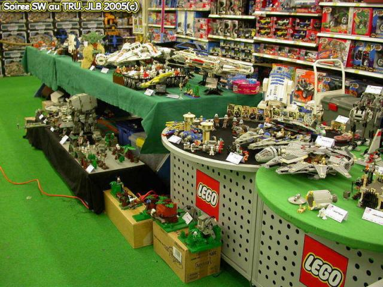
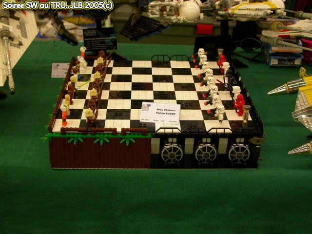
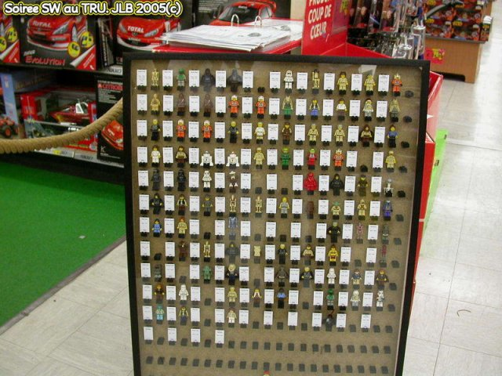
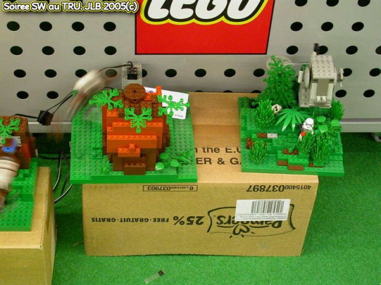
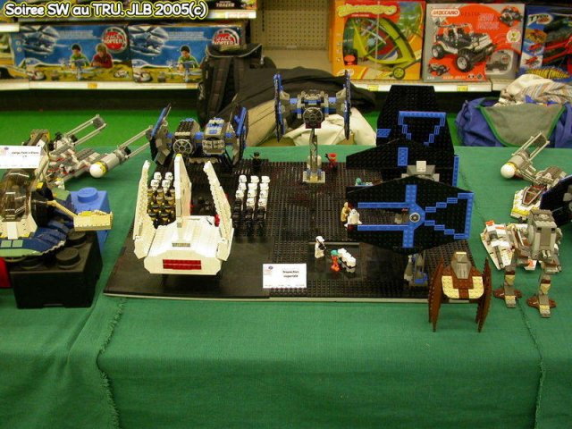
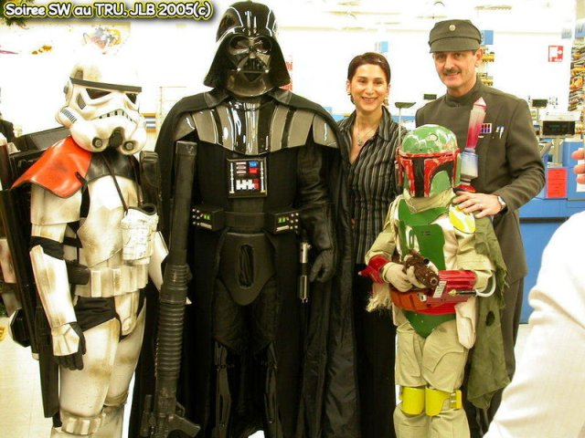
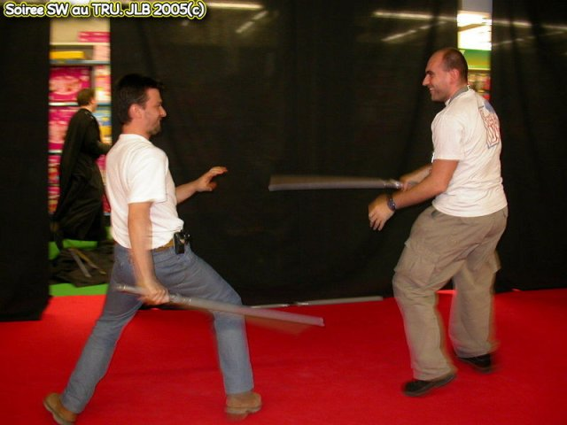
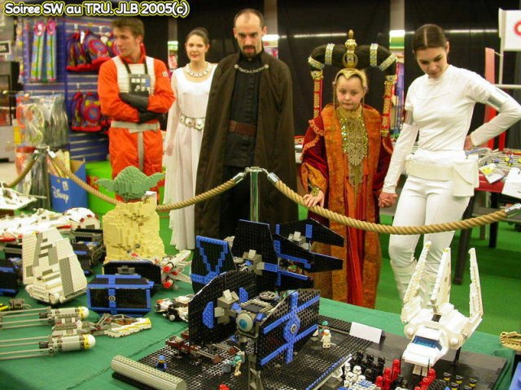

Compte-rendu de l’exposition LEGO StarWars au Toys’R’Us de la Défense dans la nuit du 1 au 2 avril 2005

## Présentation de l’exposition

Le But de cette exposition était de créer, pour le magasin Toys’R’Us de la Défense, un événement autour de la sortie de l’épisode III de StarWars, et plus particulièrement marquer le lancement de la campagne de merchandising. Ainsi ce magasin, avec LEGO et Hasbro, a organisé une nuit StarWars dans la nuit de 1 au 2 avril 2005. LEGO nous a sollicité pour organiser une petite exposition de différents modèles StarWars.

## Notre Stand

Nous avions réussi à réunir à peu près tout ce qui s’était fait en LEGO autour de StarWars. Cela nous a fait un belle table d’environ 5 mètres de long. Il a quand même fallut aller glaner des tables supplémentaires dans le magasin !

Divers [MOCs](/articles/liste-d-acronymes/) sont venus compléter ces sets officiels (pardonnez moi si j’en oublie certain).

**Jeu d’echec sur le theme StarWars Endor**

**Minifig StarWars**

**Quelques MOC animés sur le theme endor**

**Visite Imperiale**

Je ne parlerai pas du MOC fantôme de Manu (cassé en arrivant qu’il disait :-))

Bref un joli stand bien complet et bien rempli.

## L’ambiance

Notre stand n’était pas la seule animation de cette soirée (et de loin). il y a eu aussi, et surtout, la [ligue costumée française](http://lcfstarwars.free.fr/) ainsi que la [501ème french garnison](http://www.501frenchgarrison.com/) qui déambulaient dans les allées du Toys’R’Us en costume. Les costumés sont trop nombreux pour les citer ici, je vous renvoie vers la [galerie](http://gallery.freelug.org/SWTRU) pour cela.  
Nous les plaignions un peu, car sous leur costumes certains avaient vraiment très chaud !  
Allez, je vous montre quand même le Darth Vader prenant la pose :

**Darth Vader prend la pose :-)**

Il y avait aussi une démonstration et initiation de combat au sabre laser (les sabres étaient en mousse). Le menton de certaine personne se souvient encore de cette initiation.  
Cette démonstration était l’occasion d’obtenir un beau diplôme "d’élève Jedi".

**Qui va prendre un mechant coup de sabre ?**

Les clients se sont rués à minuit pile dans les rayons du magasin. Beaucoup se sont arrêtés devant notre stand. Les LEGO, même chez les plus grands, ont toujours autant de succès (même si cela ne se concrétise pas toujours par des achats). On a quand même réussi à convaincre quelques personnes d’acquérir un ISD !

Même les princesses nous ont honorées de leur visite à notre stand :-)

La vague cessa vers les 1h30 du matin, heure à laquelle nous avons pu commencer à ranger notre stand.

## Conclusion

Nuit fort sympathique qui nous a permis, fans de StarWars, d’en prendre plein les yeux, surtout de la part des personnes costumées. Je dirais tout de même que nous faisons petits fans en comparaison des associations citées plus haut.

La leçon que nous avons apprise c’est que les sets Star Wars LEGO, ça en prend de la place pour une exposition et la superficie initialement prévue était fort insuffisante :( Ça tombait bien que Manu ait laissé choir son MOC dans la réserve de TRU ;)

## Liens

**–** [http://gallery.freelug.org/SWTRU](http://gallery.freelug.org/SWTRU)
