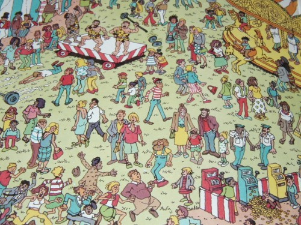
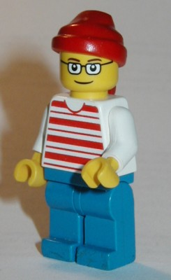
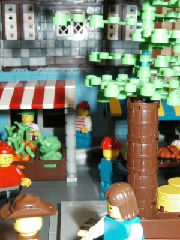
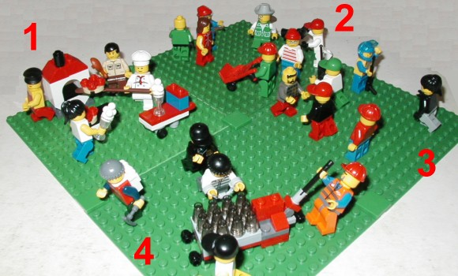

Je ne crois pas nécessaire de présenter Charlie, ce personnage qu’il faut chercher parmi une foule d’individus dans les pages illustrées des livres "Où est Charlie ?".

Depuis quelques années, Charlie est devenu un personnage récurrent présent sur les dioramas que j’apporte en exposition. Et si finalement, comme pour les livres, nous faisions de telles fresques avec des minifigs ?

**Extrait de Où est Charlie ?, Librairie Gründ, 1987**

Charlie est un personnage très reconnaissable : pantalon bleu, pull à rayures horizontales rouges et blanches, des lunettes et un bonnet rouge. Il dispose parfois d’une canne. Un personnage facile à reproduire en LEGO.

Inventaire :  
**–** [le bonnet (en fait un foulard de pirate)](http://www.bricklink.com/catalogItemIn.asp?P=x70&colorID=5&in=S)  
**–** [la tête](http://www.bricklink.com/catalogItem.asp?P=3626bpb122)  
**–** [le buste](http://www.bricklink.com/catalogItem.asp?P=973px62c02)  
**–** les jambes bleues, mais tout le monde connait :)

En exposition, il se cache régulièrement derrière un décor ou un arbre :

Pour ce projet, l’idée est que chaque participant vienne avec une ou plusieurs petites scènes - des modules - reprenant l’esprit des livres : beaucoup de personnages pour rendre la recherche difficile, mais aussi beaucoup de situations comiques pour donner le plaisir de tout regarder en détails.

Comme tout projet commun, pour assurer une concordance entre les modules, il faut respecter quelques règles simples.

Chaque module doit être un multiple d’une plaque de taille 16x16 tenons (16x16, 16x32, 32x32, etc). La couleur de la plaque de base est fixée à l’avance en fonction du thème global choisi.

Les éléments de décors ne devront pas être trop élevés afin de ne pas masquer les modules situés derrière.

Le placement des minifigs ne devra pas être linéaire (ne pas suivre l’alignement des tenons pour éviter une impression trop linéaire) et devra occuper l’ensemble du module, afin de ne pas faire apparaitre de zone vide entre chaque module et donc un effet de quadrillage.

Afin de réaliser une image type poster de la scène, les modules seront orientés de 45° face à l’appareil photo. Pensez-y lorsque vous placez vos personnages.

**Où est Charlie ?**

Sur ce mauvais exemple vite réalisé, il y a 4 modules (ici 4 plaques de 16x16), numérotés de 1 à 4. On voit par exemple des zones vides entre chaque module, ce qui nuit à l’effet d’unité de l’ensemble. Sur le module 3, tous les personnages sont alignés sur les tenons. Il faut mettre davantage de diversité dans les positions.

Il ne s’agit pas d’un concours du module le plus original, mais simplement d’une participation pour obtenir la plus grande fresque possible. Cela peut aller d’une famille se promenant au groupe de touristes prenant des photos dans tous les sens (vive les clichés) en passant par des urgentistes réanimant une victime, des joueurs de foot etc. Mais n’oublions pas, si on souhaite préserver l’esprit des livres, pensons à faire des petites scènes comiques pour attirer l’oeil curieux et ne pas se contenter uniquement de chercher Charlie.

En fonction des rencontres, des thèmes pourront être déclinés.
