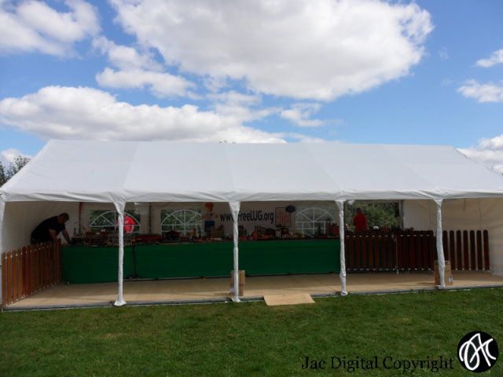
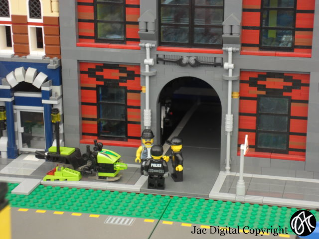
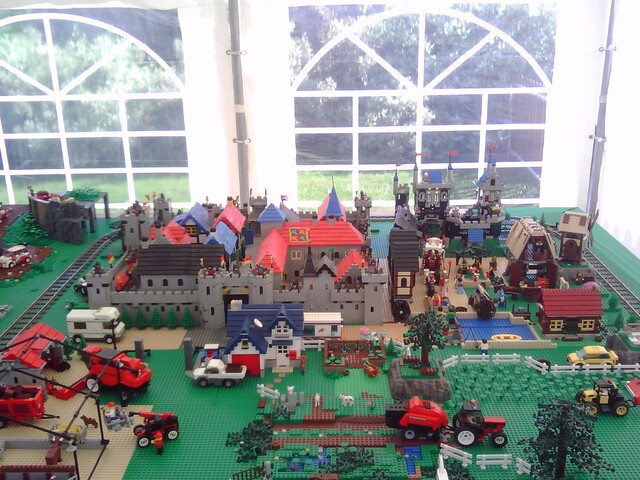

Les 30 et 31 août 2014, nous avons exposé un diorama sous chapiteau dans le parc Franck Bayle à Aubière.

Cette foire de la Saint Loup était placée cette année sous le thème des "petits loups", comprendre les enfants, et explique notre présence suite à la sollicitation de M. Lachat, conseiller municipal.

C’est donc le vendredi 29 août après-midi que nous avons abordé, sous un temps pluvieux, l’installation du diorama de 9 x 2 m sous le chapiteau mis à disposition par la Mairie d’Aubière dans le parc municipal Franck Bayle.

Le public est arrivé dès 10h00, sous le soleil et la chaleur retrouvés, le samedi 30 août jusqu’au dimanche 31 vers 18h00. Impossible de dire le nombre de visiteurs, l’entrée étant gratuite pour tous dans le parc municipal où de nombreuses activités ludiques étaient proposées aux enfants.

Les participants de FreeLUG étaient : Pierre Charles, Philippe Label, Christophe Lemaire, Franck Loiseau, Danielle Quincy-Rossignol, Laurent Spaeth et Jérôme Teissier.

* * *

Expo de la Saint Loup (la st loup des p-tits loups) à Aubière (63) thème de cette année : l’enfance.

Pour cette belle fête la municipalité avait mis la barre très haute, avec de multiples animations, dont nous faisions partie avec un barnum rien que pour nous et un espace de 10 m sur 2 à remplir de nos petites briques préférées. Nous étions 7 freeLUGiens à exposer, ainsi ma ville qui sortait en Auvergne pour la 6ème fois c’est sentie moins seule.

A droite, autour de la citée médiévale de Franck Loiseau, le marché médiéval et devant la ferme de Christophe Lemaire avec pleins d’animaux pour la joie des petits "regarde les petits cochons et les chèvres", et de superbes mini machines agricoles pour les plus grands, puis le rallye au milieu des vignes de Pierre Charles ou les connaisseurs on reconnu la voiture du célèbre Sébastien LOEB "c’était celle du rallye de...". Devant ce domaine, une maison de Maître, (celle du propriétaire des vignes ??) concoctée par JAC Jérome Tessier, avec tout " Ya même une piscine" t’as vu ?". Ces deux la avaient inclus dans ma ville, l’un une maison occitane, "comment est fait ce toit ?", l’autre un garage fabriquant de motos volantes !!!!!!!!! Devant Franck Loiseau avait sorti une collection de sets LEGOLAND qui a fait surgir beaucoup de souvenirs parmi les visiteurs, "regardes, j’avais cette maison, ouah ! et celle-là aussi" ou "ton papa jouait avec cette caserne de pompiers quand il était petit". A gauche, à l’arrière l’énorme et belle caserne de pompiers de Laurent Spaeth, (dont c’était je crois la 1ère expo) avec les pompiers en exercice, villa en feu, véhicule accidenté, et de superbes véhicules. Les enfants ont une admiration sans bornes pour les pompiers !! Laurent avait aussi exposé une gare de triage avec un choix de locos, wagons devant la caserne. A l’avant des voies, la rotonde, la gare de triage avec pont roulant, l’atelier de réparation des trains, enfin toute la gare interactive de Philippe Label, incontournable pour les petits, avec oh ! surprise un train à bonbons...même les grands s’y sont essayé.

J’ai été ravie de passer l’après midi de montage, et les deux jours d’expo avec 6 garçons sympas, les sages Christophe, Franck et Laurent, les deux animateurs et troublions, Pierre et Jérôme, auteurs d’un maximum de déraillements, (les trains et wagons de Laurent ont été testés, et le hangar de la ferme de Christophe a été refait plusieurs fois, et les petits cochons ont eu très très chaud) et Philippe chef de gare, impressionnant de calme avec les enfants, mais tenant tout d’une main d’acier enfin de briques.

Enfin j’ai bien rit aussi, et ces épisodes ferroviaires, m’ont permis de tester ma voix car j’ai passé deux après-midi à crier, "attention aux petits doigts et aux bouts du nez, le train arrive" et quelques fois il arrivait en morceaux !!!!!!! Merci, les grands loups FreeLUGiens

**mamy danny**

* * *

Oula, Mamy Danny a déjà tout expliqué. Vous savez pourquoi nous étions à Aubière pour cette foire, ce que nous avons présenté et qui a joué avec les trains......

Heureusement je peux faire des remerciements. Je risque d’en oublier alors je m’excuse par avance. Merci à Laurent qui pour sa première expo a pu avoir un aperçu de ce que l’on peut faire avec du train. Merci à Christophe qui s’est rendu compte que la place dans le virage n’est pas la meilleure, merci à Philippe pour le prêt de son système de commande des trains qui offre une jouabilité incroyable.... Je vous avez dis que j’en oublierais alors je vais faire groupé, merci à tous pour ces bons moments passés.......

Je confirme pour mon garage qui était bien un petit centre de construction et réparation de motos volantes.

Une phrase est resté pour ma part : "Les wagons ne sont pas rangé dans la rotondes, c’est seulement pour les locos !!!".

**JAC**

* * *

Pour ma première exposition en Auvergne (après une réalisée en Dordogne en 2012), ce fut une belle réussite, un agréable moment avec d’autres passionnés dont j’ai pu mettre un visage sur les pseudos.

Pour la partie me concernant, celle-ci était composée d’une zone médiévale qui est venue parfaitement s’assembler avec la cité de Franck. Un bel ensemble entouré par la voie ferrée.

Une autre zone mettait en avant l’agriculture, avec une petite ferme, des animaux, et des Mocs de matériels agricoles (moissonneuse batteuse, tracteurs, benne, faucheuse, presse notamment). Cette zone fut le théâtre de plusieurs catastrophes ferroviaires, les fous du volant (ou du rail plutôt) étaient de sortis, hein Pierre et Jérôme. Zone dans virage est synonyme de zone dangereuse et à risque !!!

En conclusion, un bon week-end marqué par les grands sourires et regards ébahis des enfants (et des adultes aussi), une organisation bien rodée, la bonne humeur des collègues exposants et des visiteurs.

Et surtout, un grand merci et bravo à Philippe, pour son accueil, la gestion des exposants, la réalisation du plan...

**Timivox**

## Galerie photo

[JAC](http://photos.freelug.org/main.php/v/JAC/Exposition/2014/Aubiere/)

[mamy danny](http://photos.freelug.org/main.php/v/dannylou/expos/Aubiere+2014++st+Loup/)

[Frogleap](http://photos.freelug.org/main.php/v/Frogleap/ExpositionsLego/Aubiere2014/)

[Timivox](http://photos.freelug.org/main.php/v/Timivox/Aubiere+2014/)
