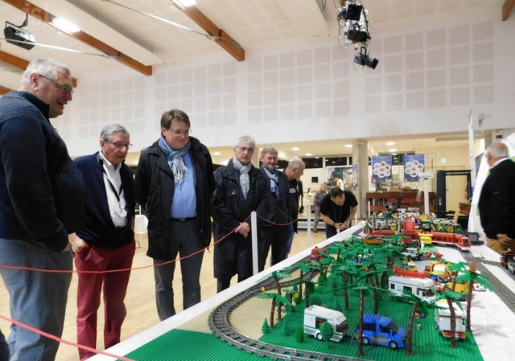
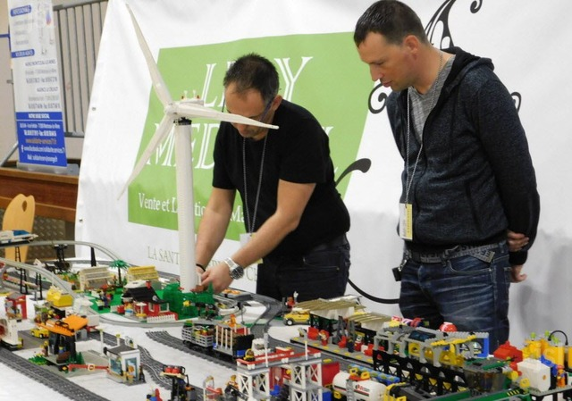
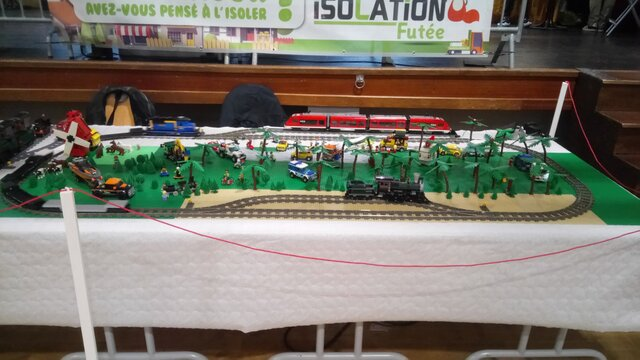
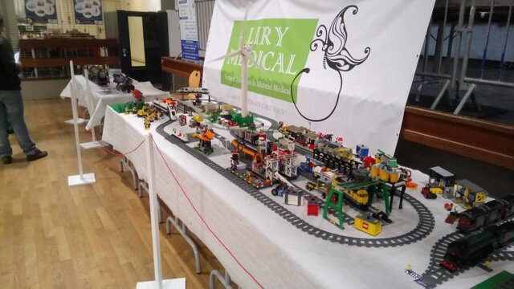
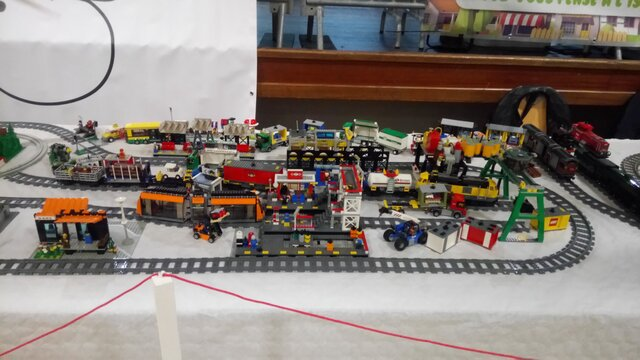
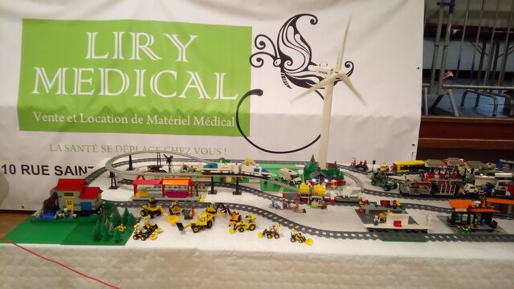
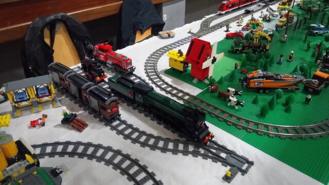
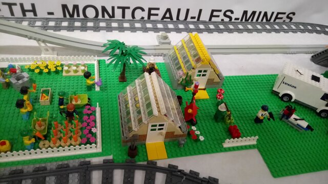

Samedi matin, à une heure où les afols dorment encore, deux adhérents prennent la route pour une petite ville de Saône-et-Loire : Blanzy.  
Il fallait être prêt pour 11h et l’inauguration avec monsieur le Maire.

Ces deux courageux, François et Sylvain, ont été invités par l’association Montceau Train Miniatures (MTM) pour proposer des trains (en briques LEGO, bien sûr)

Pour proposer un diorama intéressants, il a fallu ressortir des cartons et des placards, où ils dormaient depuis un moment, des sets de qualité dont ma fameuse éolienne (et si sylvain avait gagné un euro pour : "qu’elle est belle cette éolienne", il en aurait racheté deux de plus...).

Nous nous sommes répartis la place et moi, j’ai fait au plus simple :

Un petit décor champêtre où, selon l’envie, un train de marchandise, une locomotive à vapeur ou le train de voyageur tournait...

De l’autre côté, Sylvain a bien occupé la place avec, au centre du paysage, la fameuse éolienne :

Une autre vue de ce que mon compère a exposé :

J’ai profité de l’occasion pour sortir ma loco vapeur : la 241P...

...et Sylvain sa superbe serre et son jardin potager :

* * *

En bref, sur un jour et demi (samedi après-midi et dimanche), il y a eu plus de 1700 visiteurs. Beaucoup d’émerveillement sur l’éolienne, des personnes qui connaissaient déjà FreeLUG et peut-être de futurs adhérents, qui sait ?  
Donc merci à mon père pour m’avoir proposer de participer et à Sylvain pour m’avoir accompagné. Et c’est à refaire sans aucun souci !

Quelques lien sur le net :  
**–** [https://montceau-news.com/montceau\_...](https://montceau-news.com/montceau_et_sa_region/blanzy/573490-blanzy-a-le-v-a.html?fbclid=IwAR1J4ZP3clF1I98UjQSlA_gJx6jUMGtDWMri_rUuGgKrYdHTt-CRwmb7gWg)  
**–** [https://www.lejsl.com/edition-montc...](https://www.lejsl.com/edition-montceau/2019/10/19/le-salon-model-s-expo-presente-des-miniatures-jusqu-a-dimanche-soir?fbclid=IwAR1FShuyYXPVZ4NPwZm2h06UqG7hc_AsOtvSCghZEx5LgrpgVeK3cJbVwRk)
