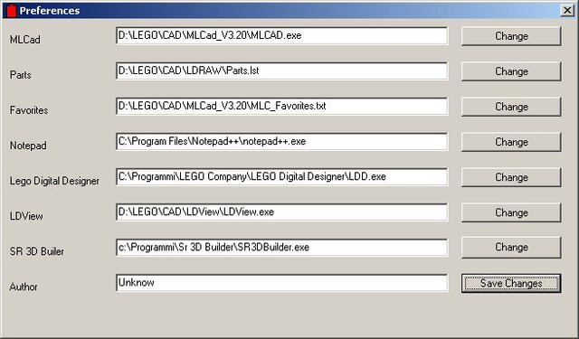
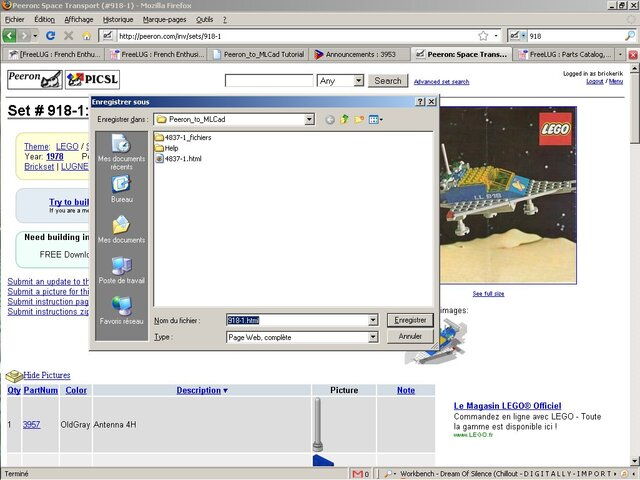
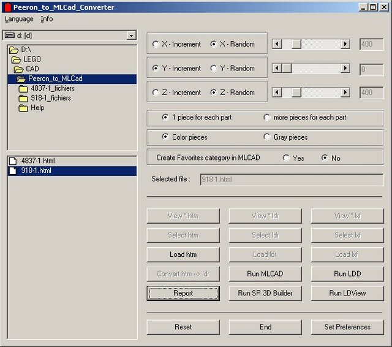
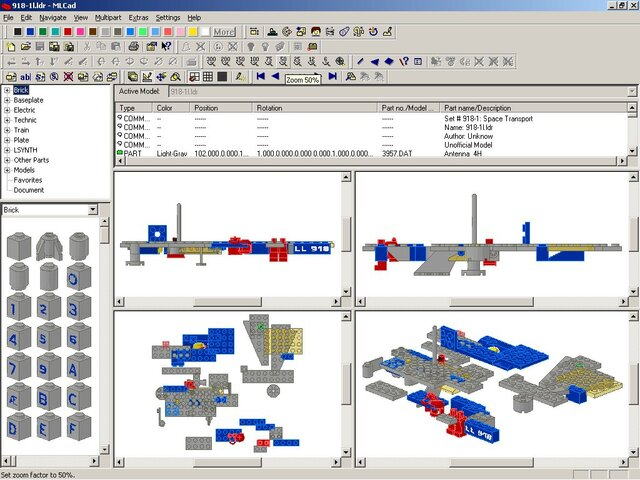

_Peeron\_to\_MLCad_ est un programme qui, à partir de la page web d’un inventaire Peeron, génère un modèle LDraw contenant l’ensemble des pièces nécessaires à la réalisation du modèle.

Ce petit logiciel fonctionne sous Windows, sans installation et est proposé par Michele Somma. Bien évidemment, ce logiciel est en anglais.

Il est disponible gratuitement à l’adresse suivante :  
[http://zaxxonit.altervista.org/peer...](http://zaxxonit.altervista.org/peeron_to_mlcad_eng.htm).

## Préambule

Le nom _Peeron\_to\_MLCad_ est un peu réducteur puisque le logiciel génère un fichier LDraw (.ldr), qui peut être interprété par de nombreux logiciels autres que MLCad, tel Leocad, SR3D Builder etc. D’ailleurs, _Peeron\_to\_MLCad_ propose même d’interagir avec d’autres logiciels que MLCad. C’est ici davantage un abus de langage - que nous faisons tous - d’assimiler MLCad à un fichier LDraw, MLCad étant le logiciel le plus utilisé dans la communauté AFOL pour l’édition des fichiers LDraw.

Il va également de soi que le programme se contente de rassembler toutes les pièces dans un même fichier LDraw et ne propose pas l’assemblage complet !

Enfin, le contenu récupéré sera possiblement incomplet lorsque des pièces ne sont pas modélisées ou présentes dans votre bibliothèque LDraw.

## Configuration

Pour assurer le bon fonctionnement du logiciel, il faut commencer par quelques configurations (bouton _Set Preferences_).  
Le nom des champs parlent d’eux mêmes, mais celui qui est obligatoire concerne la bibliothèque LDraw, le fichier _Parts.lst_ qui contient l’inventaire complet de votre bibliothèque LDraw.

Si vous utilisez les autres logiciels proposés, vous pouvez les paramétrer.

## Enregistrement d’un inventaire Peeron

Depuis votre navigateur Internet préféré (seuls Internet Explorer 7 et Firefox 3 ont été testés par l’auteur), consultez [l’inventaire d’une boîte, le 918 par exemple](http://peeron.com/inv/sets/918-1).

Enregistrez la page web (Fichier > Enregistrer sous...) directement dans le dossier où se situe _Peeron\_to\_MLCad_.

## Analyse de l’inventaire

La seconde étape est de faire analyser cet inventaire par le logiciel.

En cliquant sur _View \*.htm_, les pages sauvegardées apparaissent dans l’arborescence. Sélectionnez celle qui vous intéresse puis cliquez sur _Select htm_.

Le bouton _Load htm_ permet d’afficher la page sauvegardée (opération non nécessaire).

## Génération du fichier LDraw

La dernière étape consiste à transformer le résultat de l’analyse en un fichier LDraw.

Pour cela, cliquez sur le bouton _Convert htm —> ldr_. Le fichier LDraw est alors généré. Le bouton _Report_ affiche le résultat de la génération (pour les curieux). Cliquez ensuite sur _Reset_ puis sur _View \*.ldr_. Sélectionnez le fichier qui correspond à votre boîte, puis sur _Load ldr_. Le modèle se charge dans MLCad.

Plusieurs agencements des pièces sont possibles. Cette opération doit se faire avant la conversion htm -> ldr. Des exemples sont disponibles dans le [tutoriel complet (en anglais) de l’auteur](http://zaxxonit.altervista.org/peeron_to_mlcad_eng.htm).

## Conclusion

Voila donc un petit logiciel simple d’usage (l’ergonomie est quand même à revoir) mais qui permettra à ceux qui aiment modéliser des sets officiels de leur faciliter la tâche en générant un fichier LDraw contenant toutes les pièces. Bien sûr, il reste une grosse part de travail pour l’assemblage, et peut-être est-ce une façon de retrouver le plaisir de fouiller dans un gros tas de briques pour construire, mais le tout virtuellement cette fois-ci !

On pourrait toutefois souhaiter une compatibilité avec [PartsCatalog](/articles/parts-catalog-un-outil-d-inventaire-lego/) par exemple qui gère lui aussi des inventaires.
