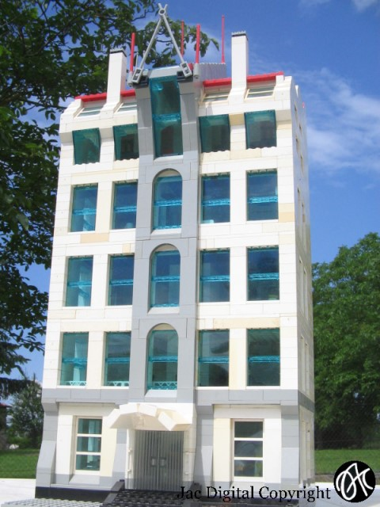
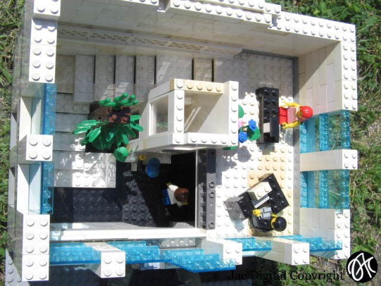
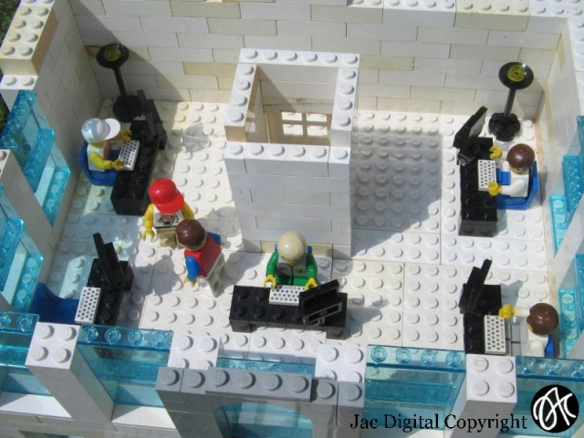
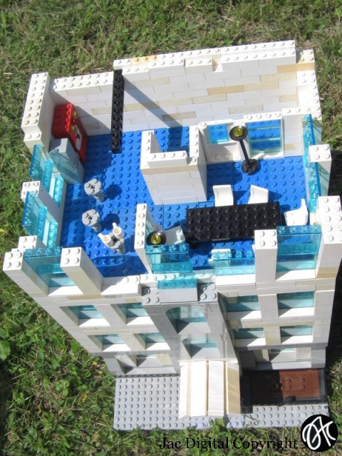
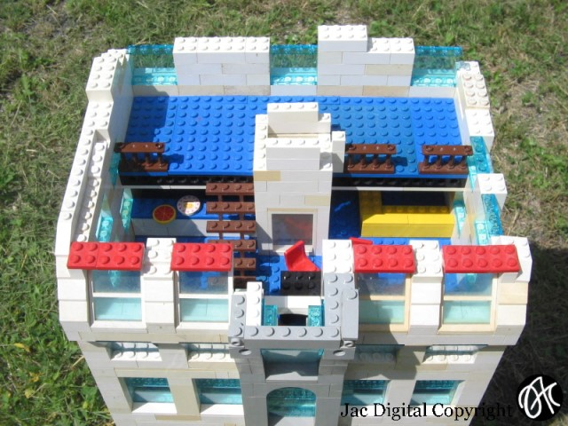

Pas beaucoup d’étages, pas très haut, mais un design qui me plaît beaucoup, un appartement en duplex mansardé et beaucoup d’expositions...

## L’immeuble

**Vue de la façade**

Au début il était tout petit, car construit dans le style de mes premiers modèles, avec l’angoisse du manque de pièces. Donc une façade et très peu de largeur. Ce qui veut dire que l’aspect extérieur est construit depuis quelques années. J’ai juste agrandi et aménagé l’intérieur lorsque j’ai estimé que mon stock de briques était suffisant.

J’ai donc profité de cet agrandissement pour aménager entièrement l’immeuble et lui donner une réelle fonction. Le plus avec un ascenseur (non fonctionnel) qui dessert tous les étages et une toiture qui comporte quelques antennes et des tiges de décorations, pour donner une fluidité à l’ensemble.

Je n’ai pas pu conserver des photos de la première version, malheureusement. Par contre, lors de la destruction, bien oui, il faut bien à un moment, j’ai fait en sorte de prendre suffisamment d’images pour l’avoir en mémoire. Il manque juste une notice de construction, peut être plus tard...

**Rez de chaussée et premier étage**

Au rez de chaussée, c’est l’accueil de l’entreprise d’informatique. On peut prendre l’ascenseur pour accéder aux différents étages de l’immeuble. Un grand escalier permet de monter au premier étage pour rencontrer le directeur et sa secrétaire. De là, une terrasse surplombe le bas. Le plafond est très haut. Une belle plante a fait sa place sur la hauteur.

**Vue intérieure des 2 premiers niveaux**

**Deuxième étage**

Comme pour le restant de l’immeuble, on y accède seulement par l’ascenseur. C’est la que l’on trouve les informaticiens de la société. La pièce qui prend tout le bâtiment, comprend 5 postes de travail. Par contre, je ne peux pas vous dire ce qui se fait ici. C’est top secret...

**Vue intérieure du deuxième étage**

**Troisième étage**

On y trouve une belle salle de réunion avec une grande table. Tous les membres de la société peuvent prendre place. C’est là que sont décidés les points forts... Au même niveau, une salle de repos permet de se relaxer un peu et de prendre un petit café ou une collation au distributeur.

**Vue intérieure du troisième étage**

**Quatrième et cinquième étage**

L’ascenseur dessert uniquement le quatrième étage, c’est à dire le bas de l’appartement en duplex. Là, c’est un peu un plaisir, avoir cet appartement en hauteur et sur deux niveaux ! La façade change aussi de manière à différencier l’utilité du niveau. En mansarde les fenêtres sont toutes petites mais restent très nombreuses et suffisantes. Du coup, l’appartement est très bien éclairé.

**Vue intérieure de l’habitation**

## Petite conclusion

C’est avec plaisir que j’ai pu présenter cet immeuble dans diverses expositions. Il a participé au début du [quartier des affaires](/articles/le-quartier-des-affaires-freelug/). On peut dire qu’il est temps qu’il prenne sa retraite et qu’il laisse la place à ses grands frères...

[Galerie photo](http://photos.freelug.org/main.php/v/JAC/MOC/Batiment/maison-immeuble/immeubleblanc/).
