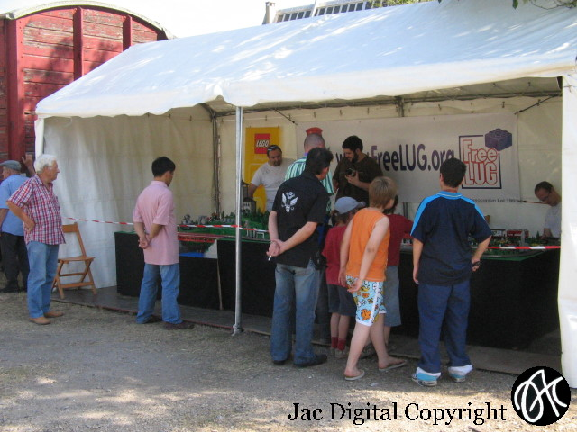
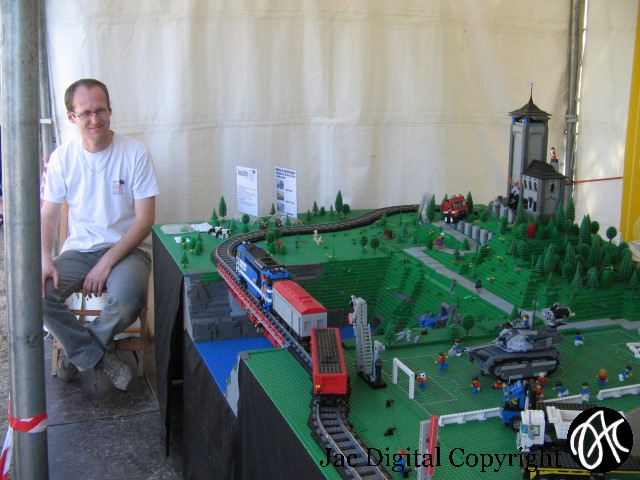

La Mairie de la ville de Miramas a pris contact avec FreeLUG pour avoir un réseau en LEGO présent lors de la fête du train les 23 et 24 mai 2009. Lorsque j’ai vu cette demande, je n’ai pas mis longtemps à me décider. Faire une exposition sur le lieu de travail de mon père, le dépôt, et là où ont roulé les BB67000, il n’y avait pas à hésiter.

J’ai donc confirmé notre participation et pris contact avec Mr Toiron, responsable des festivités à Miramas. Il était entendu que nous présenterions un réseau de 6x2m.

Après demande sur la liste, Pierrick Dauny (PZ) et David (Guss) ont répondu présents à cette première participation. Nous avons réparti le réseau en trois ensemble, suivant nos moyens...

L’arrivée sur place s’est faite sans soucis majeur. Je connais bien les lieux. Par contre, ce n’est pas facile de caser 12 tables, plus le réseau qui va dessus, dans une Calibra. C’était bien plein. Et Pierrick, qui a du faire le trajet avec moi a eu du mal à trouver une place, autant pour ses briques que pour sa propre personne...

Nous avions une tente pour nous tout seul. Le sol était recouvert d’un dallage en bois, pas très stable, et du coup, une inquiétude pour la stabilité du réseau nous a envahi. Qu’importe, nous avons tout de même commencé le montage des tables Bab, et une fois toutes reliées entre elles, plus rien ne bougeait. Elles sont vraiment efficace, ces tables ! Par contre, y’a pas de photos. C’est très dur de se concentrer sur le montage, pour qu’il soit correct, et de penser à faire des souvenirs par l’image...

**Affluence.....**

L’exposition était donc en plein air. Une grande tente accueillait quelques réseaux, dont un très ludique, centré sur la manoeuvre des wagons marchandises, puis une tente semblable à la notre recevait un magasin. Plus loin, en extérieur, nous avions quelques vieux wagons marchandises sortis et entretenus par les membres du musée. et une belle BB75000 FRET trônait devant le bâtiment du dépôt.

L’ambiance était très sympathique. Le site recelait multiples choses à découvrir et à visiter, en miniature, et en grandeur nature. Nous avons passé deux jours très agréables, au milieu de cet espace ferroviaire. Les visiteurs ont vraiment apprécié notre présentation, malgré la chaleur. Un bel article dans le journal le confirme d’ailleurs. Nous avons eu droit, en exclusivité, au fonctionnement de la loco tonneau, conçue par Pierrick.

**Pierrick à la surveillance.**

Merci à Monsieur Roussel, pour la prise de contact. Et grand merci à vous, les participants, pour présenter à nouveau un très beau réseau.

[Galerie de JAC](http://photos.freelug.org/main.php/v/JAC/Exposition/Expositions2009/Miramas-2009/)

[Galerie de Pierrick](http://photos.freelug.org/main.php/v/-PZ/Exposition/miramas09/)

[Galerie de Guss](http://photos.freelug.org/main.php/v/guss/evenements/Miramas2009/)

Et une petite vidéo...

[Vidéo de la publication d’origine](http://www.youtube.com/v/kTg38k21v8A&hl=fr&fs=1)
