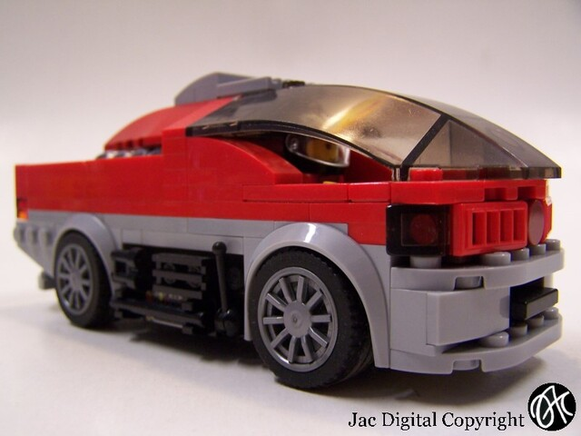
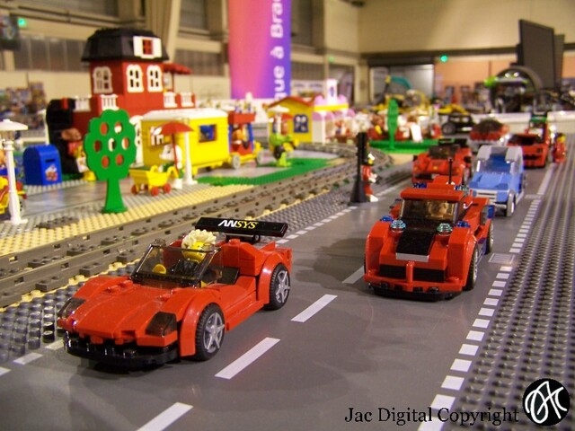

C’est pour le concours des Racers à Diemoz en 2015 que, très inspiré, j’ai eu l’idée de construire ce Pick Up.

Dans les principales règles de ce [concours réservé aux exposants](/articles/briqu-expo-diemoz-le-programme-du-week-end-12-13-septembre-2015/), il fallait garder l’esprit de la série LEGO "Speed Champion". Mais j’avais aussi quelques contraintes personnelle :  
**–** Les roues larges ;  
**–** Le gabarit ;  
**–** Le poste de conduite à l’avant ;  
**–** les côtés différents ;  
**–** Une benne pour le moteur...  
En fait j’avais bien un Pick Up en tête...

Pour le deuxième point, je me suis arrêté juste à temps car j’avais bien démarré sur un bolide en 7 tenons de large. Après avoir relu les règles et tout détruit pour repartir de zéro, j’ai réussi à reproduire l’avant qui me plaisait bien.

C’est donc après plusieurs reconstructions et quelques modifications que j’en suis arrivé à ça :

J’ai bien l’aspect Pick Up comme je le voulais même s’il n’y a pas de capot. J’ai réussi à placer un bon V10 dans la benne, ne m’en demandez pas trop sur ses caractéristiques... La cabine est à l’avant avec une vitre bien profilée. J’ai voulu faire en sorte que l’arrière s’ouvre, mais ça devenait compliqué en pièces et un peu dénudé. Alors tant pis, on est en course. Il manquait plus qu’à présenter le bolide en course, lors de l’exposition.

Il a fait très bonne figure au milieu des autres constructions et je remercie le jury pour leur choix. Il a fini deuxième derrière un très beau rod. Ce qui est fou c’est qu’ils ne sont pas en tête sur la photo !

[Sa galerie pour plus de photos](http://photos.freelug.org/main.php/v/JAC/Concour/Diemoz2015/)
