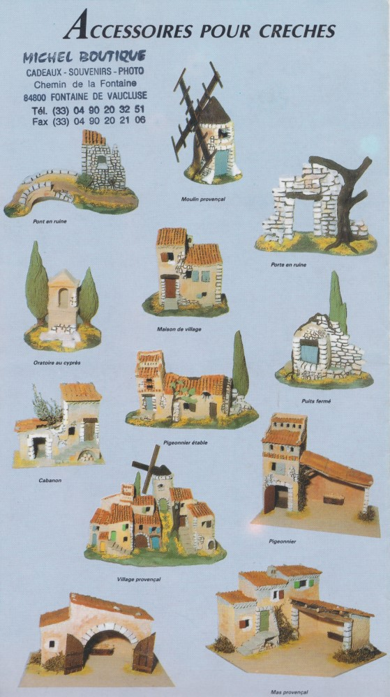
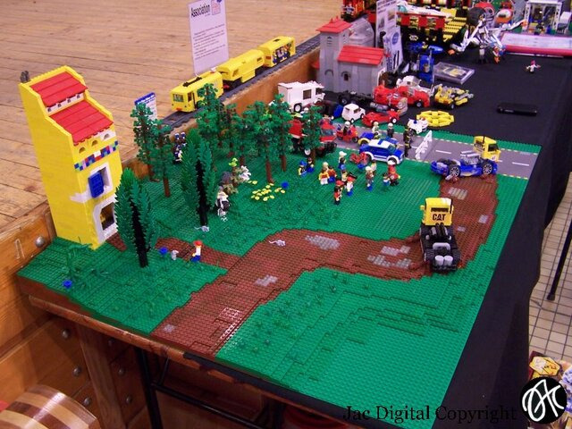
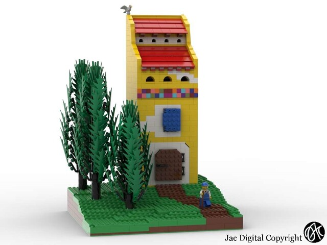
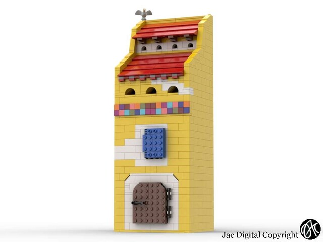
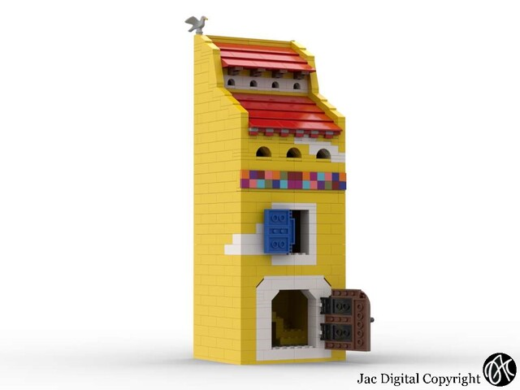
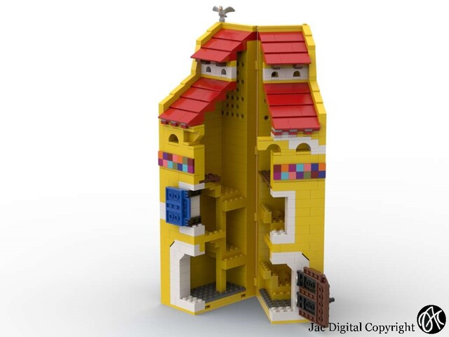
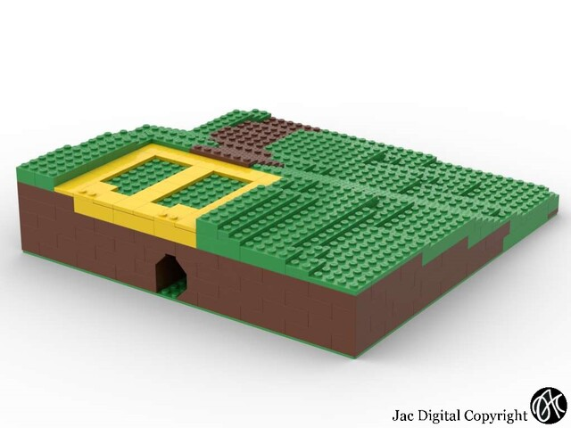

Parmi les bâtiments que j’aime construire il y a ceux de ma région d’origine, la Provence. Pour celui que je vais vous présenter, je me suis inspiré d’une photo issue d’une petite brochure publicitaire. C’est celle de l’univers des santons de Jacques Flore à Aubagne : [https://www.santons-flore.com/](https://www.santons-flore.com/)

La brochure présente la collection de santons disponibles, et au dos il y a quelques exemples de décors disponibles pour agrémenter la crèches. Pour en faire une en LEGO, j’avais déjà reproduit le petit mas. Ici, c’est le pigeonnier que je vais vous décrire. J’avais mis l’appentis présent sur la photo au début, mais je l’ai retiré car dans mes souvenirs il n’y en avait pas en réalité, ou peut-être détruit.

Il y a tant d’années que ce petit bâtiment est construit que je ne me souviens même plus combien ça en fait. Malheureusement, je n’ai pas énormément de photos, seulement celles en expositions. Aujourd’hui, je le trouve un peu vieillot pour le conserver encore, mais je l’ai quand même modélisé avec Studio. Ca permet des rendus sympa et aussi de modifier des couleurs sans forcément les avoir.  
D’ailleurs, j’avais essayé de faire les murs de couleur "tan", mais le contraste avec le blanc ne rendait plus vraiment bien . Ca s’éloignait trop du concept des crèches. Du coup, je l’ai laissé en jaune...

Le voilà à sa dernière exposition, c’était à Randan :

Cette fois, plutôt que des photos, voilà quelques rendus, possible avec Studio, en commençant par une vue générale. J’ai rajouté quelques cyprès bien droits. Ca rappelle le pays...

La tour toute seule :

Une vue avec les huisseries ouvertes :

Puis une particularité du bâtiment, la fonction "livre ouvert", pour admirer l’aménagement intérieur. Malheureusement, j’ai manqué de documentation pour vraiment faire comme en réalité :

Enfin, pour finir la base à nue vue de dos. Ca permet de découvrir la petite cavité où je planquais des rats. Bin oui, il devait y en avoir pas mal qui tournaient autour ! Les pièces lisses permettent de poser et enlever la tour sans soucis. En exposition, ça surprend toujours.

