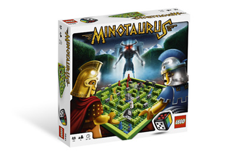

Il y a 2 ans, un pique-nique avait eu lieu en août sur Paris.

Je vous propose de refaire la même chose pour le 15 août 2009 au Parc André Citroën.

[Photos du petit pique-nique en 2007](http://photos.freelug.org/main.php/v/FreeLUG/Evennements/PiqueNique2007/)

Rendez-vous vers midi, au pied du ballon _Air de Paris_. Pour les retardataires, il faudra faire le tour du parc pour nous retrouver :)

Chacun amène sa tambouille.

Pour accéder au parc :  
**–** RER C, Boulevard Victor ou Javel ;  
**–** Métro 8 Balard ou métro 10 Javel - André Citroën ;  
**–** Tramway T3, Pont du Garigliano ;  
**–** Parking Citroën Cevenne (sans doute payant) ;  
**–** Plein de stations Velib tout autour du parc ;  
**–** [GoogleMaps](http://maps.google.fr/maps?q=48.842044,2.273321&t=h&sll=48.842082,2.274234&sspn=0.001839,0.003449&ie=UTF8&ll=48.841937,2.273746&spn=0.001839,0.003449&z=18).

Nous en profiterons pour nous essayer au Minotaurus.

Bien sûr, si la météo ne nous est pas profitable, le pique-nique serait annulé.
