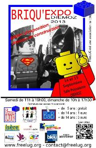
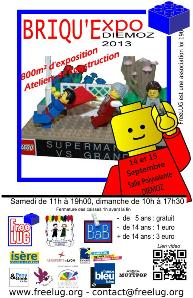
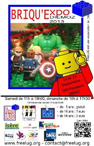
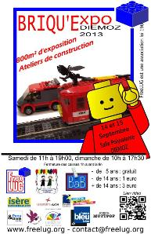
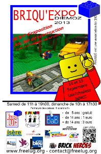
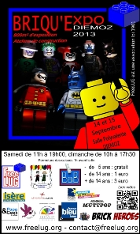
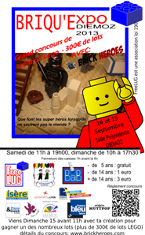

Il y a plus d’un an, après un petit Barbecue organisé dans la région Lyonnaise, la décision a été prise de choisir le thème des Super Héros pour la première BRIQU’Expo de la région. L’article concernant le Barbecue est accessible [ici](http://freelug.org/spip.php?article1509).

La première affiche a été rapidement réalisée afin de communiquer au plus tôt. Une affiche qui bien sûr rappelle le thème principal de l’exposition, avec deux héros emblématiques : **Superman** et **Batman**  !

**Briqu’Expo Diemoz**

Première affiche officielle

En octobre dernier, lors d’un RestoLEGO organisé à Lyon, nous avions mis en place un petit concours. Il fallait réaliser une petite scène. La plus belle serait récompensée entre autre en apparaissant sur la seconde affiche ! L’aticle consacré à cette soirée est accessible [ici](http://freelug.org/spip.php?article1576).

La première variante de l’affiche a donc été réalisée d’après le MOC de Laurent, mettant en scène une fois encore **Superman**, mais dans une situation pour le moins comique.

**Briqu’Expo Diemoz**

Affiche réalisée suite au RestoLego

Ces deux affiches étant consacrées uniquement aux héros DC, j’ai pour ma part décidé d’en réaliser une nouvelle avec des personnages Marvel : **Les Avengers**. Il s’agit de la version Comics des Avengers, puisqu’on y retrouve les personnages de Spider-Man, Wolverine ou Iron Fist qui ne font eux pas partie du casting du film.

**Briqu’Expo Diemoz**

Affiche avec les Avengers

Ensuite d’autres FreeLUGiens de la région et participant à l’exposition ont été mis à contribution. Ils avaient pour objectif de mettre en scène un super héros avec un train, car pour cette BRIQU’Expo, nous avons également la chance d’accueillir la LGV :

JAC a choisit une fois encore **Batman** accompagné d’un de ses prototype dédié à battre des records de vitesse.

**Briqu’Expo Diemoz**

Affiche de JAC

Pierre, lui, a préféré **Superman** et le fameux train Horizon Express.

**Briqu’Expo Diemoz**

Affiche de Pierre

Ces affiches ont été imprimées et grands et en petits (flyers) et si vous êtes dans la région Lyonnaise, il y a fort à parier que vous en croisiez une !

Enfin, dans le cadre du partenariat réalisé avec le bloggeur Papa et Geek à la fois (qui est par ailleurs aussi FreeLUGien, et qui sera bien sûr à Diémoz), nous avons eu droit à une dernière affiche, plus dark, sur laquelle on retrouve **Batman** et **Robin**, en bien mauvaise compagnie.

**Briqu’Expo Diemoz**

Affiche de Papa et Geek à la fois

Cette affiche aussi sera visible essentiellement sur les panneaux d’affichages public de la région !

Et pour finir, nous avons réalisé une dernière affiche dans le cadre du super concours organisé avec le site [Brick Heroes](http://www.brickheroes.com/2013/07/briquexpo-diemoz-un-concours-pour-les-grands-et-les-petits/). Dans ce concours, les participants doivent imaginer une scène qui répond à la question : _Que font les super héros lorsqu’ils ne sauvent pas le monde ?_ Tous les détails sont sur la page du site de [Brick Heroes](http://www.brickheroes.com/2013/07/briquexpo-diemoz-un-concours-pour-les-grands-et-les-petits/).

Pour l’occasion, il fallait bien sûr une nouvelle affiche sur le thème du concours. Et pour cette petite dernière, on retrouve donc **Batman** et **Catwoman** sur la plage en train de faire des châteaux de sable.

**Briqu’Expo Diemoz**

Affiche pour le concours avec Brick Heroes

Alors voilà, cette première BRIQU’Expo Diemoz aura eu droit à de nombreuses affiches, bien différentes les unes des autres car réalisées par des MOCceurs différents. Un constat s’impose cependant : les héros DC (**Batman**, **Superman**) ont la cote ! Mais rassurez-vous les autres seront aussi à Diémoz !
