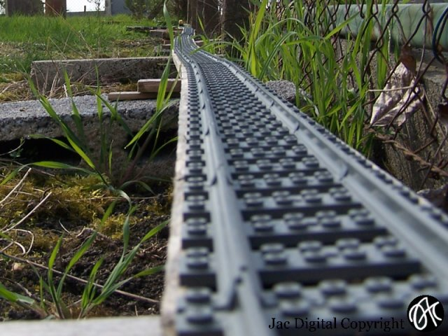
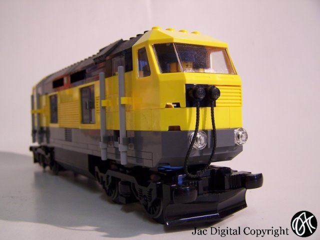
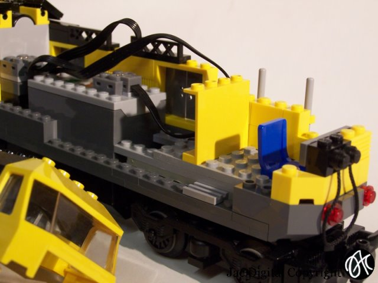
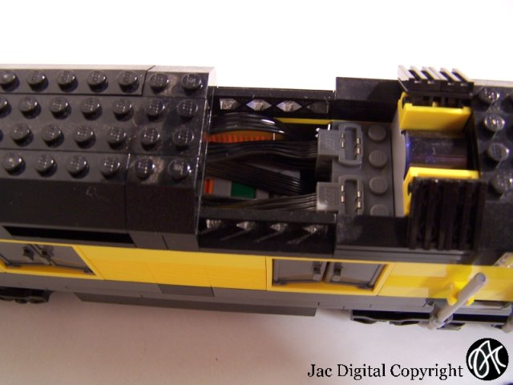
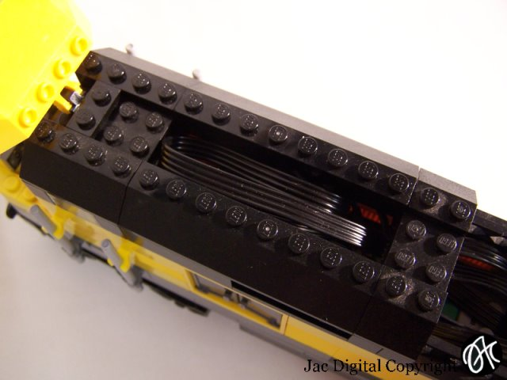
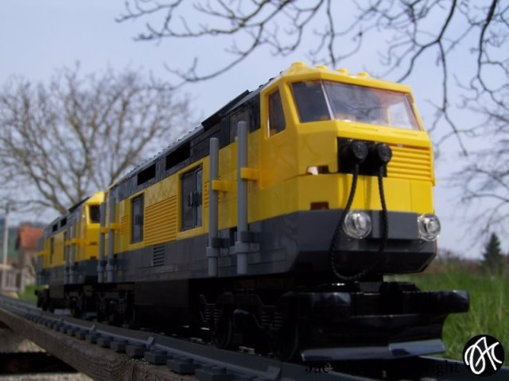

Nos trains LEGO sont conçus pour rouler sur de petits réseaux, dans des chambres d’enfants. Pour nos "jeux" d’adultes, le train atteint vite ces limites.

Pour profiter encore plus du jeu, j’ai installé une petite voie unique en extérieur. Un rêve dans ma tête depuis longtemps enfin réalisé, grâce au nouveau système "Power Function System". Plus besoin de devoir entretenir les rails métalliques. La voie est simplement posée, si on peut dire, l’alimentation des moteurs étant embarquée dans la locomotive ou ailleurs dans le train.

Le problème, c’est que les trains LEGO atteignent vite leurs limites. Ils ne sont pas conçus pour ça : déraillements et perte de puissance pour les problèmes principaux. Donc après avoir bien analysé les problèmes dus à la conception de la locomotive, construite suivant la notice, je démarre la construction d’un modèle plus puissant, qui aura une meilleure tenue de voie.

Pour ce faire, il faut tout d’abord supprimer le châssis en méta-pièce (c’est à dire construit en une seule pièce) qui a tendance à bloquer le pivotement des bogies. Il faut faire le châssis en plates et prévoir des pièces Technic percées pour le passage de l’axe des bogies. Cela permet de placer le boitier de piles au centre de la locomotive, le plus bas possible. Il sert aussi de lest pour l’adhérence, même si ce n’est pas vraiment nécessaire grâce aux bandages des roues. Plus il est bas, plus il rabaisse le centre de gravité. Cela améliore le passage en virage.

Ensuite, pour un fonctionnement optimal, il faut que toutes les roues soient motrices. Mais là, ça se complique. Le câble qui sort du bogie doit être branché sur le récepteur à infrarouge. Le plus pratique c’est de le faire passer par le centre du châssis. Mais du coup, les deux moteurs fonctionnent en sens inverse. De plus, par rapport au système 9V, les fiches comportent un détrompeur. Il faut alors intercaler un inverseur sur le branchement de l’un des moteurs pour les mettre tous les deux dans le même sens. Si on veut aussi placer les fanaux (les phares sur les trains) ça va faire beaucoup de câbles dans la locomotive... Autant le dire tout de suite, l’emplacement disponible à l’intérieur ne permet pas du tout cela.

D’où la réorganisation complète de cette locomotive. Après la construction du châssis plus long de 2 tenons, j’ai fait en sorte de conserver la ligne générale et j’ai un peu vidé l’intérieur pour pouvoir placer tous les câbles.

Dans la réalité pour gagner encore plus de puissance, les motrices sont doublées voire triplées et parfois plus, raccordées par des câbles électriques pour permettre à un conducteur de contrôler toutes les locomotives. En France, c’est la marche en UM pour Unités Multiples.

Vous me direz que, avec un train comme ça, il faut prévoir le stock de pile, c’est sûr, on a rien sans rien. Mais franchement, avec le fonctionnement que l’on a, grâce à ce montage, ça en vaut la peine. C’est un plaisir de suivre du regard mes deux locomotives, que je fais rouler seules, au ralenti, tout feux éclairés, sur des rails pas toujours bien alignés, comme sur certaines voies de manœuvres. Et puis là, vous pouvez accrocher quelques wagons marchandises chargés...

Il est possible de faire la même chose avec d’autres locomotives munies du système PFS.

Par contre, il faut surveiller l’état des piles régulièrement, pour éviter que l’une des locomitives tracte l’autre. J’aurais bien voulu, aussi, modifier la position du capteur qui ne reçoit pas très bien les informations. Mais cela aurait trop modifié la ligne générale. Mon but était vraiment de conserver l’aspect que je trouve réussi. Toutefois, ma locomotive n’a pas de pantographe. En fait, je ne l’ai pas mis dès le premier montage, car impossible d’installer la caténaire sur nos réseaux. Mais, les moteurs utilisent un carburant bio-renouvelable...

Toutes les photos de ce train dans la [galerie](http://photos.freelug.org/main.php/v/JAC/MOC/Train/7939/).
