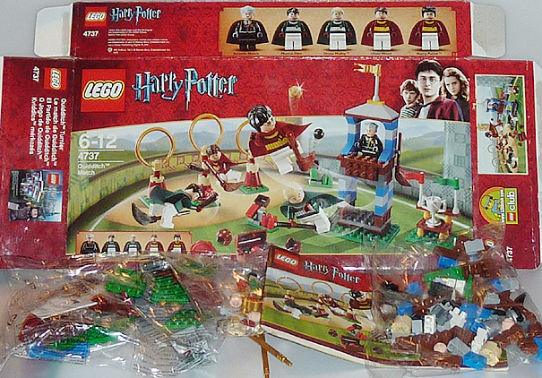
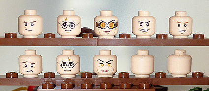
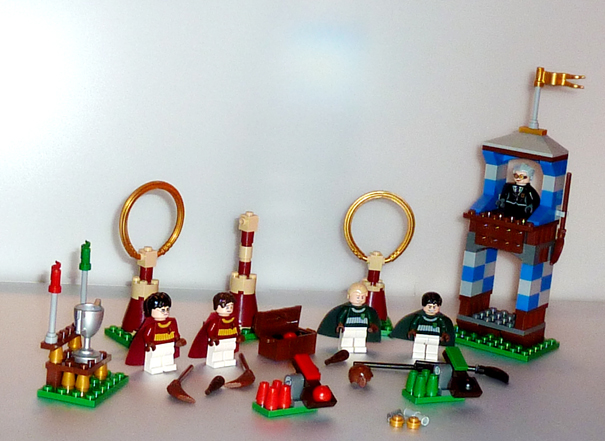
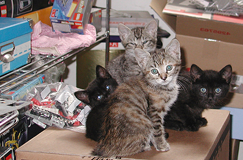

En visite chez des amis, j’ai reçu en cadeau cette boite que j’avais décidée de ne pas acheter à 26 Euros pour 153 pièces.  
Bon, maintenant que je l’ai, je ne vais pas la jeter et donc allons-y pour une petite revue de ce set.

**La boite 4737 et son contenu.**

Le première impression, habituelle avec les produits sous licence, est le peu de pièces par rapport à la taille de la boite. J’avoue que même le sachant, je n’ai pas encore réussi à m’y habituer.

Passé cette première impression, je me lance dans le montage.

Bonne surprise par rapport à la version 1 : il y a 5 minifigs dont 3 avec une tête réversible (3 minifigs dans la version 1)

**Les 8 têtes !**

Le reste du montage est sans surprise et est très simple, donc bien adapté pour des petits.

Tout y est pour faire un match : les joueurs, l’arbitre et deux petites catapultes.

Chaque élément du jeu étant séparé, cela permet aussi une bonne jouabilité.

En conclusion : je suis pas fan de ce set, mais quand-même, si vous aimez Harry Potter, alors pourquoi pas.

PS : Vous avez sans aucun doute remarqué qu’il manque un des anneaux des buts sur la photo du set terminé. Il était bien dans la boite, mais il a disparu suite à l’intervention d’un groupe de félins venu m’aider. Je cherche encore cette pièce...

**Lequel est le coupable ?**
