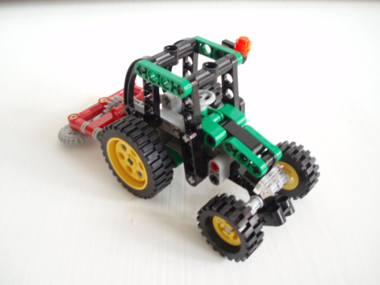
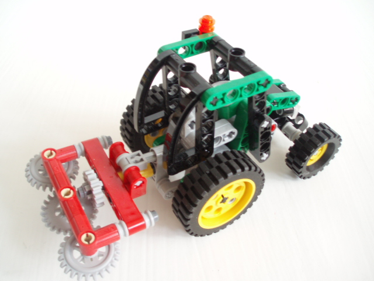
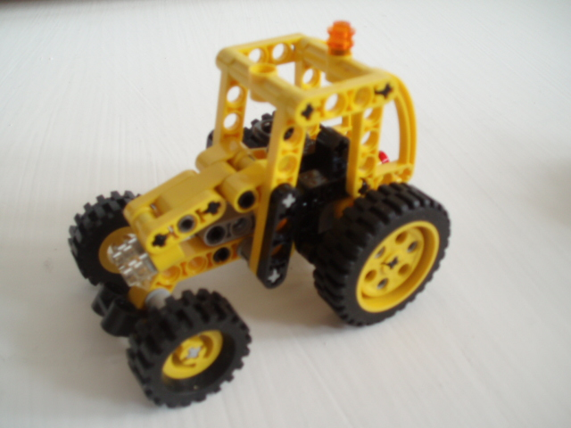
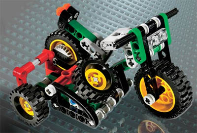
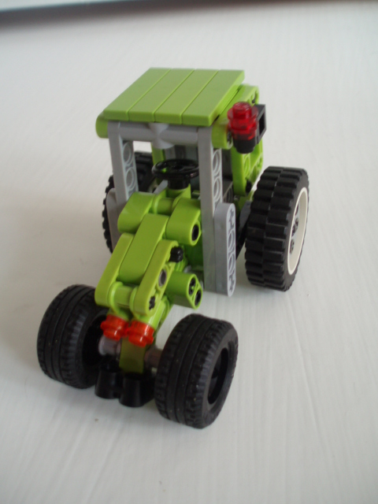
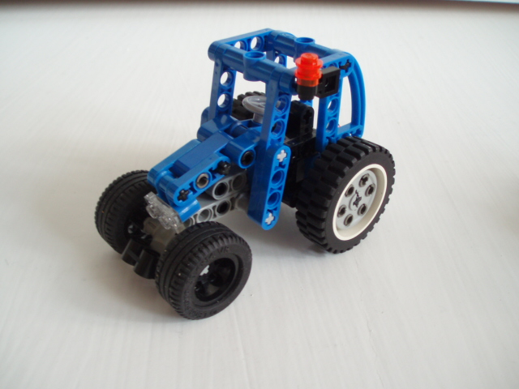
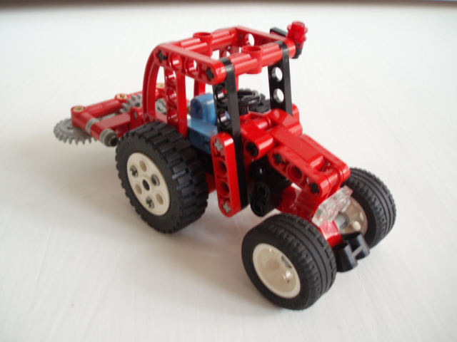

Le "8281" est enfin sur les rayons dans les magasins, et c’est un set sympathique à ne pas manquer.

Faisons d’abord connaissance avec cette boîte. Elle n’est pas bien grosse, surtout pour un set Technic. En fait, c’est la plus petite des [trois sets Technic](http://guide.lugnet.com/set/?q=8281%2C8282%2C8283) disponible en Mars. Son prix de moins de 10 euros et ses 121 pièces la rendent attractive.

Le modèle principal est un [mini tracteur](http://guide.lugnet.com/set/8281) de couleur verte, avec des roues jaunes et un outil rouge.

Ce mélange de couleur, qui s’ajoute aux monochromes noir et gris, est cependant esthétique. Dans la taille et le style, il vous rappelera des modèles au jaune uniforme comme le [camion benne 8451](http://guide.lugnet.com/set/8451) et plus certainement la [mini chargeuse 8418](http://guide.lugnet.com/set/8418). D’ailleurs si vous avez les pièces, vous pourrez choisir de reconstruire ce tracteur en jaune.

C’est un set d’initiation sympathique pour plusieurs raisons.  
**–** Il est petit donc rapide à monter, chose qu’apprécie toujours les plus jeunes pour pouvoir jouer "immédiatement",  
**–** la variété de pièces est grande en proportion de la taille de l’engin (121 pièces, 54 différentes), ce qui favorise la créativité,  
**–** le modèle est fonctionnel (les roues entraînent une prise de force, entraînant elle-même un outil),  
**–** le modèle alternatif (un "side-car") est tout aussi intéressant pour le jeu.

**–** les jeunes constructeurs plus avertis créeront facilement d’autres outils (des herses, des faucheuses, des remorques....) ou bien des modèles légèrement modifiés avec la collection de pièces de leur papa.

Quelques liens utiles :

**–** [La notice de montage du tracteur](http://assets.lego.com/bigdownloads/buildinginstructions/4292380.pdf)  
**–** [La notice de montage du side-car](http://assets.lego.com/bigdownloads/buildinginstructions/4292381.pdf)  
**–** [Une galerie de photos](http://www.brickshelf.com/cgi-bin/gallery.cgi?f=173930)  
**–** [Le 8281 sur le site officiel de la société LEGO](http://shop.lego.com/product.asp?p=8281)  
**–** [Initiez vous au Technic (en anglais)](http://www.lego.com/eng/create/technicdesignschool/)
