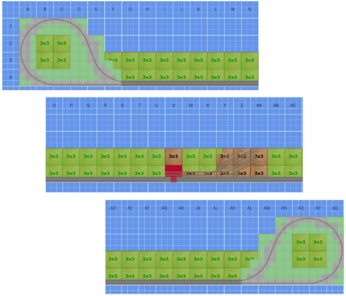

## Informations générales - Date & Lieu

L’exposition Briqu’Expo Diemoz aura lieu les 14 et 15 septembre 2013 à Diemoz (20km à l’est de Lyon).

Ouverture au public :  
**–** samedi 14 septembre 2013 11h – 18h00  
**–** dimanche 15 septembre 10h – 16h30

La date limite d’inscription des exposants est le 30 juin 2013.  
**–** l’[inscription à l’exposition doit impérativement être faite via le wiki](http://wiki.freelug.org/Briqu%27Expo+Diemoz+2013) pour les membres de FreeLUG, ou en prenant contact avec Yannick Vignat (yannick.vignat@club-internet.fr) et en remplissant le formulaire qui sera envoyé à la demande par le coordinateur.  
**–** le nombre d’exposants est limité à 40.

Dans ce cadre général, BàB participe avec la LGV V2b dont ce sera la seule sortie en 2013. Et comme les autres fois, l’ensemble des tables de la zone LGV sont mises à la disposition de FreeLUG et autres associations pour le diorama train ville et super héros.

## Informations exposant spécifiques pour le layout train-ville LGV.

La salle sera mise à disposition dès le vendredi 13 au matin (afin d’installer entre autre la LGV).  
Toutes les installations doivent être terminées pour l’ouverture au public le samedi 14 à 11h00.

Les coordinateurs :  
**–** Coordinateur FreeLUG : Xavier Viallefont  
**–** Coordinateur Layout LGV : Denis Huot

_Thème :_

Le thème principal de l’exposition est _Les Super Heros_.  
Même s’il est recommandé de privilégier le thème des "héros" au sens large, ce thème n’est pas exclusif, et tous les modules pouvant s’intégrer dans un ’train-ville’ sont bien sûr acceptés.

**Quelques indications pratiques pour ce layout**

La disposition des voies sur ce layout a été choisie pour permettre à un maximum de personnes de venir exposer avec leur(s) module(s).

Le fait de se regrouper sur un seul layout doit aussi permettre que chacun puisse profiter au maximum des autres exposants tout en restant proche de sa réalisation et du public.

Il est bien sûr possible, voire indispensable de faire un maximum de petits sous-réseaux : tram, train 12V, train 4,5V, PFS, western, monorail, etc.

Vous pouvez aussi vous coordonner à plusieurs pour un méga sous-module sur un thème qui vous plait, etc.

La LGV sera bien sûr ouverte aux exposants du layout pour y faire rouler (et donc conduire) leurs trains : soit pour tenter le record de vitesse ou tout simplement pour s’amuser en allant un peu plus vite que sur une voie 9V LEGO.

_Nota_ : lors de cette exposition la priorité sera donnée aux séquences de run pour battre les différents records.

Si vous décidez de participer sur ce layout :

1.  vous devez impérativement vous inscrire vous-même directement à Briqu’Expo Diemoz 2013 comme exposant.
2.  vous devez aussi vous inscrire auprès du [coordinateur FreeLUG pour la LGV (CDHD) sur le wiki](http://wiki.freelug.org/Briqu%27Expo+Diemoz+2013)

**Le Layout**

Toutes les zones vertes sont pour vos modules. Coordination générale : cdhd (Denis H)

De la place pour tous : pas de limitation dans le cadre général train/ville/travaux/campagne/etc. (ELTEP) de la plaque 32x32 au décatuple module standard LGV ( 1 module standard LGV = 3x5 plaques 32x32).

Tous les modules train 9V devront être au [gabarit 8 tenons minimum](http://wiki.freelug.org/Gabarit) (Un module train 9V est un module où passe une voie 9V).

N’ hésitez pas à poser vos questions si vous en avez.

cdhd.
