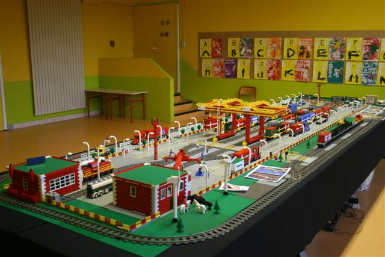
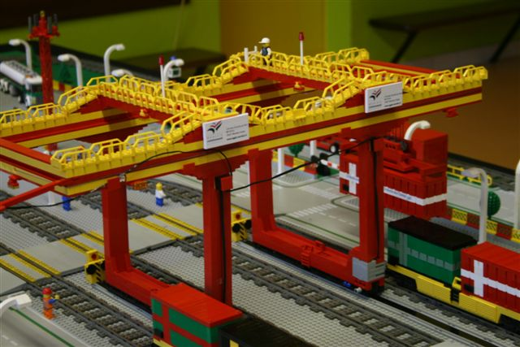
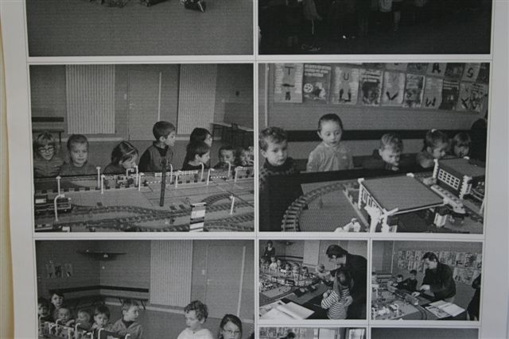
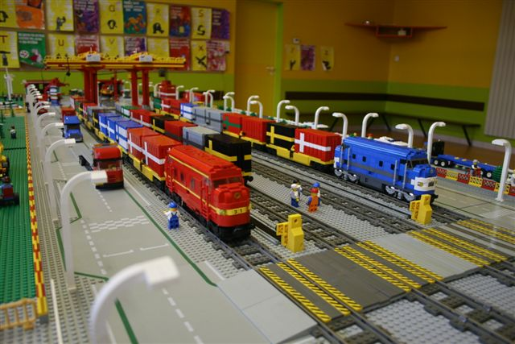

Fin octobre, j’ai contacté la Mairie de Plounéour-Ménez (Finistère), un rendez-vous a été pris avec un adjoint à la communication fort intéressé.

De cet échange, une date sur 2 jours a été entérinée, vendredi pour les scolaires et samedi pour la population.

But de ces journées, Plounéour-Ménez est une des 28 communes de Morlaix Communauté, mon diorama a été présenté en avant-première aux 50 ans de la Zone de Kérivin à Saint Martin des Champs en septembre 2011, mais la population n’avait pas pu le voir.

Ayant été subventionné en partie, il est naturel, et en accord avec Morlaix Communauté, de présenter mon diorama qui est une sorte de vision d’artiste, les décideurs économiques réfléchiront sur les suites de mon projet.

La veille fut consacrée au montage (6h) dans une belle salle du complexe scolaire au pied des Monts d’Arrée.

L’adjoint au maire est venu plusieurs fois me voir pour s’assurer de la bonne installation.

Vendredi : les directeurs de maternelles et de collège m’ont soumis un planning des arrivées des classes maternelles, CP, GS le matin, et, après-midi collège 4e à 6e.

La journée s’est bien passée, malgré la grande excitation des enfants, le retard entre classes, temps imparti dépassé, beaucoup d’entre eux n’avaient jamais vu de créations LEGO.

Pour certains, c’était Noël avant l’heure.

Samedi, c’est au tour du Conseil municipal de venir et de la population.

En conclusion, 2 journées réussies, 9 photos prises par les classes de maternelles, 2 articles de presse, 1 article dans le bulletin municipal.

Prochain rendez-vous en Janvier 2013 à Saint Pol de Léon, siège d’une entreprise, actionnaire principal de la plate-forme rail-route, les discussions sont en cours de finalisation.

Merci à Damien d’être venu en voisin et d’avoir proposé un essai de train en PFS.

Ci-joint mes photos

[http://photos.freelug.org/main.php/v/barr\_\_/expositions/2012/plouneour/](http://photos.freelug.org/main.php/v/barr__/expositions/2012/plouneour/)

Jean-Marc Barré
