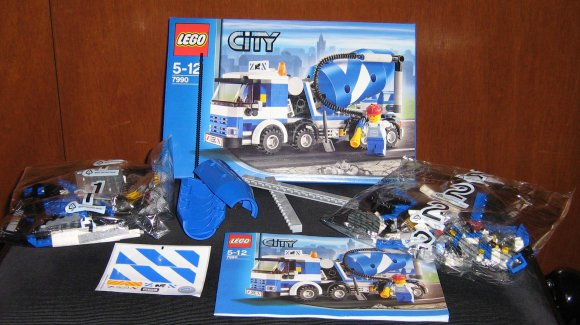
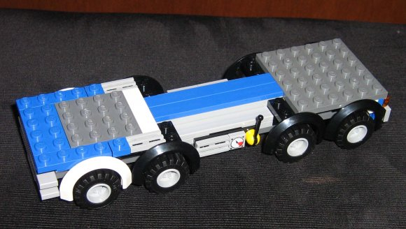
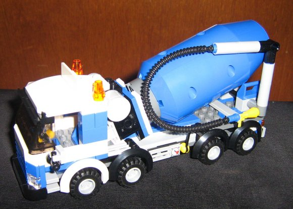
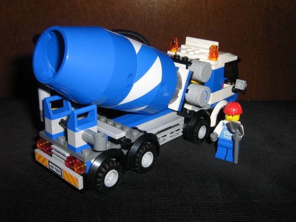
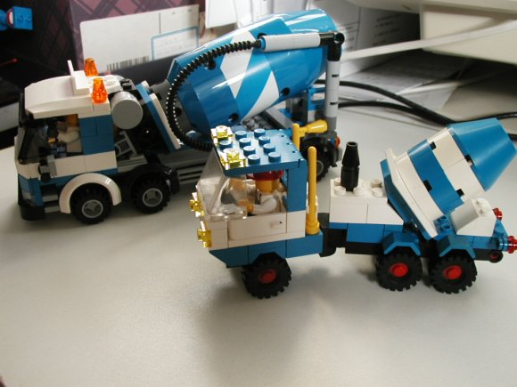
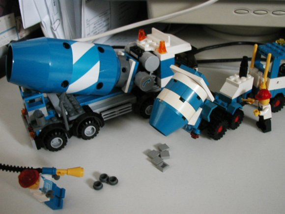
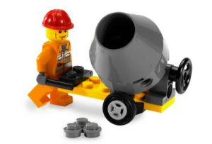

Dans la lignée de la présentation des nouveaux véhicules de la gamme City 2007 ([camion poubelle 7991](/articles/presentation-du-camion-poubelle-7991/) et [camion benne 7998](/articles/montage-commente-du-camion-benne-7998/)), nous vous présentons aujourd’hui le [camion toupie 7990](http://www.brickset.com/detail.aspx?Set=7990-1).

Comme pour la précédente présentation du camion poubelle, cette présentation va faire le parallèle avec un autre modèle historique inspiré du même thème.

La désignation anglaise du camion toupie est "cement mixer".

Un modèle de ce type a déjà été commercialisé en 1985 sous la référence [6682](http://guide.lugnet.com/set/6682).

Résumé :  
**–** Nombre de pièces : 213 ;  
**–** prix : 15 euro ;  
**–** Année : 2007.

L’ouverture de la boîte nous présente la désormais classique décomposition en plusieurs sachets numérotés.

La notice de montage recommande également aux plus jeunes d’entre nous de ne pas procéder au montage en plein air. C’est vrai, je suis désolé d’en décevoir certains, mais l’ABS ne pousse pas dans la terre, même s’il est arrosé copieusement !

La construction est relativement classique et ne pose pas de problème particulier.

Les designers de chez LEGO ne se sont pas vraiment souciés du confort du chauffeur, car bien que la cabine soit grande, le chauffeur n’a pas droit à un siège, juste à un unique dossier.

Un petit renvoi d’engrenage technique permet de faire tourner manuellement la toupie. On aurait peut-être trouvé plus ludique d’avoir un mécanisme couplé aux roues et faisant tourner la toupie lorsque le camion roule.

On remarquera que la méta-pièce permettant d’assembler la toupie comporte un rainurage hélicoïde, qui comme dans la réalité permet le mélange du béton (ici représenté par des petites plaques rondes) quand il tourne dans un sens et le déversement lorsqu’il tourne dans l’autre sens (ça marche).

Donc le mécanisme proposé dans ce set permettra d’effectuer les deux opérations, quoiqu’en mélangeant des plaques rondes je ne suis pas arrivé à couler une brique de 2x4.

Prendre soin au raccord de l’autocollant entourant la toupie, car la continuité du dessin n’est possible que si l’on respecte le sens de pose de l’autocollant.

Ma conclusion sur ce set sera relativement favorable, car ce type de set perpétue pour moi les basics de la gamme System. A savoir des sets de petites dimensions, relativement rapides à monter, ludiques et dans une gamme de prix assez abordable (quoique 15 Euro ça fait quand même 100 de nos anciens Francs, soit le prix de deux sandwichs et oui tout augmente...) Bon au-delà de ces considérations économiques, ce qui fait l’intérêt de ce genre de sets c’est qu’ils permettent aux plus jeunes de revenir aux jeux de construction avec des modèles comportant quelques techniques de constructions sympathiques, un bon niveau de détail et surtout une bonne base pour démarrer ou étendre sa collection.

## 22 ans en arrière

[Vingt années séparaient les deux camions poubelles](/articles/presentation-du-camion-poubelle-7991/#20ans). Pour le camion toupie, c’est 22 ans d’écart, sans aucun modèle intermédiaire. Vingt-deux ans que nos minifigs construisent leur ville à la truelle.

Et comme pour le 7991, la différence avec le 6682 est rude, même si l’esprit est toujours là.

La même palette de couleur est employée : blanc et bleu. Mais les ressemblances s’arrêtent à peu près là.

Plus long, plus large, plus moderne, le 7990 réduit son grand frère à l’état de vieillerie. Et pourtant, lui aussi bénéficie d’une toupie rotative et basculante pour le déchargement du béton.

Ce camion a par ailleurs conservé pendant 10 ans l’exclusivité du [cône creux bleu 4x4x2](http://peeron.com/inv/parts/4742). En sera-t-il de même pour la méta pièce du 7990 ?

Articulé en son milieu, le 6682 est plus maniable que le 7990 avec ses quatre essieux et un grand empattement. Dans la réalité, les deux essieux avants sont directeurs.

Notons que le béton de 1985 était plat, lisse et gris clair, il est de nos jours rond et gris foncé :)

## Conclusion

Pour conclure sur ce comparatif, le 7990 n’aura aucun mal à faire oublier le 6682. Le nouveau camion s’inscrit pleinement dans la belle lignée des nouveautés 2007, à notre plus grand bonheur.

Et si les camions ne vous conviennent pas, 2008 vous permettra d’acquérir le petit set 5610.

