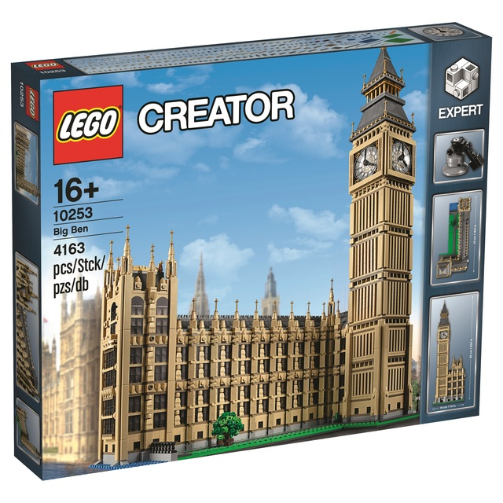
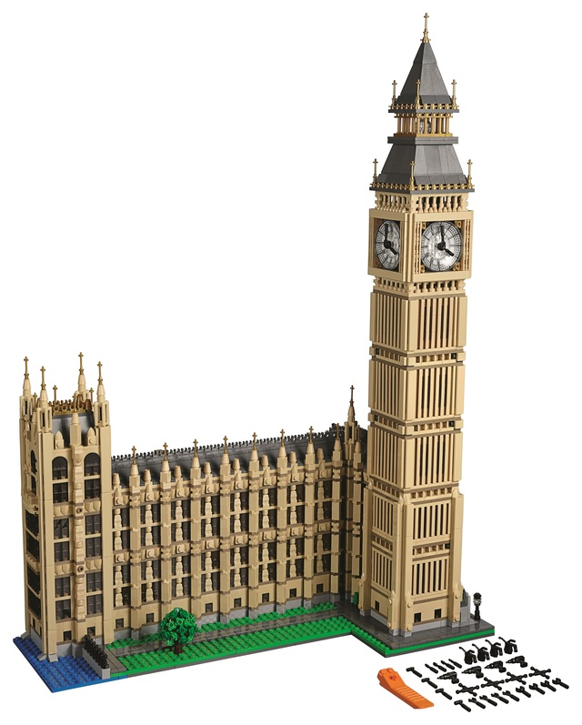
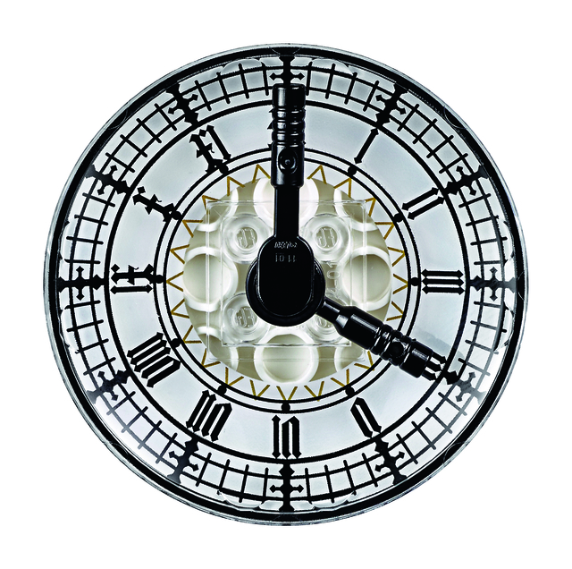
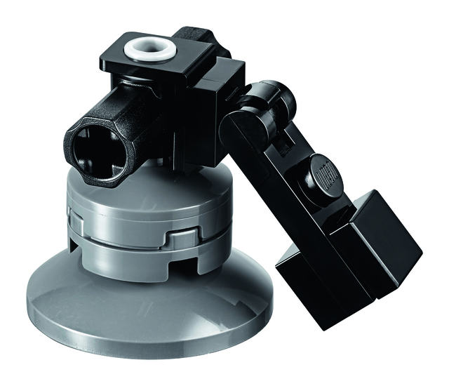
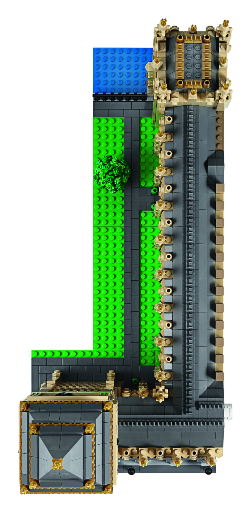

Présentation officielle du set n°10253 Big Ben

## LEGO présente aujourd’hui officiellement le set n°10253 Big Ben

> **INFO :**  
> **–** Ages **16+**  
> **–** 4,163 pieces  
> **–** US $249.99 - CA $299.99 - DE **219.99€**\* - UK £169.99 - DK 1999.00 DKK  
> **–** Disponible à partir du **15 Juin** pour les VIP et **1er juillet 2016** pour tout le monde (S@H et Stores)
> 
> _\*Les prix en Euro varient d’un pays à l’autre. Nous connaitrons le prix français une fois le set en vente sur le S@H_

## Vidéo de présentation du set :

[Vidéo de la publication d’origine](https://www.youtube.com/embed/VuGH2LBW1sE)

## Communiqué officiel (en anglais) :

> **Build the world’s best-known clock tower !**
> 
> Get up close to Big Ben ! The clock was first started on May 31st 1859, and Big Ben’s first chime rang from the 96-meter Elizabeth Tower on July 11th of the same year. This over 23” (60cm) high LEGO® interpretation of the iconic structure is a tribute to its engineering and architecture. It features a detailed facade with statues, shields and windows, and a clock tower with 4 adjustable clock dials and a removable roof allowing access to the belfry, plus buildable exterior elements including a sidewalk, lawn and a tree depicting the building’s location. This model makes a great display piece for the home or office.
> 
> **–** Big Ben features a detailed section of the Westminster Palace and the adjoining Elizabeth Tower, 4 detailed clock dials with movable hour and minutes hands, and a sidewalk, tree and grass area depicting the building’s location.
> 
> **–** Remove the top of the tower to access the Big Ben bell.
> 
> **–** Put your LEGO® building skills to the test !
> 
> **–** Special elements include 4 printed clock faces.
> 
> **–** Rare elements include ski poles, flowers and corner plates in molded gold color, and tinted-translucent elements.
> 
> **–** This set includes over 4,000 LEGO® pieces.
> 
> **–** This set offers an age-appropriate building experience for ages 16+.
> 
> **–** Big Ben measures over 23” (60cm) high, 17” (44cm) wide and 7” (20cm) deep.

## Quelques images :

lien vers la galerie contenant toutes les images :  
[http://photos.freelug.org/main.php/v/Pierre\_13/10253/](http://photos.freelug.org/main.php/v/Pierre_13/10253/)
