## 10254 Winter Holiday Train

[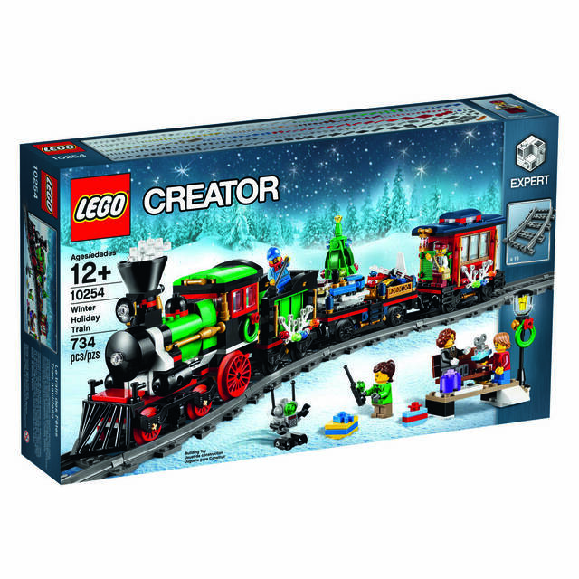](https://www.freelug.org/IMG/jpg/10254_Box1_v39.jpg)

Version originale ([lire la traduction française de la rédaction](#traduction))

>   
> **–** Ages 12+. 734 pieces.  
> **–** US $99.99 - CA $129.99 - DE 89.99€ - UK £69.99 - DK 799.00 DKK  
> _\*Euro pricing varies by country. Please visit shop.LEGO.com for regional pricing._  
> VIP Early Access for this item starts on September 15th with a launch date of October 1st.

**Climb aboard the magical Winter Holiday Train !**

Gather the family for some festive LEGO® building fun with this charming model featuring a full circle of track, boarding platform with bench and lamppost, a Power Functions upgradable train engine with brick-built smoke bellowing from its stack, coal tender, flatbed wagon with a rotating holiday tree, toys and gifts, and a red caboose with a detailed interior and table. The train engine also features large and small red-colored locomotive wheels and the train is decorated with green wreathes, string lights and white tree elements. This LEGO® Creator Expert set includes 5 minifigures.

-   Includes 5 minifigures : a locomotive driver, ticket collector, grandmother, boy and a girl.
-   The Winter Holiday Train includes 16 curved pieces of track, engine, coal tender, flatbed wagon with holiday tree, toys and gifts, caboose, boarding platform, bench and a lamppost.
-   Decorate the tree and drive the train to see the tree rotate.
-   Join the ticket collector in the cozy caboose for a delicious cup of cocoa.
-   Includes dual building instructions for a perfect family build.
-   Accessory elements include green wreathes, decorative lights and white tree pieces, plus wrapped gift elements and tiny brick-built toys, including a micro train, wind-up car, fire truck, remote controlled robot, sailboat and a spaceship.
-   Upgrade with LEGO® Power Functions (not included) for a motorized engine.
-   Special elements include small and large red train wheels, dark tan windows, train buffers, cow catcher, white tree elements and roller skates.
-   This set includes over 700 LEGO® pieces, including 16 curved tracks.
-   The Holiday Train in total measures over 4” (12cm) high, 20” (52cm) long and 2” (7cm) wide.
-   Curved rail track diameter measures over 27” (70cm).

* * *

  
**Monte à bord du magique Train de Noël !**
{: #traduction}

>   
> **–** Age : 12+. 734 pièces.  
> **–** US $99.99 - CA $129.99 - DE 89.99€ - UK £69.99 - DK 799.00 DKK  
> _\*Le prix en Euro peut varier selon les pays. Visitez shop.LEGO.com pour connaitre le prix exacte._  
> Accessible dès le 15 septembre pour les clients VIP, pour un lancement général le 1er octobre.

Rassemble la famille pour un moment de construction festive avec ce charmant modèle proposant un circuit rond complet, un quai avec banc et lampadaire, une locomotive pouvant être équipée en Power Functions avec de la fumée (en briques) s’échappant de sa cheminée, un tender pour le charbon, un wagon plat avec un sapin qui tourne, des jouets et des cadeaux, et une voiture de queue avec un intérieur détaillé et une table. La locomotive est également équipée de grandes et petites roues rouges et le train est décoré avec des couronnes verts, des guirlandes lumineuses, et de feuilles d’arbre blanches. The modèle LEGO Creator Export contient 5 figurines.

-   Contient 5 figurines : un conducteur de train, un contrôleur, une grand-mère, un garçon et une fille.
-   Le modèle Winter Holiday Train contient 16 rails courbes, une locomotive, un tender, un wagon plat avec un sapin de Noël, des jouets et cadeaux, une voiture de queue, un quai avec banc et lampadaire.
-   Décore le sapin et fais rouler le train pour voir le sapin tourner.
-   Rejoins le contrôleur dans la confortable voiture pour un délicieux bol de chocolat.
-   Contient des instructions séparées pour une construction idéale en famille.
-   Les accessoires contiennent des couronnes vertes, des guirlandes de lumière et des feuilles d’arbre en blanc, des cadeaux emballés et des mini jouets en briques notamment un micro train, une voiture à friction, un camion pompier, un robot télécommandé, un voilier et un vaisseau spatial.
-   Adaptable avec LEGO Power Functions pour motoriser le train
-   Contient des éléments spéciaux tels que les grandes et petites roues de train en rouge, des fenêtres en dark tan, des tampons de trains, un pare-buffle, des feuilles d’arbre en blanc et des patins à roulettes.
-   Ce modèle contient plus de 700 pièces LEGO dont 16 rails courbes.
-   Le Train de Noël mesure au total plus de 12cm de haut, 52 cm de long et 7 cm de large
-   Le diamètre du circuit mesure plus de 70 cm.

* * *

## Note du rédacteur

Ce set s’inscrit dans la série des modèles sur le thème de Noël lancée en 2009. En 2015, [LEGO rééditait le le modèle sorti en 2009](/articles/revue-du-set-10249-toy-shop/), alors lorsque les rumeurs ont annoncé l’arrivée d’un train de Noêl pour cette année, on pouvait se demander si LEGO n’allait pas nous ressortir le [modèle 10173](http://brickset.com/sets/10173-1/Holiday-Train). Ce n’est donc pas le cas.

Dans les éléments spéciaux cités, les roues rouges sont sorties dans le [train Toy Story](http://brickset.com/sets/7597-1/Western-Train-Chase), les petites feuilles blanches dans le [château d’Arendelle](http://brickset.com/sets/41068-1/Arendelle-Castle-Celebration), quant aux fenêtres dark tan, elles sont sorties dans [Big Ben](http://brickset.com/sets/10253-1). Rien de bien exclusif.

## Photos

[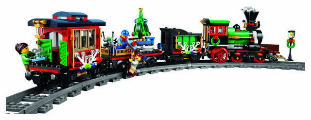](https://www.freelug.org/IMG/jpg/10254_Back_01.jpg)

[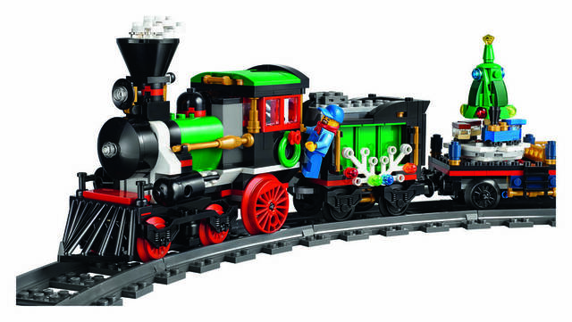](https://www.freelug.org/IMG/jpg/10254_Back_03.jpg)

[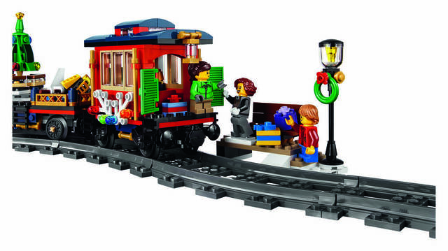](https://www.freelug.org/IMG/jpg/10254_Back_04.jpg)

[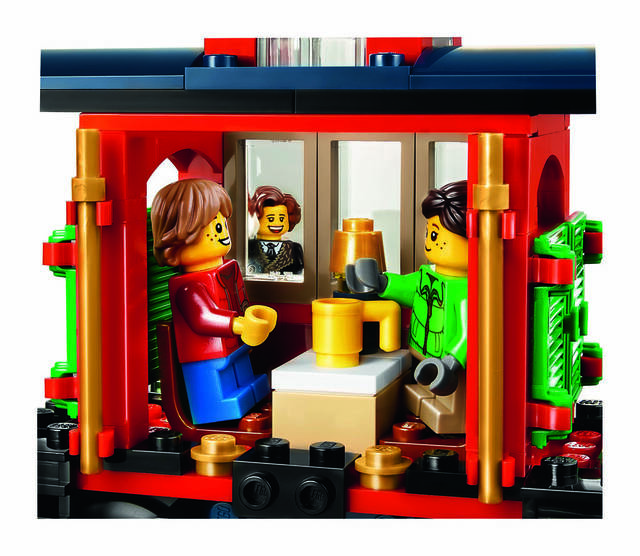](https://www.freelug.org/IMG/jpg/10254_Back_06.jpg)

[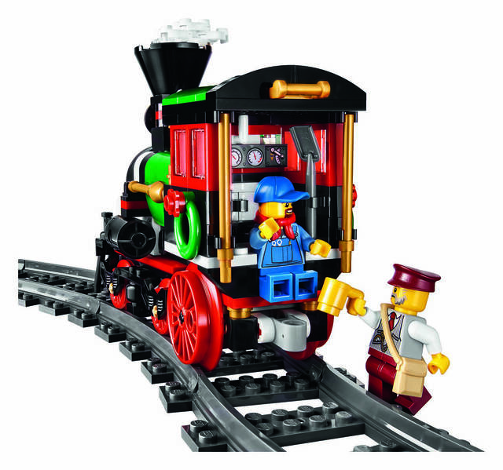](https://www.freelug.org/IMG/jpg/10254_Back_07.jpg)

[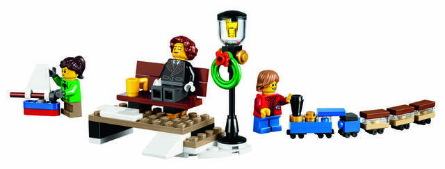](https://www.freelug.org/IMG/jpg/10254_Back_08.jpg)

[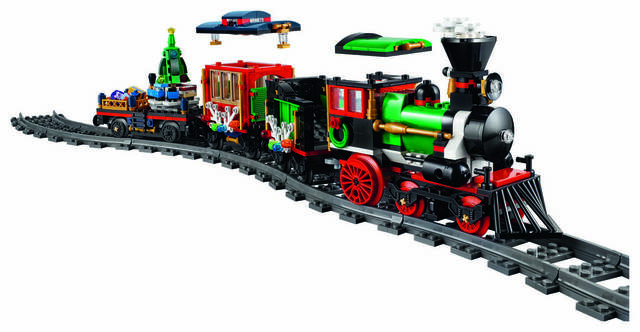](https://www.freelug.org/IMG/jpg/10254_Bottom_01.jpg)

[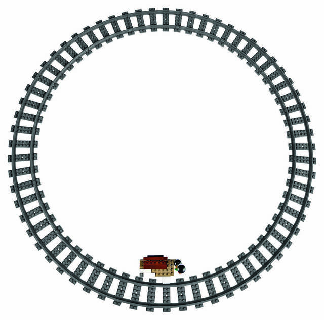](https://www.freelug.org/IMG/jpg/10254_Bottom_CallOut_01.jpg)

[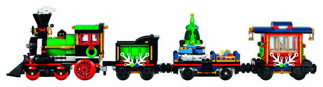](https://www.freelug.org/IMG/jpg/10254_Bottom_CallOut_02.jpg)

[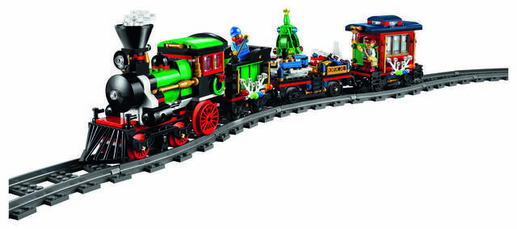](https://www.freelug.org/IMG/jpg/10254_Front_01.jpg)

[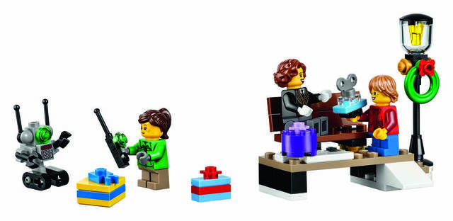](https://www.freelug.org/IMG/jpg/10254_Front_02.jpg)

[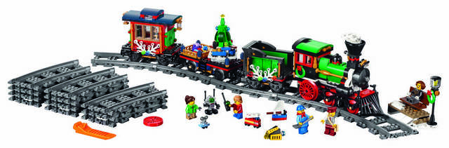](https://www.freelug.org/IMG/jpg/10254_Prod.jpg)

[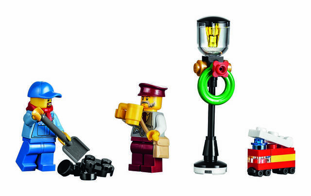](https://www.freelug.org/IMG/jpg/10254_Right_01.jpg)

[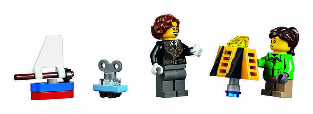](https://www.freelug.org/IMG/jpg/10254_Right_02.jpg)

[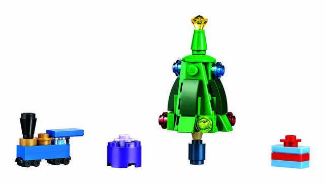](https://www.freelug.org/IMG/jpg/10254_Right_03.jpg)

[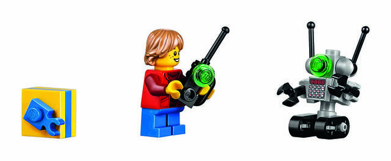](https://www.freelug.org/IMG/jpg/10254_Right_04.jpg)
