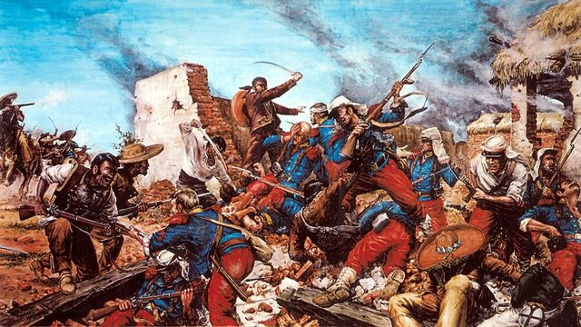
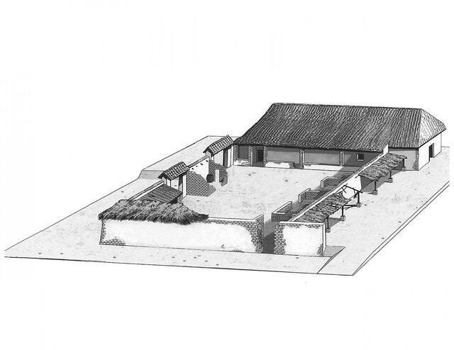
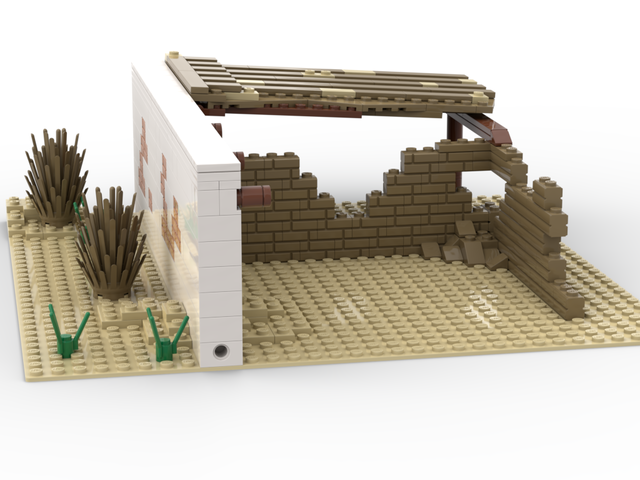
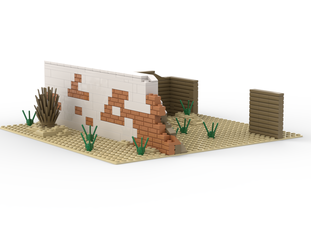
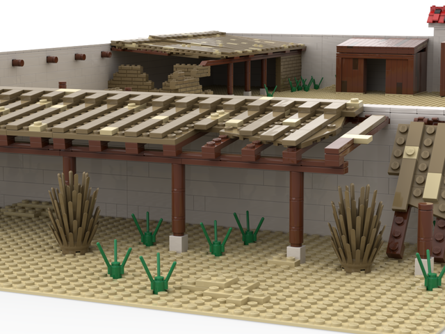
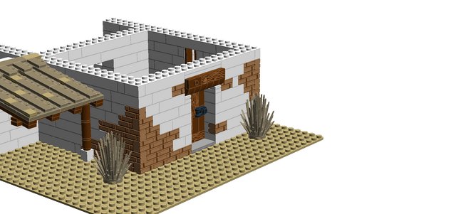
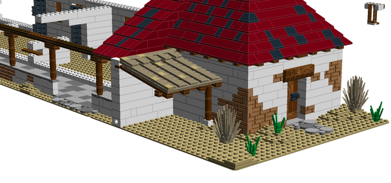
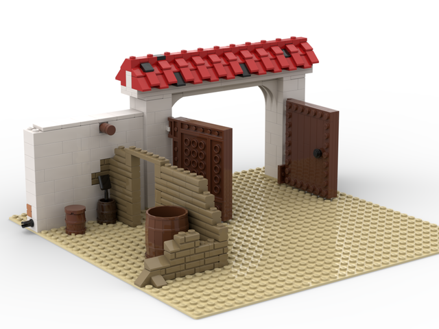
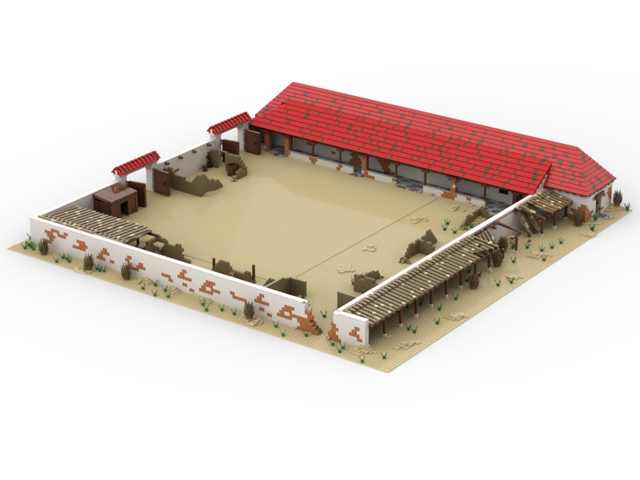

Suite à l’exposition au musée de la bataille de Loigny, pour laquelle certains membres avaient réalisé plusieurs créations sur le thème de la guerre de 1870, FreeLUG a été contacté à la rentrée par le musée de la Légion Étrangère à Aubagne.

Dans le cadre d’une exposition autour du jouet, de novembre 2019 à mars 2020, le musée souhaitait faire reconstituer la bataille de Camerone, légendaire combat pendant lequel 63 légionnaires ont résisté une journée durant, barricadés dans l’hacienda de Camerone, au Mexique, aux assauts répétés de milliers de mexicains.  
Depuis cette fameuse journée de 1863, le 30 avril est une journée de commémoration dans tous les régiments de la Légion Étrangère.

_30 avril 1863, la bataille de Camerone._

Le musée souhaitait une évocation de la bataille comprenant "le plus de personnages possible".  
A l’inverse du projet pour le musée de la bataille de Loigny, où nous devions recréer des petits dioramas, chacun utilisant ses pièces personnelles, il est apparut tout de suite, que la reconstitution de l’hacienda et des forces en présence ne serait pas possible dans les mêmes conditions.

_Un des documents fournis par le musée de la Légion pour travailler sur le projet._

Il a donc été convenu avec le musée que si des adhérents étaient volontaires pour travailler sur ce projet, une modélisation du diorama serait réalisée pour évaluer le nombre de pièces nécessaires pour sa construction et un budget d’achat de pièces.

Après un appel sur la liste adhérents, une petite équipe composée de quatre personnes s’est composée, deux personnes se chargeant de la modélisation, une des besoins en pièces pour les figurines, et une dernière pour mouliner le tout et établir un budget et des options de commande.

A l’échelle minifig, l’hacienda représentait une surface de 25 baseplates de 32x32, un carré de 5x5. Pour faciliter la construction, le transport et le montage, il a été rapidement décidé de travailler sur des modules de 32x32, sur le principe des bâtiments modulaires.

Les portails ont été modélisés avec les portes (absentes lors de la bataille), dont les pièces devaient servir pour fabriquer les pièces de barricade.

Après plusieurs jours de modélisation, d’essai et de recherches de pièces dans les bonnes couleurs (merci Stud.io qui permet de savoir au moment de la modélisation si une pièce est dispo dans la couleur nécessaire), nous sommes arrivés à un projet de 9578 pièces pour l’ensemble de l’hacienda, d’éléments de décors tels que cactus, chariots et les 213 figurines - 63 légionnaires et 150 mexicains, chargés d’habiller le diorama qui devait s’étendre au delà de l’hacienda sur une surface de 15 baseplates (3x5).

Malheureusement le budget qui aurait permis la réalisation de ce projet était trop élevé pour le musée de la Légion Étrangère, qui a préféré décliner notre proposition, malgré les mails d’encouragement reçus tout au long de la modélisation.
