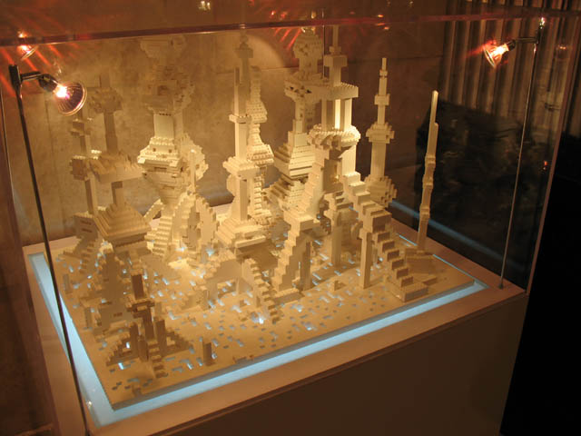
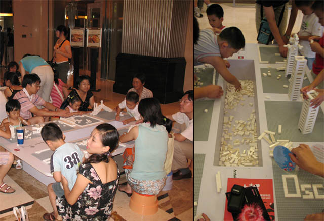
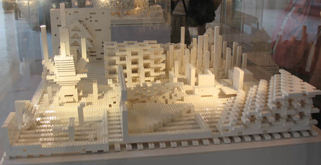
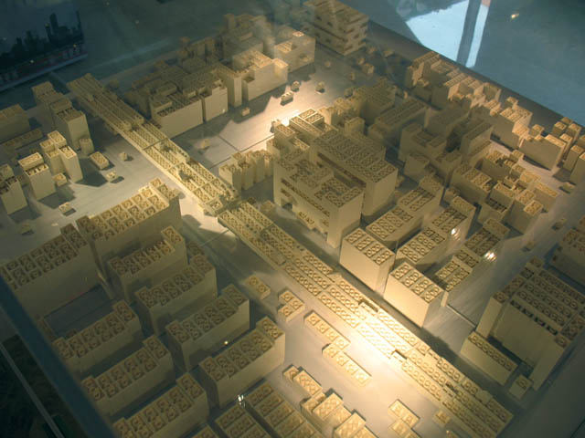
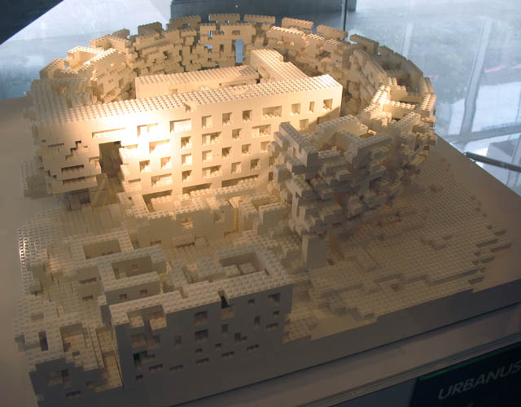
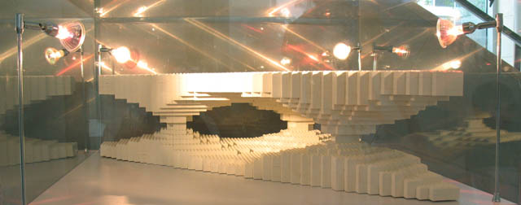
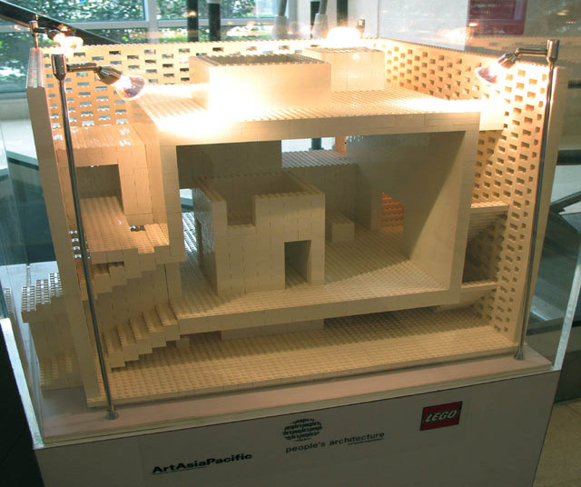
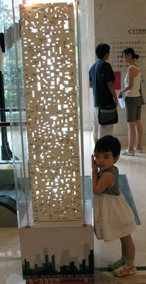
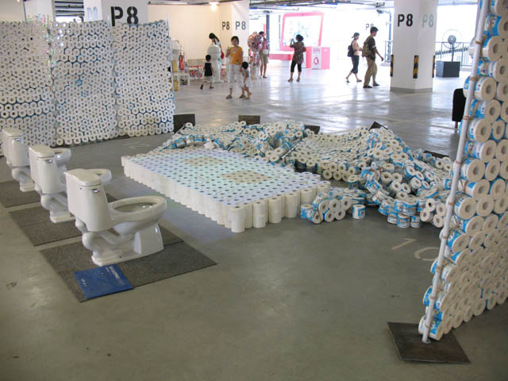

Une exposition itinérante d’objets d’art et de design contemporain se déroule actuellement en Chine. Quelques architectes ont joué le jeu de construire des maquettes en briques blanches pour cette exposition.

J’ai eu connaissance de cette exposition par l’intermédiaire du [Brickjournal](http://www.brickjournal.com/news/2007/8/1/archtectural-lego-project-tours-china). Etant sur place je me suis dit que je pourrais aller faire un tour, prendre quelques photos et vous faire un petit résumé.

Le premier modèle est en fait un regroupement de plusieurs reproductions de la célèbre "TV Tower" qui est un peu la "Tour Eiffel" de Shanghai. Il est probable que ces "TV Towers" aient été faites par les enfants bien que je ne puisse l’affirmer.

**artiste inconnu**

Notez que le socle est en SNOT (briques couchées).

L’exposition se déroulait dans un hall de grand magasin, elle était donc en accès libre mais les oeuvres n’étaient pas vraiment mises en valeur, juste à coté d’un escalator. Cependant il y avait quand même quelques briques à disposition des enfants.

**Aire de jeu pour les enfants**

J’ai visité cette exposition le dernier jour, ce qui explique sans doute le peu de briques disponibles dans les bacs. :-)

**Scenic Architecture**

En fait si on se réfère au [site lié à cette exposition](http://www.aapmag.com/brickbybrick/), il semblerait qu’il y ait 14 architectes (ou cabinets d’architectes) qui aient participé, mais je n’ai vu que 6 oeuvres. Peut-être n’ai-je pas bien visité tous les recoins du grand magasin ?

**Map Office**

Ci dessus une autre oeuvre en [SNOT](http://www.brickwiki.org/index.php?title=SNOT_techniques)... quoique, elle est entièrement montée "tenons vers le haut" sauf qu’ensuite ils ont retourné toutes les briques. Un peu facile non ? :-)

L’oeuvre suivante est une des celles qui m’a le plus plu, c’est une sorte de coliseum en [SNIR](http://www.brickwiki.org/index.php?title=SNIR_techniques). On sent que l’architecte n’a pas voulu se laisser imposer la géométrie à angle droit de la brique.

**Urbanus**

J’ai aussi beaucoup aimé l’oeuvre suivante que je trouve très élégante. Il s’agit de deux triangles connectés par 3 colonnes évasées.

**MADA s.p.a.m.**

Un cabinet japonais nous offre une oeuvre dans un style à la [Escher](http://fr.wikipedia.org/wiki/Maurits_Cornelis_Escher).

**Atelier Bow-wow**

**Bernard Khoury**

Et pour finir une colonne éclairée de l’intérieur dont vous pouvez apprécier la hauteur grâce à ma fille se tenant à ses cotés.

Enfin pour l’anecdote, sachez que cette exposition de LEGO faisait partie d’une plus grande exposition de design et d’art contemporain. Et bien sûr comme dans toute bonne exposition d’art contemporain il y a toujours des oeuvres qui valent le détour (si si, vraiment), comme par exemple ce magnifique mur en rouleau de papier toilettes qui malheureusement s’est écroulé sans doute à cause des courants d’air vu que cette partie de l’exposition se tenait dans le parking du grand magasin.

* * *

**Mur de PQ**

J’omets bien sûr le nom de l’artiste car je suis sûr qu’il ne voudrait pas voir son oeuvre ainsi par terre. :-)
