Il m’a été demandé de faire un article sur des montages didactiques que j’utilise sur des expo pour expliquer le fonctionnement d’organes mécaniques couramment utilisés tel qu’un différentiel par exemple.

Ces montages ne sont pas tous de moi (loin de là). Je les ai glanés je-ne-sais-plus-où sur le net. Je ne puis donc attribuer les crédits à leurs auteurs respectifs et je les prie donc de bien vouloir m’en excuser. Bien évidement, ils sont invités à se faire connaitre et je modifierai alors l’article en conséquence.

Je vais prendre chacun de ces montages et les commenter.  
Juste deux conventions avant de commencer :  
**–** La lettre t suivit d’un chiffre (ex 16t) = 16 dents (tooth en anglais)  
**–** Liftarm : brique Technic lisse, sans tenons sur le dessus, de largeur 1 tenon, aux extrémités arrondies, avec des trous. Ex L3 = Liftarm avec 3 trous.

## Boite de vitesses à deux rapports

Commençons par une boite de vitesse à 2 rapports, avec sélection automatique du rapport selon le sens de rotation de l’entrée :

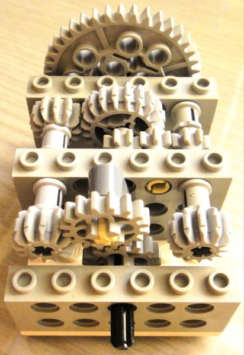

Comme vous le voyez, une entrée (en bas de la photo), une sortie (en haut de la photo) et 2 chemins possibles (à gauche et à droite sur la photo). Celui de gauche est une réduction (pignon de sortie plus gros que l’entrée), celui de droite est une démultiplication (pignon de sortie plus petit que celui de l’entrée).

La sélection du chemin s’opère automatiquement, par simple friction, selon qu’on fait tourner l’axe d’entrée dans le sens horaire (chemin de droite) ou dans le sens anti-horaire (chemin de gauche).

L’axe d’entrée traverse la brique Technic (le support), puis un 16t (pignon menant) puis un liftarm L3. Sur ce liftarm L3 est disposé un autre 16t (pignon mené ou pignon baladeur), engrainé avec le 1er. C’est le frottement des deux 16t ensemble qui fait basculer l’ensemble à gauche ou à droite.  
Voici la position à droite :

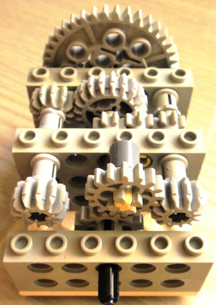

Nota : le 40t en sorti n’est présent que pour mieux voir le changement de rapport de vitesse (en lui montant un pin sur un des trous périphériques).

Ci-dessous, pour conclure, vous voyez pourquoi la sortie tourne toujours dans le même sens, que l’entrée soit horaire ou anti-horaire. En effet, il y a trois 8t engrainés (entourés en rouge sur la photo suivante). S’il n’y avait eu que deux engrenages (un 24t sur un 8t, par exemple), alors la sortie aurait été inversée.

Vous pouvez donc soit vous en servir pour avoir une marche avant plus rapide qu’une marche arrière (donc chemin de droite avec 2 engrenages), soit pour avoir 2 vitesses avant (ou arrière, c’est selon…) de rapports différents (avec chemin de droite à 3 engrenages comme ici).

La cerise sur le gâteau est que le basculement de l’ensemble d’entrée fait aussi office d’embrayage, permettant de ne pas arrêter la rotation lors de la bascule des rapports. Top, non ?

Bien sûr, vous pouvez modifier les rapports d’engrenages à votre guise, mais ceci peut vous obliger à augmenter la taille totale du montage.

[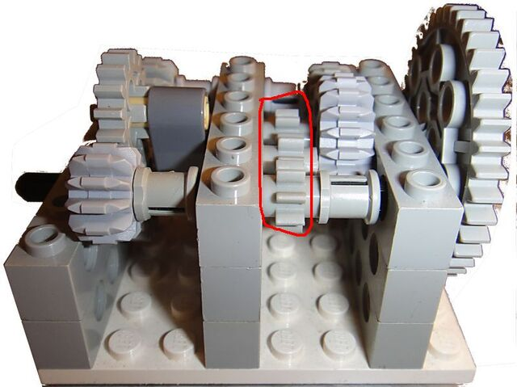](https://www.freelug.org/IMG/jpg/resized_-_DSC01663.jpg)

## Boite de vitesses rotatives

Tout en restant dans le domaine des boites de vitesse atypiques, en voici deux rotatives.

  
**–** La première :

[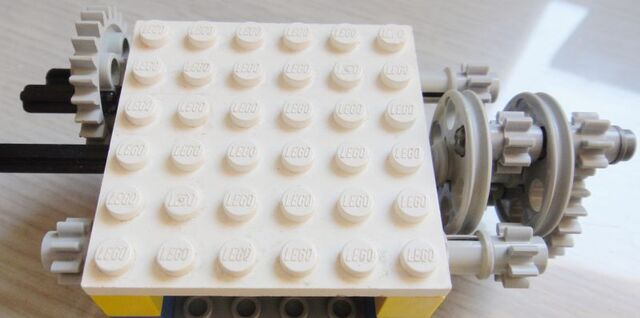](https://www.freelug.org/IMG/jpg/resized_-_DSC01686.jpg)

Entrée/Sortie : en-haut/en-bas (c’est réversible, donc au choix du client).  
La sélection s’effectue par l’axe entre les deux (à gauche sur la photo). Cet axe commande la rotation de l’ensemble de pignons à droite. Sur ces photos, on est au point mort.

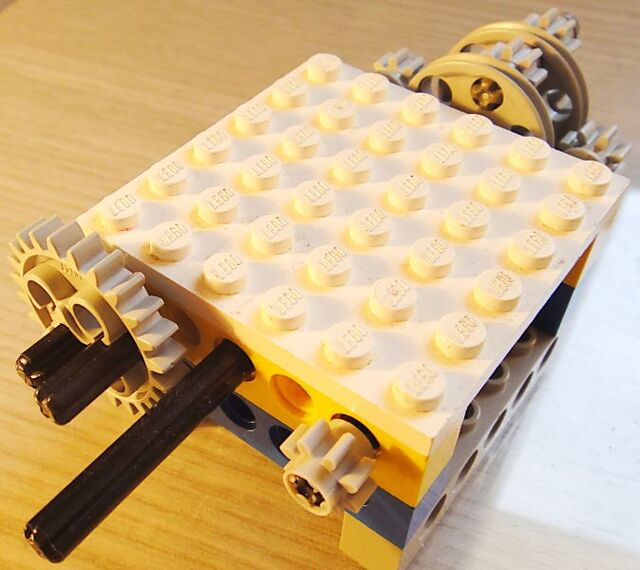

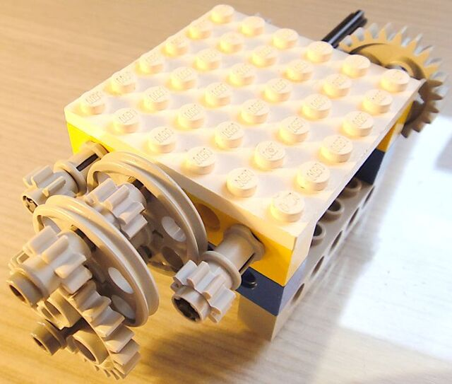

Sur la photo ci-dessous, vous pouvez voir le détail des pignons. D’un côté on démultiplie (augmentation de la vitesse, mais diminution du couple), de l’autre on réduit (diminution de vitesse, augmentation du couple).

[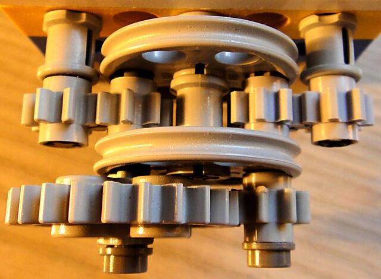](https://www.freelug.org/IMG/jpg/resized_-_DSC01689.jpg)

[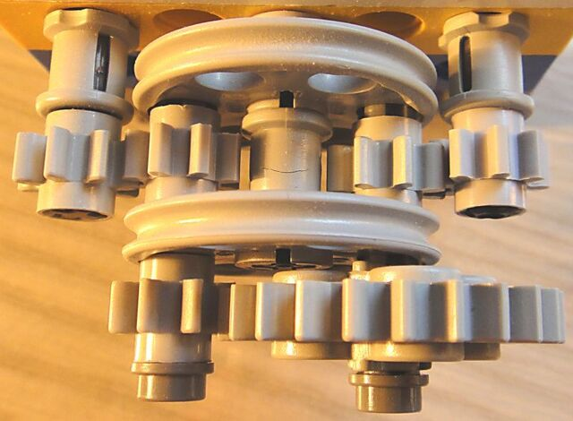](https://www.freelug.org/IMG/jpg/resized_-_DSC01690.jpg)

Un des intérêts de ce montage, est que la rotation apporte roue libre et et une sorte d’embrayage.

[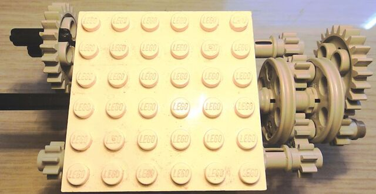](https://www.freelug.org/IMG/jpg/resized_-_DSC01691.jpg)

La difficulté de ce montage est de faire un système mécanique semi-bloquant pour que les pignons restent alignés une fois le rapport engagé.

  
Ici une évolution de ce système (celle-ci est de moi, par contre ;-p). Il y a maintenant 2 entrées et 2 sorties (interchangeables, comme sur le montage précédent), mais il n’est pas possible d’utiliser les 2 en même temps (une entrée/une sortie à la fois) :

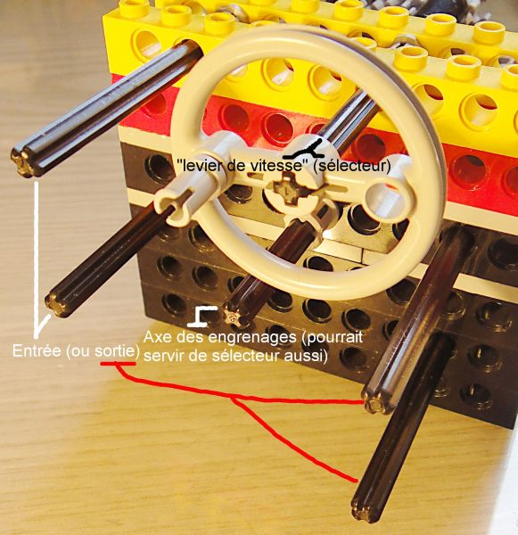

Sur la photo suivante, vous voyez le détail des rapports de vitesse. Il y a 4 rapports possibles pour chacune des 2 entrées/sorties sachant qu’il y a 2 rapports 1:1 et les 2 autres rapports sont réduction et démultiplication.

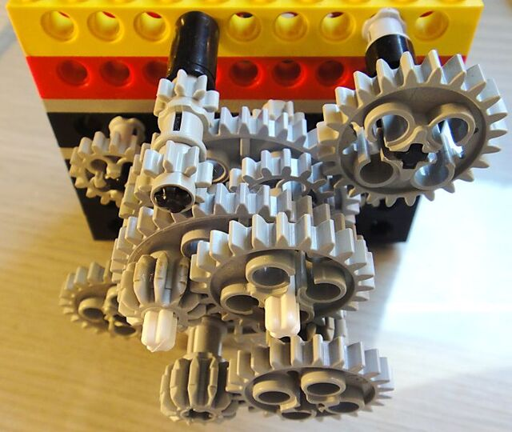

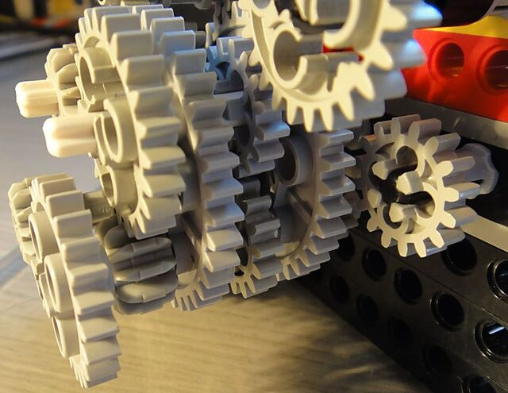

Ces rapports passent par les 4 axes blancs pris sur les 40t.  
Ces 4 axes blancs forment un carré.  
Lorsque ce carré est horizontal, ce sont les entrées/sorties diagonales qui sont en fonction :

[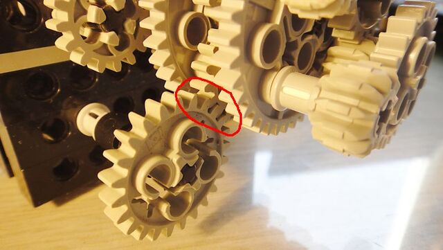](https://www.freelug.org/IMG/jpg/resized_-_DSC01706.jpg)

Lorsque ce carré est sur la pointe, ce sont les entrée/sortie horizontales qui sont en fonction :

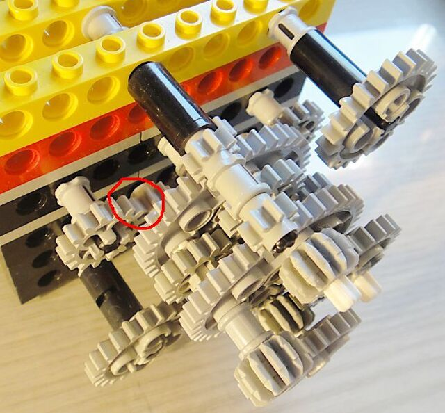

[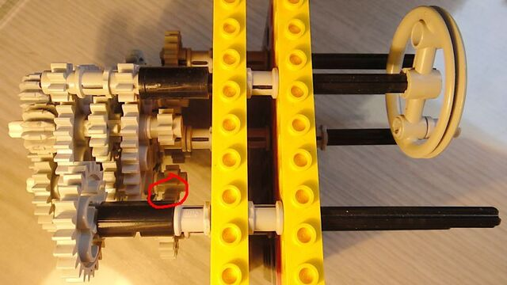](https://www.freelug.org/IMG/jpg/resized_-_DSC01714.jpg)

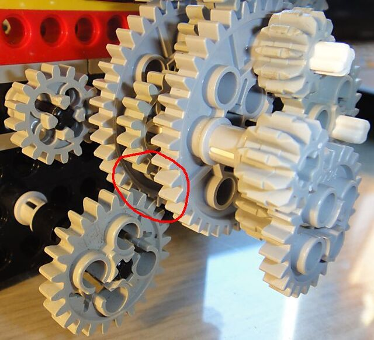

Sur cette dernière photo, on voit que les pignons de l’E/S diagonale ne sont plus engrainés.

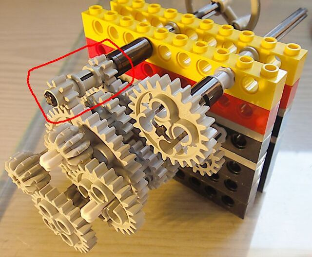

[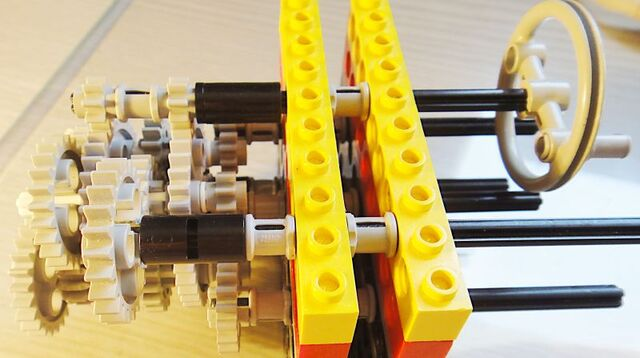](https://www.freelug.org/IMG/jpg/resized_-_DSC01703.jpg)

Comme sur le montage précédent, il y a une roue qui permet de sélectionner le rapport à appliquer (voir les 2 photos précédentes).  
Ici elle n’est pas prise sur l’axe central, bien que ce soit possible, mais déportée.

Pour utiliser ce montage dans un ensemble, il faut bien veiller à ce que les 40t ne puissent pas bouger. Lorsqu’on applique du couple sur les E/S, alors l’axe central tenant les 40t se déforme et il arrive que les pignons ne s’entrainent pas bien et sautent. Ceci serait évité par l’adjonction de 4 autres barres de sélection, présentes uniquement pour guider les 40t afin qu’ils ne sautent pas.

En outre, il n’est pas monté ici, mais il faut un autre mur de briques Technic pour y faire passer les axes de l’E/S diagonale car les pignons étant loin du " mur porteur ", les axes se déforment aussi sous l’effet du couple.

Cette déformation étant beaucoup moins possible sur l’E/S horizontale du fait que les pignons sont plus près du " mur porteur ", il n’est pas nécessaire de le faire (et ce serait difficile car leur axe heurterait les pignons des vitesses).

## Boite de vitesses automatique

Plus fort maintenant : une boite de vitesse automatique (BVA) :

[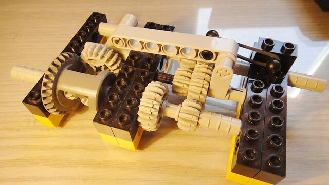](https://www.freelug.org/IMG/jpg/resized_-_DSC01718.jpg)

L’entrée est à droite, la sortie à gauche.  
Lorsque le couple devient trop fort sur l’arbre de sortie, celui-ci fait tourner le différentiel. Ce dernier, pris sur un 20t, entraine alors le liftarm qui change le rapport.

[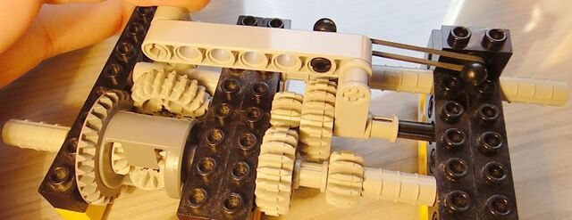](https://www.freelug.org/IMG/jpg/resized_-_DSC01720.jpg)

Lorsque le couple revient à la normale, l’élastique ramène le liftarm au rapport de base.

[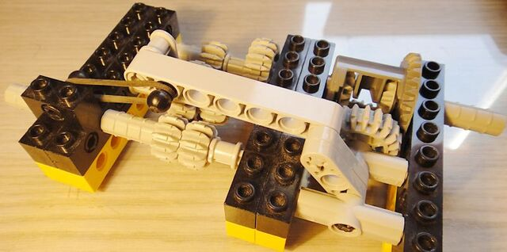](https://www.freelug.org/IMG/jpg/resized_-_DSC01719.jpg)

Très ingénieux et très efficace lorsque l’axe d’entrée est motorisé.

## Différentiels

On attaque maintenant les montages à différentiel :

[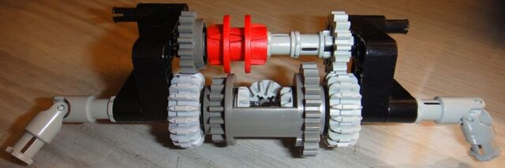](https://www.freelug.org/IMG/jpg/resized_-_DSC01667.jpg)

Ici un montage permettant de venir verrouiller un différentiel.  
Ci-dessus débrayé, la roue sans axe à gauche de la pièce rouge fait que les 2 moyeux peuvent tourner indépendamment l’un de l’autre.  
Cependant, que se passe-t-il lorsqu’une des roues est dans un trou, sur de la glace ou tout autre cas où elle n’a pas d’adhérence ?  
Dans ce cas, la roue qui a l’adhérence ne peut plus avancer car le différentiel passe toute la puissance sur la roue ayant le moins de résistance, à savoir celle qui n’adhère plus. Résultat : le véhicule est bloqué.  
Pour palier ce problème, plusieurs solutions. L’une d’elle est de bloquer le différentiel :

[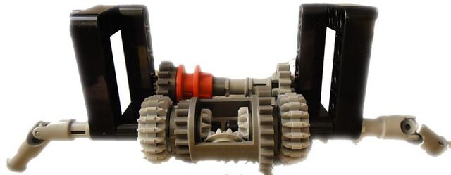](https://www.freelug.org/IMG/jpg/resized_-_DSC01668.jpg)

Comme ceci, embrayé, la roue sans axe est connectée à l’axe via la pièce rouge. De ce fait, elle est solidaire du 16t à droite. Les 2 engrenages (la roue sans axe et le 16t) étant solidaires des 2 moyeux, ceux-ci sont obligés de tourner ensemble. Ainsi, il n’y a plus de patinage.

Ce blocage, comme dans la réalité, est à utiliser avec précaution. En effet, la fonction du différentiel est contournée et les roues ne peuvent plus tourner à des vitesses différentes. Autrement dit, le véhicule ne peut plus tourner (dans le monde LEGO) ou la mécanique va casser (dans la réalité).

  
Il y a d’autres solutions au problème de distribution de puissance par un différentiel ayant une roue qui n’adhère plus. Les photos suivantes représentent un différentiel à glissement limité.

[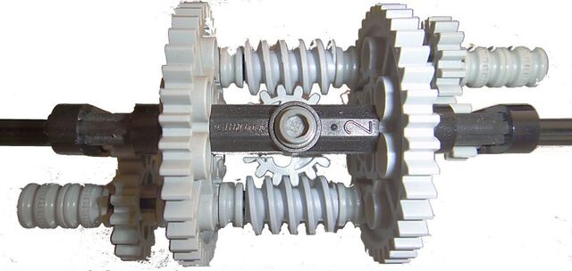](https://www.freelug.org/IMG/jpg/resized_-_DSC01669.jpg)

[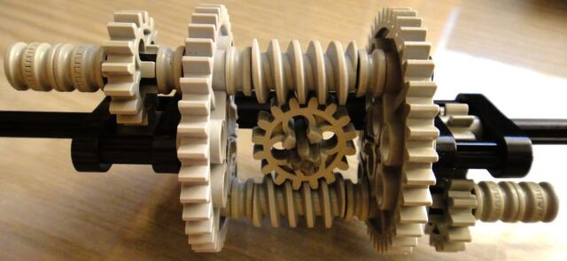](https://www.freelug.org/IMG/jpg/resized_-_DSC01670.jpg)

[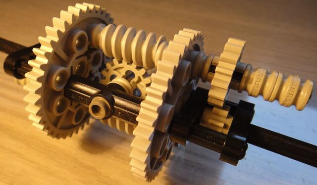](https://www.freelug.org/IMG/jpg/resized_-_DSC01673.jpg)

La fonction différentiel est assurée par la communication entre les 2 moyeux par le 16t central et les vis sans fin.

Cependant, si une roue est bloquée et l’autre libre, et qu’on continue à faire tourner le différentiel (via un des 40t - ou les 2), alors la vis sans fin n’étant pas réversible, elle va obliger la roue bloquée à tourner.

Nota : pour que ça fonctionne, il ne faut évidement pas que les axes des moyeux (ceux où il y a les 8t) entrent dans les 40t).  
Le montage suivant est sur le même type, implémenté différemment (l’entrainement principal est sur les roues sans axe des 2 côtés, et le 16t central est remplacé par un 8t).

[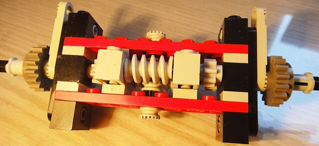](https://www.freelug.org/IMG/jpg/resized_-_DSC01674.jpg)

[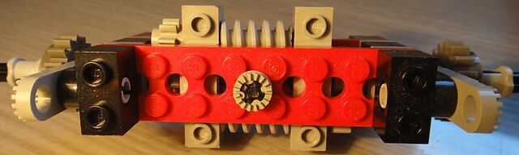](https://www.freelug.org/IMG/jpg/resized_-_DSC01675.jpg)

[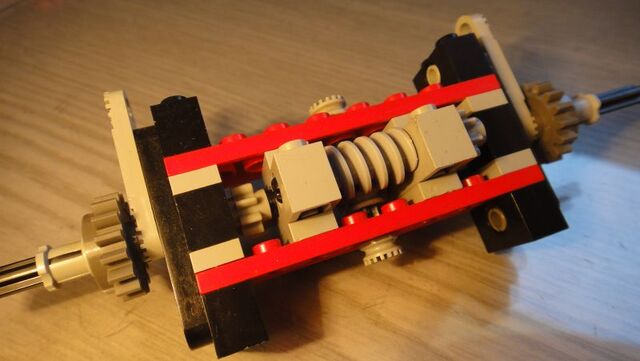](https://www.freelug.org/IMG/jpg/resized_-_DSC01676.jpg)

Détail de la jonction entre la roue sans axe et le corps du différentiel à glissement limité. Il s’agit d’engrainer les dents de la roue sans axe avec une plate Technic à dents, laquelle est fixée à un liftarm 5L demi-épaisseur via ses tenons, lequel est fixé au corps du différentiel via des " pins 1&½ " en haut et en bas (celui du milieu laisse passer l’axe).

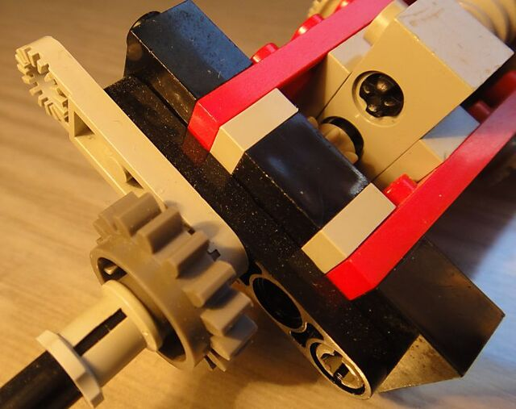

[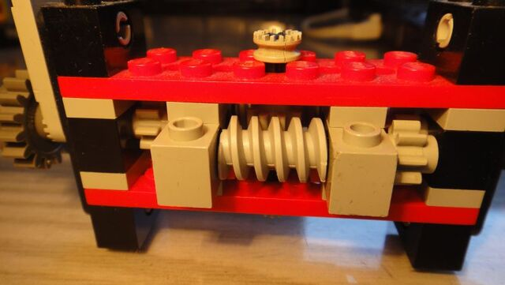](https://www.freelug.org/IMG/jpg/resized_-_DSC01679.jpg)

  
Le montage suivant est un autre type de limitation de glissement :

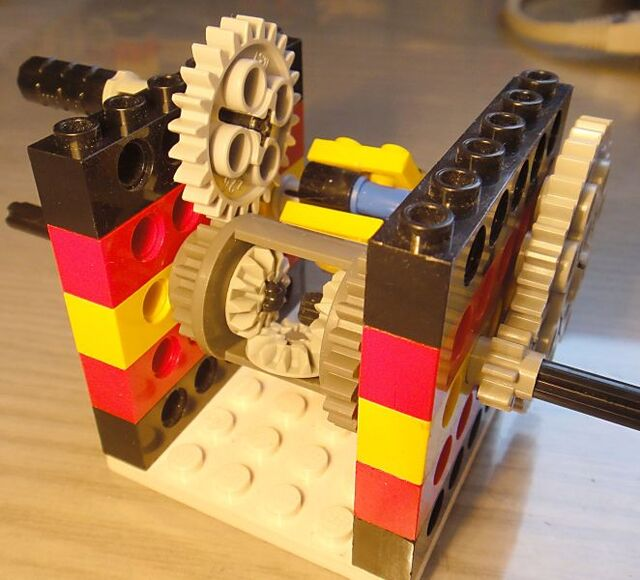

[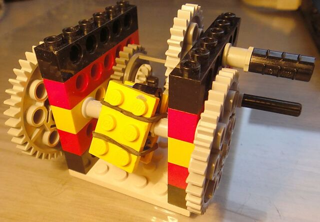](https://www.freelug.org/IMG/jpg/resized_-_DSC01681.jpg)

Les plates 2x3 sont liées par un élastique. Entre elles, il y a des 2x2liftarms L2 demi-épaisseur avec trous d’axes. Un des trous d’axe est sur le même axe et lié à un des deux 40t. L’autre trou contient un axe avec pin.  
Ils sont montés en opposition (voir photo suivante).

[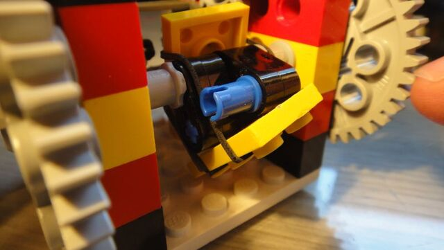](https://www.freelug.org/IMG/jpg/resized_-_DSC01683.jpg)

Lorsque le différentiel " glisse " (une roue en adhérence et l’autre en patinage), alors les pins vont se rejoindre et se bloquer l’une l’autre. L’élastique est là pour limiter cet effort et permettre le retour à l’opposition plus facilement.

[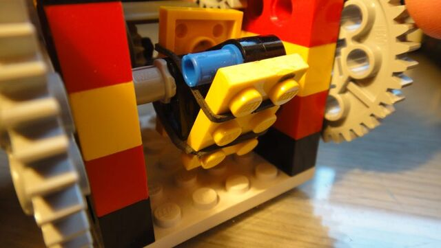](https://www.freelug.org/IMG/jpg/resized_-_DSC01682.jpg)

Tout comme les 2 différentiels à glissement limité précédents, ce montage a un défaut : il faut veiller à ce que la position d’équilibre (ici d’opposition) soit regagnée une fois l’obstacle franchi. Sinon, le blocage devient permanent, ce qui n’est pas souhaitable non plus.

Ceux d’entre vous qui ont voulu faire un gros engin bien lourd, incluant les différentiels classique, le savent bien : s’il y a trop de couple, les petits 12t (les satellites sur les différentiels classiques) cassent rapidement.

  
Il y a des montages permettant de faire des différentiels plus solides. En voici un exemple :

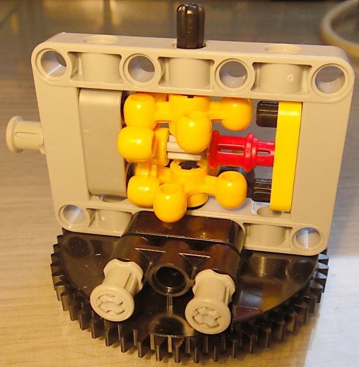

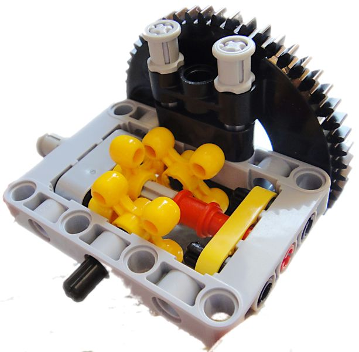

Je vois déjà votre œil averti se demander à quoi peut bien servir le long pin avec manchon rouge !

Ah-ah ! Tout simplement à limiter le glissement en effectuant un frottement avec le liftarm L3 demi-épaisseur.  
En fonction du volume/masse du montage total, on pourra même envisager de mettre 2 liftarm L3 demi-épaisseur voire un L3 classique pour faire plus de frottement.

Petite amélioration possible : utiliser un L4 avec stop pour le satellite central, ce qui évitera de faire sortir l’axe du cadre et économisera un manchon

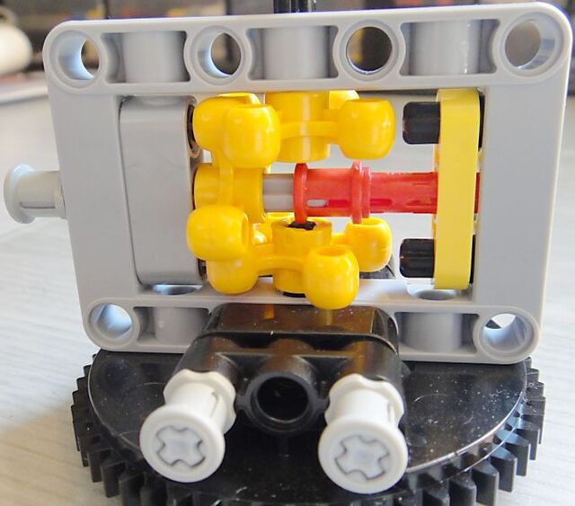

## Soustracteur

Dernier montage : un soustracteur.

Il existe plusieurs implémentations de ce système.  
Ce système permet d’avoir 1 moteur pour la propulsion et 1 pour la direction.  
Le problème est toujours le même, les 12t en satellites de ces différentiels LEGO qui finissent par casser. Si seulement LEGO pouvait les faire avec un plastique beaucoup plus dur, voire même en métal…

En gros, une des entrée permet de faire tourner les 2 sorties à la même vitesse, et l’autre entrée permet d’ajouter de la rotation à l’une des sorties et d’en soustraire en même temps à l’autre (et inversement si on fait tourner cette entrée dans l’autre sens), ce qui fait tourner un véhicule par exemple.

C’est très utile pour faire tourner des chenilles sans avoir à en bloquer une, et avoir une commande simple avec avance/recule sur un moteur, et droite/gauche sur l’autre.

[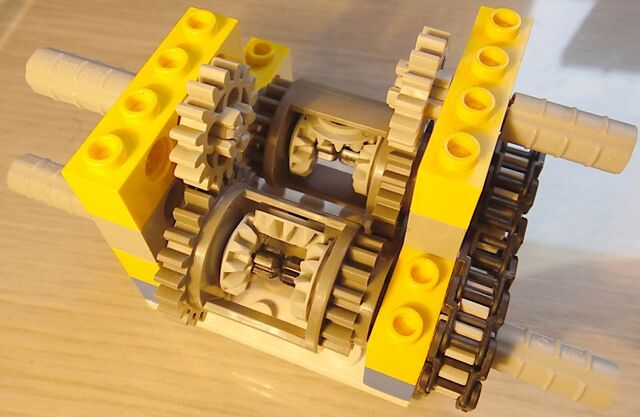](https://www.freelug.org/IMG/jpg/resized_-_DSC01715.jpg)

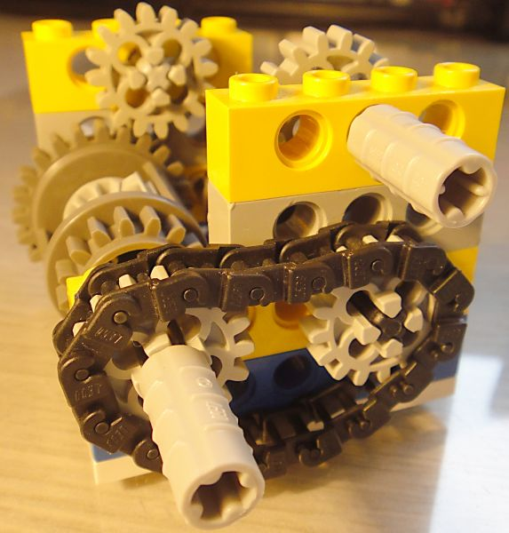

[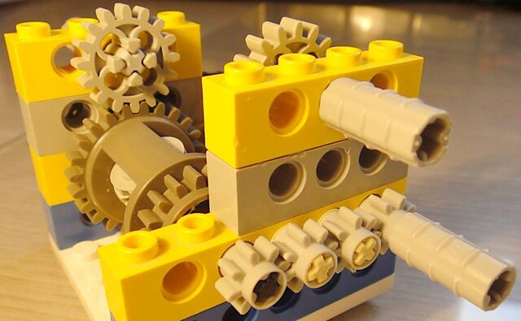](https://www.freelug.org/IMG/jpg/resized_-_DSC01717.jpg)

Merci pour votre attention !

Pour poursuivre dans la technique (ou Technic, c’est selon), quelques articles complémentaires :  
**–** [les différentiels](/articles/etude-de-piece-9-les-differentiels-lego/)  
**–** [les boites de vitesses](/articles/etude-de-piece-8-boites-de-vitesse/)  
**–** [les "articulations"](/articles/les-techniques-d-articulation-partie-2/)
