Je compare quelques sets des années 1980 et même antérieurs, avec des sets plus récents afin de souligner une sorte de récurrence dans le cycle de production LEGO®.

**Avertissements :** les propos tenus dans cet article n’engagent que moi.

## Introduction :

Cela fait maintenant 3 ou 4 ans que je suis sorti de ma “période rebelle” (_dark age_) qui a duré environ 10 ans. Durant cette période, j’ai malheureusement raté la sortie de quelques sets remarquables des années 1990 mais d’un autre côté je n’ai rien raté avec entre autres le thème [Jack Stone™](http://guide.lugnet.com/set/?qc=lego/jackstone) et surtout [Bionicle™](http://guide.lugnet.com/set/?qc=lego/technic/bionicle) (sans parler de la sortie, plus tard encore, du thème [Galidor™](http://guide.lugnet.com/set/?qc=lego/galidor)). L’élément clé qui m’a fait sortir de ma “période rebelle” et qui m’a fait devenir un adulte fan de LEGO® (_AFOL_), c’est la sortie du thème [Mindtsorms™](http://guide.lugnet.com/set/?qc=lego/mindstorms), même si (pour plusieurs raisons) j’ai pris le train en retard (version 2.0).

Alors que je termine tout juste de reconstruire de vieux sets de mon enfance et que les vieux souvenirs ressurgissent vaguement, je découvre avec plaisir et au fur et à mesure de leur sortie les nouveaux sets de l’année 2005. Je suis ainsi frappé par la similitude de certains nouveaux sets avec d’anciens sets de la période de mon enfance (que je qualifie bien sûr d’ “âge d’or” des LEGO®).

Ci-dessous, je compare quelques sets des années 1980 (que je possède pour la plupart) et même antérieurs, avec des sets plus récents (que je possède également ou que je compte acheter) afin de souligner, même s’il est impossible d’être exhaustif, une sorte de récurrence dans le cycle de production LEGO®.

Alors qu’il est discutable que la compagnie LEGO® a elle aussi subie une “période rebelle”, il semblerait que LEGO® effectue récemment une sorte de retour aux sources, ce dont, je pense il faut se féliciter. Les plus critiques parmi nous peuvent arguer que LEGO® n’est plus créatif, et qu’ils réinventent la roue, mais je pense que pour un enfant (ou même un fan adulte de LEGO®), une voiture de police ou des engins de construction par exemple sont indémodables.

Une dernière remarque avant de commencer les comparaisons : la tendance chez LEGO® à ce que l’on peut appeler la modernisation d’anciens sets, est “plus gros est mieux” (_bigger is better_). Cette tendance (à laquelle je n’adhère d’ailleurs presque jamais) est-elle due à l’optimisation des moyens de production chez LEGO®, à la réduction des coûts de production ou à une augmentation du pouvoir d’achat des clients, ou à un ensemble de toutes ces raisons ? Quoiqu’il en soit, les sets modernes contiennent bien plus de pièces que leurs ancêtres.

## Thème Ville :

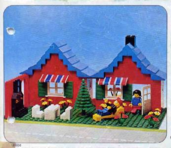

Ref # : [376](http://guide.lugnet.com/set/376_2)  
Année : 1978

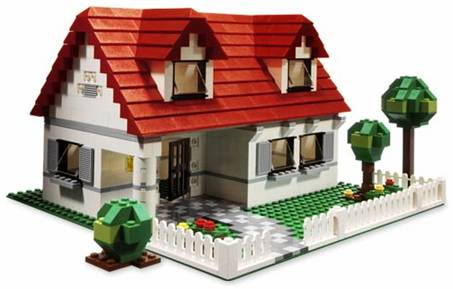

Ref # : [4886](http://guide.lugnet.com/set/4886)  
Année : 2004

Le set [376](http://guide.lugnet.com/set/376_2) est un classique du thème Ville. Peut-être autant un set pour les filles que pour les garçons ? Il contient deux minifigs. Le set [4886](http://guide.lugnet.com/set/4886) fait quant à lui partie du thème [Designer™](http://guide.lugnet.com/set/?qc=lego/system/designer) et, de ce fait ne contient pas de minifig. On ne peut cependant que constater un air de famille entre ces deux sets. Cette comparaison est aussi un bon exemple du syndrome “_bigger is better_”, sans dire pour autant que le set [4886](http://guide.lugnet.com/set/4886) est mieux que le [376](http://guide.lugnet.com/set/376_2) : le ratio du nombre de pièces est de presque 3 pour 1 !

* * *

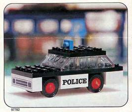

Ref # : [420](http://guide.lugnet.com/set/420_1)  
Année : 1973

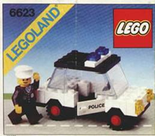

Ref # : [6623](http://guide.lugnet.com/set/6623)  
Année : 1983

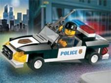

Ref # : [7030](http://guide.lugnet.com/set/7030)  
Année : 2003

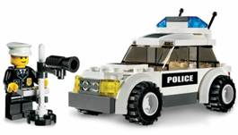

Ref # : [7236](http://guide.lugnet.com/set/7236)  
Année : 2005

L’indémodable \[et incontournable \] voiture de police ici à travers les années. Que dire de plus ?

* * *

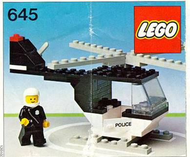

Ref # : [645](http://guide.lugnet.com/set/645_1)  
Année : 1979

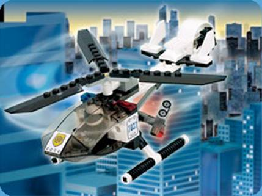

Ref # : [7031](http://guide.lugnet.com/set/7031)  
Année : 2003

Après la voiture de police, l’hélicoptère. Alors que le set [645](http://guide.lugnet.com/set/645_1) était peut-être trop “haut” et mal proportionné, le cockpit du set [7031](http://guide.lugnet.com/set/7031) est trop aplati ce qui lui donne un look étrange. L’ajout dans ce dernier, d’un treuil et d’une caméra directionnelle augmente la jouabilité.

* * *

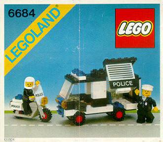

Ref # : [6684](http://guide.lugnet.com/set/6684)  
Année : 1984

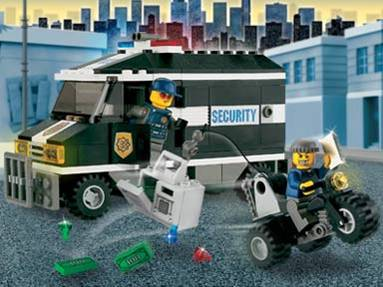

Ref # : [7033](http://guide.lugnet.com/set/7033)  
Année : 2003

Deux vans et deux motos. Dans l’un, les minifigs sont deux policiers ; les minifigs de l’autre sont un agent de sécurité et un voleur pour encore plus de jouabilité. Ici encore le syndrome “_bigger is better_” (_is it ?_) : quatre tenons contre six tenons de large.

* * *

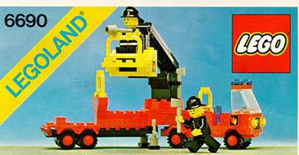

Ref # : [6690](http://guide.lugnet.com/set/6690)  
Année : 1980

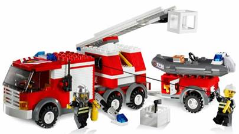

Ref # : [7239](http://guide.lugnet.com/set/7239)  
Année : 2005

Quatre tenons de large pour le set [6690](http://guide.lugnet.com/set/6690), six tenons de large pour le set [7239](http://guide.lugnet.com/set/7239). 25 années les séparent l’un de l’autre. La tourelle du set [6690](http://guide.lugnet.com/set/6690) était capable de pivoter, elle, à 360°. ;o)

* * *

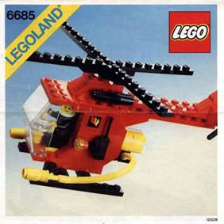

Ref # : [6685](http://guide.lugnet.com/set/6685)  
Année : 1982

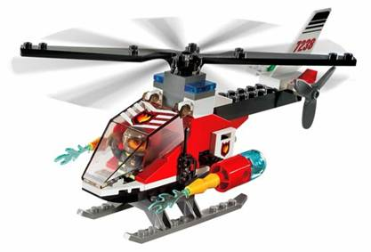

Ref # : [7238](http://guide.lugnet.com/set/7238)  
Année : 2005

Le set [7238](http://guide.lugnet.com/set/7238) n’est qu’une version moderne et restylisée du set [6685](http://guide.lugnet.com/set/6685). Il contient ainsi plus de metapièces qui rajoutent au réalisme.

* * *

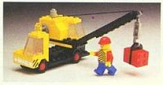

Réf # : [558](http://guide.lugnet.com/set/558)  
Année : 1979

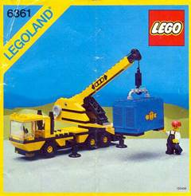

Réf # : [6361](http://guide.lugnet.com/set/6361)  
Année : 1986

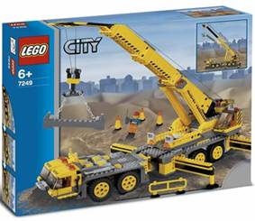

Réf # : [7249](http://guide.lugnet.com/set/7249)  
Année : 2005

L’évolution de la grue d’après LEGO® : je trouve ces sets, chacun dans leur contexte, très réussis. Essayons d’imaginer la taille de la prochaine grue qui sortira (peut-être) dans 10 ans !

* * *

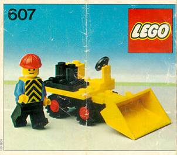

Réf # : [607](http://guide.lugnet.com/set/607_1)  
Année : 1979

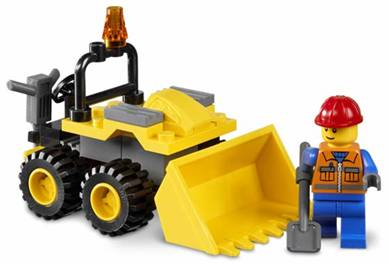

Réf # : [7246](http://guide.lugnet.com/set/7246)  
Année : 2005

Le set [607](http://guide.lugnet.com/set/607_1) était un modèle de simplicité et de sobriété ; Le set [7246](http://guide.lugnet.com/set/7246) n’est qu’une version modernisée du set [607](http://guide.lugnet.com/set/607_1). Plus gros aussi.

* * *

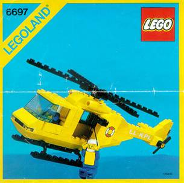

Réf # : [6697](http://guide.lugnet.com/set/6697)  
Année : 1985

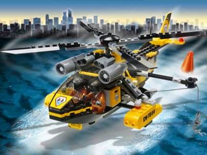

Réf # : [7044](http://guide.lugnet.com/set/7044)  
Année : 2004

Le set [6697](http://guide.lugnet.com/set/6697) est un grand classique ! Combien d’heures j’ai passé à jouer avec le treuil et combien de minifigs j’ai sauvées du naufrage ! Je trouve également le set [7044](http://guide.lugnet.com/set/7044) superbe, non pas pour son esthétique pour le moins discutable, mais pour ses nombreuses fonctionnalités par rapport au set [6697](http://guide.lugnet.com/set/6697) : projecteur, civière et délestage de balises entre autres.

Si l’on met ces deux sets côte à côte, le set [7044](http://guide.lugnet.com/set/7044) parait énorme et il donne un sacré coup de vieux au set [6697](http://guide.lugnet.com/set/6697) !

## Thème Designer™ :

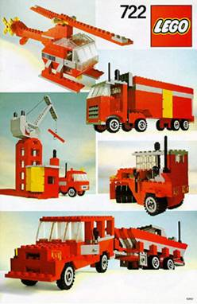

Réf # : [722](http://guide.lugnet.com/set/722_1)  
Année : 1980

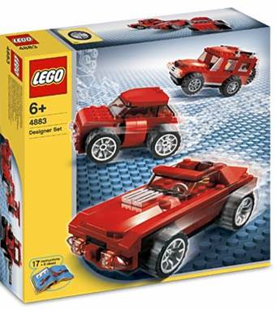

Réf # : [4883](http://guide.lugnet.com/set/4883)  
Année : 2005

Le set [722](http://guide.lugnet.com/set/722_1) faisait partie du thème “[Set de construction universelle](http://guide.lugnet.com/set/?qc=lego/basic/universalbuildingset)”. Le set [4883](http://guide.lugnet.com/set/4883) fait lui partie du thème [Designer™](http://guide.lugnet.com/set/?qc=lego/system/designer). Les deux sets sont une grande source pour des pièces de couleur rouge.

## Thème Moyen âge :

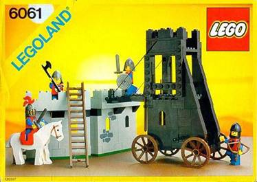

Réf # : [6061](http://guide.lugnet.com/set/6061)  
Année : 1984

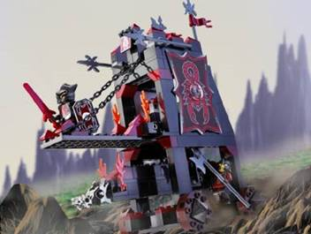

Réf # : [8800](http://guide.lugnet.com/set/8800)  
Année : 2004

La tour d’assaut [6061](http://guide.lugnet.com/set/6061) était un de mes sets favoris dans le thème Moyen Age. Le set [8800](http://guide.lugnet.com/set/8800) est similaire en forme même s’il ne contient pas de murailles (vendues séparément avec le set [8799](http://guide.lugnet.com/set/8799)). Cette nouvelle tour d’assaut est bien plus grosse mais je lui trouve plusieurs défauts : le pont-levis ne peut être levé ou descendu à l’aide d’un treuil contrairement au set [6061](http://guide.lugnet.com/set/6061). L’esthétique prime ici sur le fonctionnel.

Le système de soutien du bélier est situé juste derrière le pont-levis ; une fois le pont-levis relevé, où donc les soldats sont supposés se tenir en attendant l’assaut ? Enfin, les deux boucliers latéraux ne sont ici que pour cacher la machinerie du bélier et elles sont faites de carton, matériau, hélas, de plus en plus utilisé dans les sets LEGO®. Je trouve par contre le bélier et surtout son système de balancier assez bien réussi. Ce set est en fait un mixage (plus ou moins heureux) des sets [6061](http://guide.lugnet.com/set/6061) et [6062](http://guide.lugnet.com/set/6062).

* * *

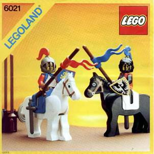

Réf # : [6021](http://guide.lugnet.com/set/6021)  
Année : 1984

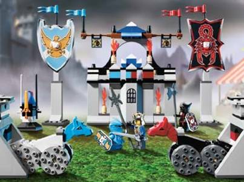

Réf # : [8779](http://guide.lugnet.com/set/8779)  
Année : 2004

Ces deux sets sont-ils comparables ? Les deux mettent pourtant en scène une joute médiévale. Le set [8779](http://guide.lugnet.com/set/8779) offre bien sûr plus de jouabilité (pour les enfants) avec les “lanceurs” de chevaux. On remarque ici aussi l’usage disproportionné de [metapièces](http://www.freelug.org/article.php3?id_article=271&recalcul=oui) et aussi de carton. Le thème [Knights’ Kingdom II™](http://guide.lugnet.com/set/?qc=lego/system/castle/knightskingdomii) est en quelque sorte un curieux mélange des thèmes [Espace classique](http://guide.lugnet.com/set/?qc=lego/system/space) et [Moyen Age classique](http://guide.lugnet.com/set/?qc=lego/system/castle) (avec [dernierement](http://www.freelug.org/article.php3?id_article=248) un soupçon de [Bionicle™](http://guide.lugnet.com/set/?qc=lego/technic/bionicle)).

## Thème Espace Classique :

[Space Classic™](http://guide.lugnet.com/set/?qc=lego/system/space)  
Année : 1978

[Starwars™](http://guide.lugnet.com/set/?qc=lego/system/starwars)  
Année : 1999

Je risque de faire bondir certains en disant cela, mais on peut dire que le thème [Star Wars™](http://guide.lugnet.com/set/?qc=lego/system/starwars) est la version moderne du thème [Espace Classique™](http://guide.lugnet.com/set/?qc=lego/system/space).

* * *

## Conclusion :

-   Je pense avoir souligné avec cet article une certaine récurrence dans le cycle de production LEGO®.

-   Il serait impossible \[et ennuyeux\] de comparer l’intégralité des sets de périodes différentes. Cependant, d’autres comparaisons sont disponibles [ici](http://www.brickshelf.com/cgi-bin/gallery.cgi?f=76975).

-   Les sets d’aujourd’hui contiennent bien plus de pièces que leurs ancêtres et privilégient pour la plupart l’esthétisme au détriment de fonctions plus élémentaires (tourelle ne pivotant pas à 360°, pont-levis non relevable à l’aide d’un treuil etc.)

-   Il semblerait tout de même que l’année 2005  
    annonce un retour aux sources chez LEGO® dans sa politique de production, ce qui est, je pense, une excellente chose. Cette tendance était déjà amorcée en 2004.

-   J’espère que LEGO® continuera sur sa lancée pour  
    les années qui viennent. (et j’espère ne pas être le seul à penser cela ;o)

## Remarques :

-   Même si ces exemples \[qui sont peut-être parfois un peu tirés par les cheveux\] sont très loin d’être exhaustifs, j’ai tout de même laissé de côté les sempiternelles casernes de pompiers, postes de police, gares, trains etc...

-   Merci à [Didier](mailto:didier.enjary_AT_wanadoo.fr) "[SixStuds](http://www.6studs.com/)" [Enjary](mailto:didier.enjary_AT_wanadoo.fr) pour ses conseils en général et pour son aide sur l’utilisation de SPIP® en particulier.

-   Les images qui illustrent cet article sont la propriété de la société LEGO® ([Site officiel LEGO®](https://www.lego.com/))

-   Certains des produits cités ne sont pas encore disponibles (Sortie Année : 2005), d’autres ne sont plus disponibles.
