Unique en Bourgogne, Festiludis est une manifestation à destination du grand public (5000 visiteurs) qui a pour vocation de mettre en avant l’univers du jeu et du jouet dans ses multiples aspects. Le travail mené tout au long de l’année par l’équipe du Centre Socio-Culturel de Saint-Marcel, en partenariat avec la ville et les partenaires locaux, positionne le festival en véritable expert dans le domaine du jeu.

## Un festival de briques LEGO !

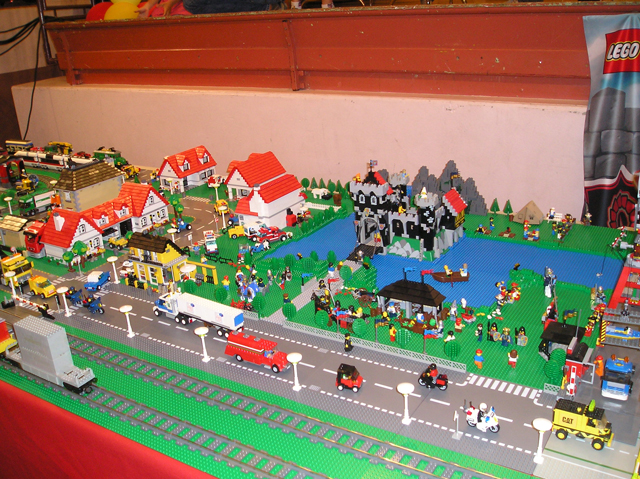

**l’ensemble**

C’est avec plaisir que je me suis lancé dans la participation à cette exposition.

Le thème de cette exposition était axé sur le médiéval, c’est pourquoi j’ai décidé de remonter mon château d’enfance le 6086. Ce fut donc un bonheur d’aller trifouiller dans mes tiroirs pour retrouver toutes les pièces pour remonter ce château. J’ai juste modifié le mécanisme du pont levis et de la herse. Cette dernière, je l’ai bloquée en position haute, puis pour le pont levis, j’ai juste ajouté deux chaines à chaque extrémités.

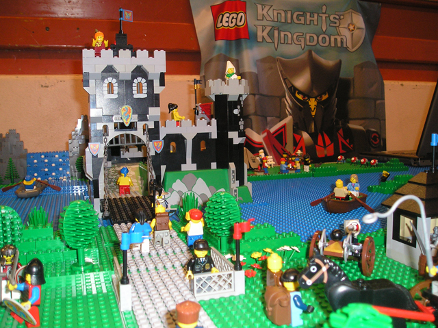

**le château 6086**

C’est tout naturellement que j’ai choisi de mettre le château au milieu de l’eau. Pour l’eau, il fallait bien un point de départ, j’ai donc réalisé ma première cascade en LEGO, elle est certes petite, mais je la trouve tout de même réussie...

Tout autour du château, j’ai mis plein de petites attractions. Rien n’avait été monté et essayé avant pour toutes ces attractions, j’avais tout en tête, le montage s’est effectué à l’improvisation.

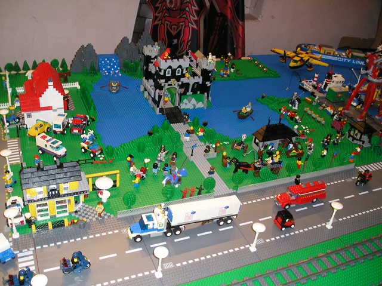

**animation autour du château**

Enfin pour tout le coin des maisons, j’avais déjà tout monté chez moi, donc il n’y avait plus qu’à mettre en place les minifigs.  
A noter que les maisons Creator 4886 et 4956 sont en double chacune. Une en version d’origine, et une autre en version inversée. Ce qui peut créer des maisons jumelées.

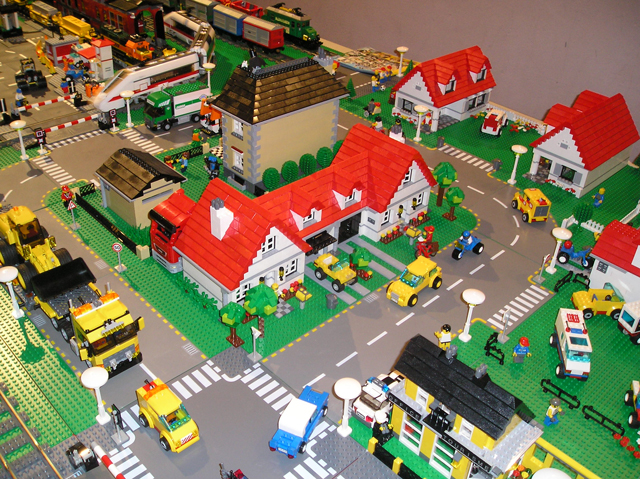

**les maisons**

Voilà pour ma participation.

Tout ceci parmi la caserne de Pierre, le port et l’aéroport de David et Jean-Gérald fait que l’on a pu présenter un grand layout.  
Il y avait aussi une voie de train 9V qui faisait le tour du layout.  
Une voie avec jusqu’à quatre ou cinq train en même temps ( 2 ou 3 9V plus 2 RC )... Ce qui a créé quelques embouteillages de temps en temps...

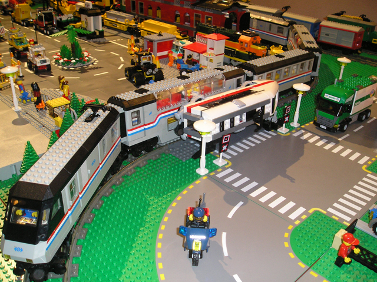

**il y a du monde !**

Enfin une maximinifig nous a tenu compagnie pendant tout le week-end. Elle a été bien sage, elle s’est même permise de remettre un peu d’ordre sur le bateau Maersk de JeanG...

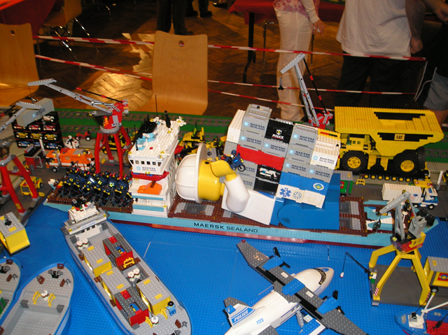

**une maximinifig qui s’amuse bien !**

Il y avait encore un public nombreux émerveillé par ce diorama. Des questions, des félicitations, tout ce qui nous incite à continuer.

Enfin bon que du bonheur !

Pierre L / Pierrolego

* * *

**Les débuts**

Nouvelle exposition et nouvelle coordination. Une exposition nait toujours par une nouvelle rencontre. Cette rencontre fut celle du directeur du King Jouet de Chalon-sur-Saone (je le remercie au passage pour le prêt de la statue LEGO, la maxifig et la PLV Ferrari). Sensible à mes propos de passionné de LEGO, il me donna le numéro de téléphone de Josie Soulier, organisatrice de Festiludis. Dès le premier rendez-vous avec elle, le feeling était là et je fais la connaissance par la même occasion de Laurent Garcia le président de l’association jeux et stratégies. Je ne pouvais pas rêver mieux que de lancer FreeLUG dans une exposition reconnue au niveau national voire international.

**Un petit nouveau à FreeLUG**

David a vécu sa première vraie exposition en tant que qu’exposant. Petit clin d’oeil à lui :)

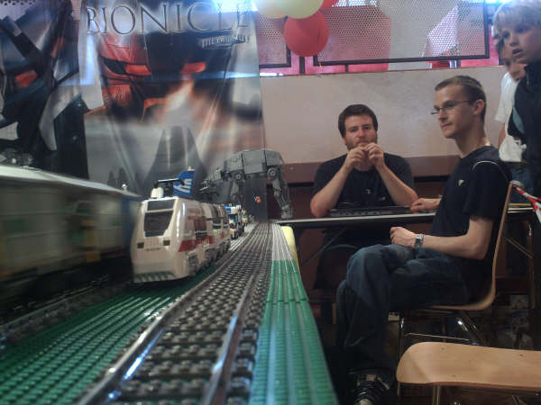

**PierreC et DavidC**

**Une organisation de folie.**

Je ne pouvais pas écrire ces quelques lignes sans dire toute mon admiration pour cette organisation. Beaucoup de bénévoles motivés et souriants nous ont accueillis.  
Tout cela ne s’improvise pas. Alors un grand merci pour tous ces efforts à l’équipe de Festiludis.  
Merci pour la logistique nourriture et logement gratuits, nous avons été chouchoutés et c’était un vrai plaisir. Merci à Josie et Philippe pour leur écoute, leur disponibilité et leur effort. Je ne peux que vous féliciter pour cette réussite totale. Et vous pouvez compter sur nous pour dans deux ans.

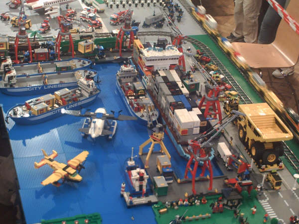

**Port JG/DavidC**

**L’aventure du jeu.**

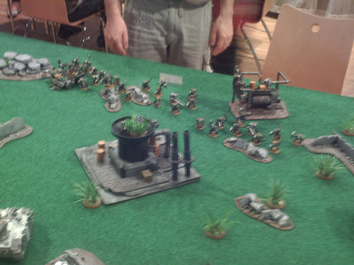

Notre exposition a été sous surveillance d’un observateur.  
A un moment donné on s’est senti observé. Une sorte de psychologue des joueurs nous a par la suite fait part de son analyse. Nous sommes des constructeurs avant tout et dès la construction finie l’enthousiasme retombe peu à peu. Nous jouons vraiment que lorsque l’on fait les idiots avec nos trains. Cet amusement refait vivre tout le layout et le public adore. L’analyse est simple : notre côté adulte nous a fait perdre cette envie de jouer avec nos LEGO pour faire semblant. L’esthétisme est mis en valeur.  
Son analyse était tout à fait juste, le moment où nous étions moins dans l’euphorie, nous avons pour un temps et pas tous en même temps quitté notre stand pour observer voire jouer à d’autres jeux.

Et là choc complet, les autres exposants nous ont redonné le goût d’être des joueurs... PierreC et moi avons passé 3h pour une partie de Warhammer expliquée par notamment Denis membre de "jeux et stratégies". Nous voilà alors avec cette idée de faire une sorte de Warhammer en LEGO... projet qui s’ajoute à de nombreux autres :).

**L’ambiance du week-end :**

La bonne humeur et la rigolade étaient bien présentes tout le week-end... mes chers compères ont corrompu la minifig pour prendre mon bateau Maersk pour un transat... heureusement que j’ai beaucoup d’humour :) du coup, tout le dimanche la minifig sur mon bateau...  
Ce week-end était pour moi aussi de pouvoir laisser exprimer toute la passion de DavidC nouveau FreeLUGien en Bourgogne (rencontré sur le Toys’R’Us de Dijon fin septembre 2007). C’est donc en priorité que je me suis lancé dans cette aventure pour lui enlever la frustration de St-Rambert où je l’ai inscrit tardivement et donc il n’a pas pu s’exprimer sur la table. C’est donc chose faite avec nos 2 modules il a su démontrer qu’il était un collectionneur de LEGO très passionné... 17 ports... folie du seters... surement puisqu’il en a 22 aujourd’hui... bravo à lui de me relancer dans l’aspect collection et je suis très content de son soutien au niveau local dans mes démarches.

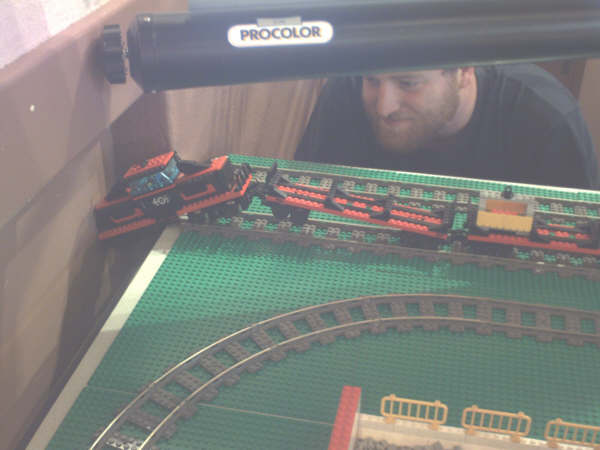

**le regard à la Homère Simpson : "holala mon train il est pété !!!"**

Sinon une animation de ma tour Eiffel a été prévue durant tout le week-end.

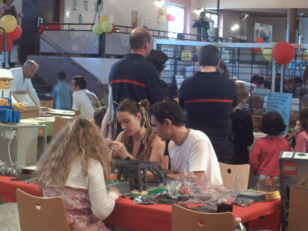

**animation de la construction de ma tour Eiffel**

animation de la construction de ma tour Eiffel

Voilà une de plus, qui pousse une fois de plus à se dire : "à quand la prochaine ?"

JeanG

* * *

Voila déjà ma quatrième exposition ! Et toujours autant de plaisir à partager un bon moment avec d’autres FreeLUGiens.

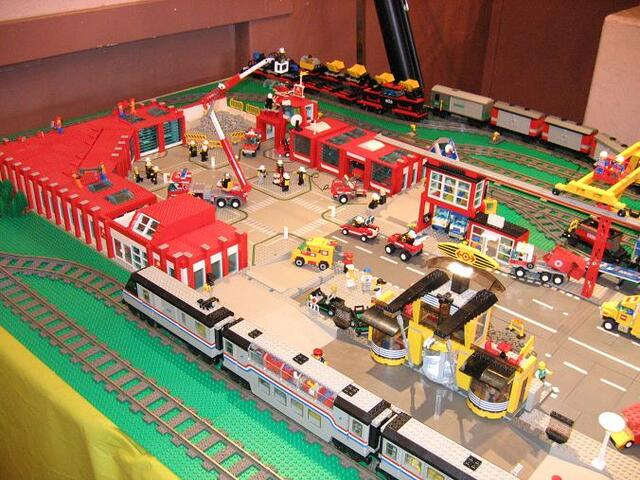

**Ma caserne**

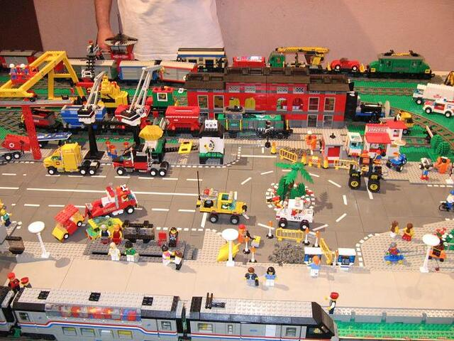

**Le centre ferovière**

Cette exposition ne se trouvait qu’à deux semaines d’intervalle de l’[exposition de Capdenac (Festirail en Rouergue)](/articles/festirail-en-rouergue-le-festival-du-rail-a-capdenac-gare-17-et-18-mai-2008/), il était donc plus simple pour moi de préparer un module pour les deux expositions ce qui m’a permis de ne pas me disperser.  
Encore une fois je pris un plaisir fou à installer mon module ainsi qu’à l’animer avec mes minifigs (je débordais même parfois un peu chez mon voisin...)

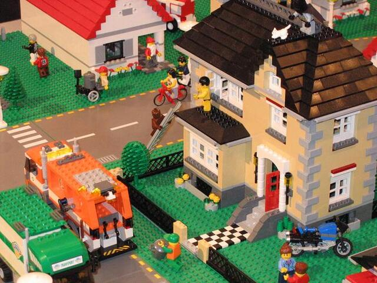

**Tien, des hommes en sous vetements !**

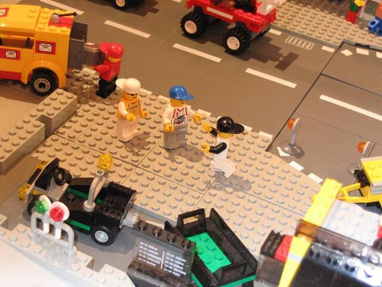

**Yo bro’ ! What’s up man ?**

Aussi le réseau de train 9V m’a permis de tester mes qualités de chef de gare... Je dois avouer que je ne suis pas encore au point ! Ce qui m’a d’ailleurs valu quelques remontrances amicales de mes camarades !

Cette exposition fut aussi très riche en découverte. Comme JeanG l’a dit nous avons pu découvrir (ou pour moi redécouvrir) le Warhammer. Cela nous a aussi donné l’occasion de rencontrer de nombreux créateurs de jeux qui partageaient la salle avec nous.

Je tiens à remercier mes camarades ainsi que les organisateurs de l’exposition qui m’ont permis de passer deux jours formidables.  
Pour finir je souhaiterais saluer également Justin, jeune membre de FreeLUG, qui est encore une fois venus nous voir en exposition.

PierreC - Tribolego

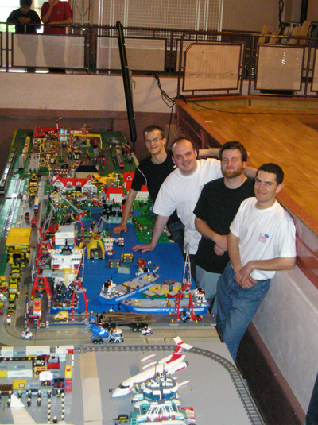

**la joyeuse équipe**

## Galeries de photos

[Galerie de Pierre Laurenge](http://photos.freelug.org/main.php/v/pierrel/exposition/festiludis/)

[Galerie de Pierre Charles](http://photos.freelug.org/main.php/v/Pierre_13/St+Marcel+2008/)

[Galerie de Jean-Gérald Villari](http://www.brickshelf.com/cgi-bin/gallery.cgi?f=330168)
