Le maire de Chamblanc, Monsieur Michel Bourdot, suite à l’article du journal _Le bien public_ de Côte d’Or dans lequel je parle de ma passion du LEGO a été très intéressé par ce que je faisais. Il m’a invité à participer à la septième exposition artisanale de Chamblanc.

Les tables ainsi que les repas ont été fournis par la municipalité.

J’étais le seul FreeLUGien pour relever ce nouveau défi, mais aidé par un collectionneur des chevaliers du zodiaque : François Mondange, avec lequel une grande amitié est née à partir de mon exposition à Toys’R’us de Dijon.  
Du coup cette exposition est placée sous le signe des Chevaliers du ciel city et Manga.

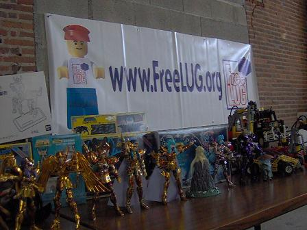

## L’aventure commence

Il est 6h à Beaune quand je pars de chez moi pour retrouver mon ami François devant chez lui. Je l’aide à descendre son énorme décor des chevaliers du zodiaque sans réveiller sa petite famille qui dort encore.

Et nous voilà parti pour Chamblanc à 35km par la route de Beaune. La route fut plutôt brumeuse et le comble c’est que nous nous sommes perdu dans le village... mais nous avons très vite trouvé l’endroit de la fête (il est 7h30).

L’accueil fut chaleureux et nous avons pu très vite nous installer. Seul petit soucis pour moi c’est que les organisateurs m’avaient donné moins en largeur et en longueur au niveau des tables... François a pu commencé son installation de ces 80 cm par 2 m. Le maire a trouvé une solution, on a donc rajouté des tables en largeur. Du coup au final je me retrouve avec un espace de 9m par 1.60m. Je devais donc improviser par rapport à mon layout de départ.

## La technique de montage pour moi le seter est simple

1.  Poser les plaques et les accrocher les unes aux autres
2.  Mettre les sachets de sets sur la table pour libérer les gros sets.
3.  Poser les gros sets et les attacher
4.  Sortir chaque set de leur sachet
5.  Poser les mocs
6.  Finir avec des petits détails : barrières, phares sur la pistes etc...  
    Il m’a fallu pas moins de 5h pour ne plus rien toucher du tout pour 83 modèles officiels exposés. (fin de montage vers 12h30)
7.  Après l’effort la pause déjeuner et la pause photo pour garder en mémoire notre première exposition ensemble.

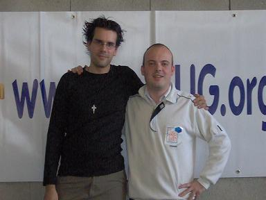

**François et moi**

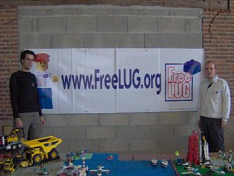

## Voici en 4 photos le détail de l’exposition

1) le traditionnel convoi + bord de cours d’eau

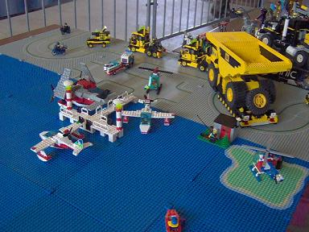

2) la base de lancement cap cosmos + canadair

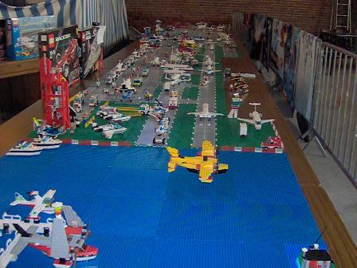

3) Aéroport N°1

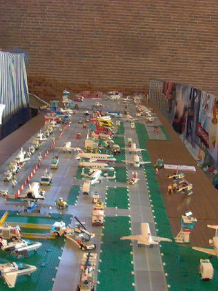

4) Aéroport N°2

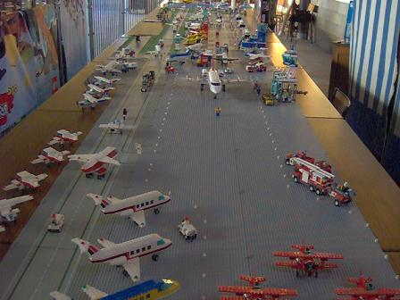

## la partie de François : les chevaliers du zodiaque.

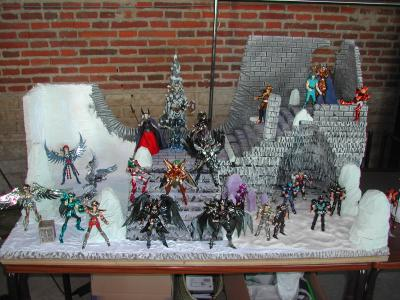

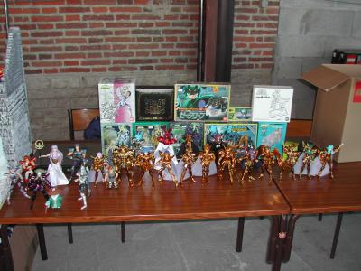

## L’après-midi

je me suis beaucoup battu avec le soleil qui commençait à s’installer sur les LEGO. J’ai dû protéger comme j’ai pu jusqu’à ce que le hangar soit bâché.

Ensuite j’ai commencé à monter le set 7894 devant le public, et j’ai pris mon temps et aussi mon pied car c’est un modèle incontournable pour tous seters de la ville. (d’ailleurs un article est en cours de réalisation afin de vous faire découvrir ce set).

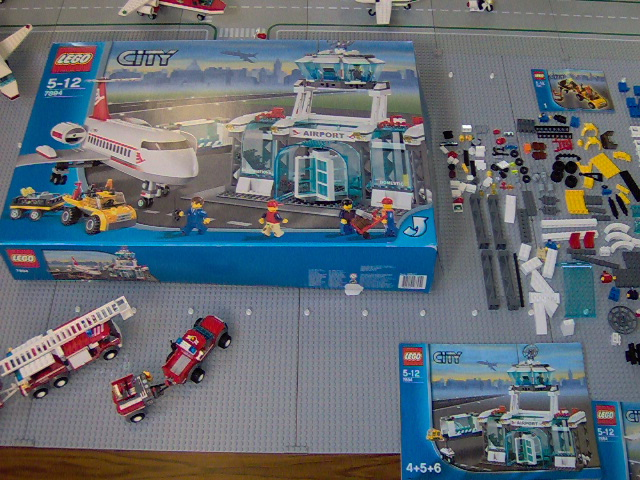

Il y a eu pas mal de monde tout au long de la journée, et surtout beaucoup d’enfants. Prise de contact avec l’association de modélisme de Bourbon-Lancy qui apparemment nous avait déjà contacté mais sans succès. Je lui ai donc assurer de faire mon maximum pour d’éventuelles participations avec leur association.

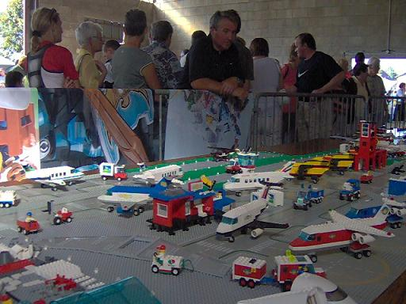

## Le soir

En 1h30 j’avais tout rangé avec François, il est 21h l’heure déjà de partir mais avant petite photo de groupe avec le maire (à ma gauche), quelques conseillers municipaux et François. Encore bravo aux hommes et aux femmes de l’ombre qui ont magnifiquement bien préparé cette journée. Retour maison vers 22h.

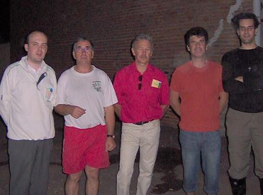

**Merci à mes amis François et Christine pour leur soutien et je leur dédie cette exposition.**

## Liens internet :

**–** Le blog de François : [http://dokko21.skyrock.com/](http://dokko21.skyrock.com/)  
**–** Brickshelf JeanG : [http://www.brickshelf.com/cgi-bin/g...](http://www.brickshelf.com/cgi-bin/gallery.cgi?f=276782)

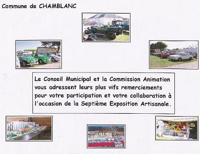

**Les remerciements de la mairie (5 octobre 2007)**

En bon **tradilugien** qui se respecte voici les 46 sets différents exposés à Chamblanc :

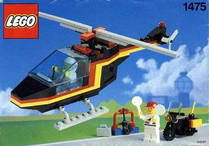

**set 1475 de 1991**

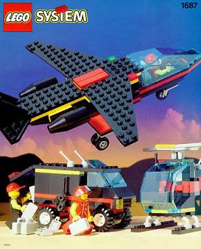

**set 1687 de 1993**

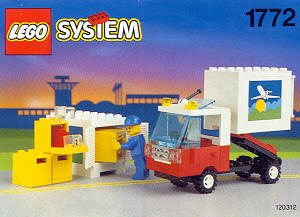

**set 1772 de 1992**

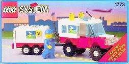

**set 1773 de 1996**

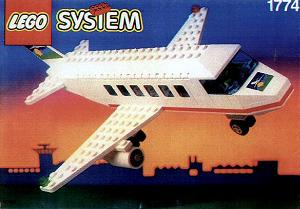

**set 1774 de 1992**

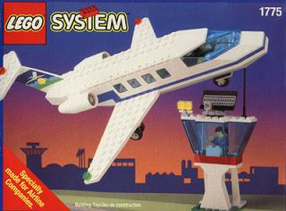

**set 1775 de 1994**

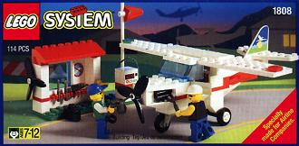

**set 1808 de 1996**

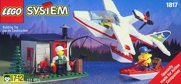

**set 1817 de 1996**

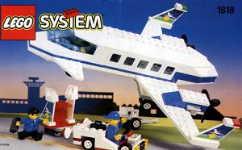

**set 1818 de 1996**

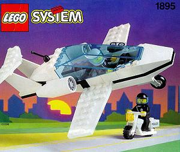

**set 1895 de 1992**

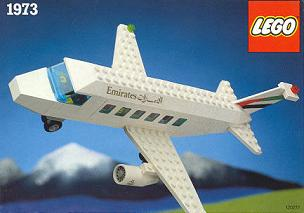

**set 1973 de 1990**

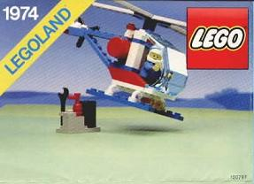

**set 1974 de 1989**

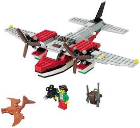

**set 5935 de 2000**

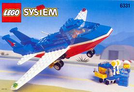

**set 6331 de 1996**

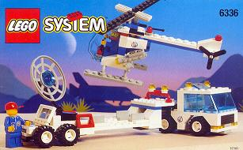

**set 6336 de 1995**

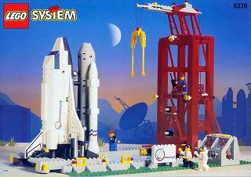

**set 6339 de 1995**

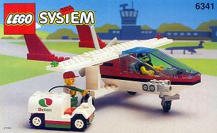

**set 6341 de 1994**

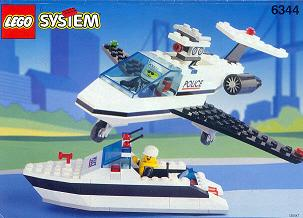

**set 6344 de 1993**

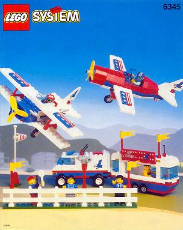

**set 6345 de 1993**

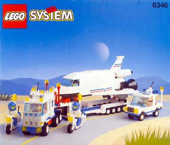

**set 6346 de 1992**

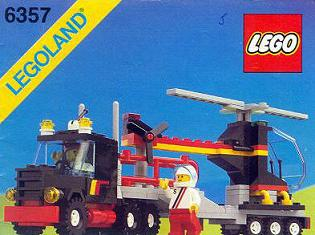

**set 6357 de 1988**

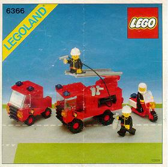

**set 6366 de 1984**

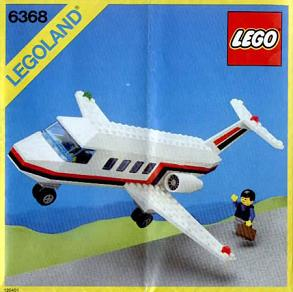

**set 6368 de 1985**

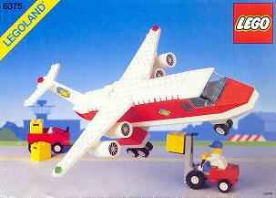

**set 6375 de 1990**

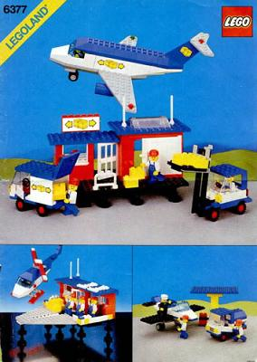

**set 6377 de 1985**

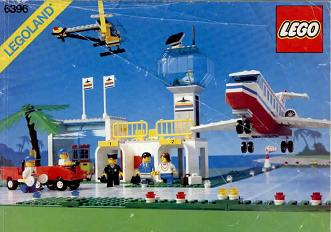

**set 6396 de 1990**

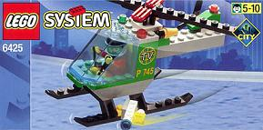

**set 6425 de 1999**

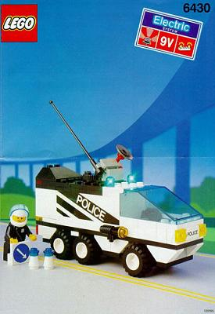

**set 6430 de 1991**

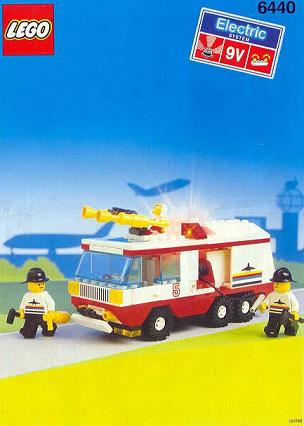

**set 6440 de 1991**

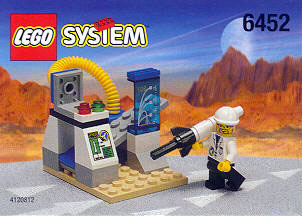

**set 6452 de 1999**

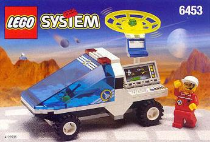

**set 6453 de 1999**

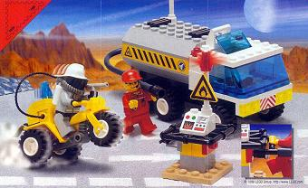

**set 6459 de 1999**

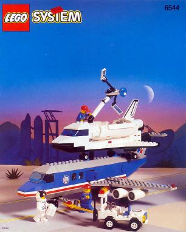

**set 6544 de 1995**

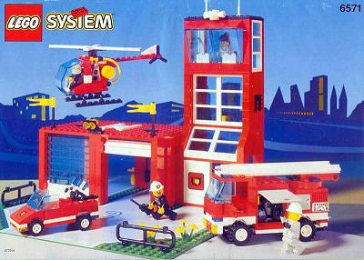

**set 6571 de 1994**

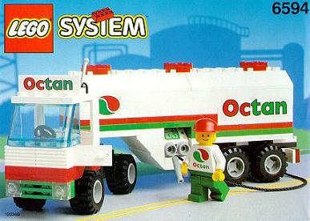

**set 6594 de 1992**

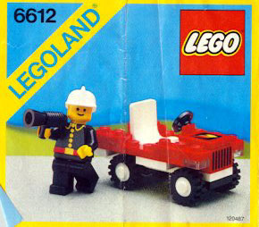

**set 6612 de 1986**

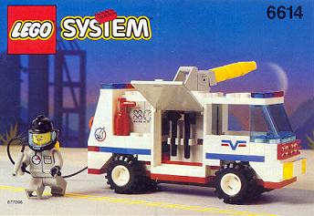

**set 6614 de 1995**

**set 6615 de 1996**

**set 6643 de 1988**

**set 6650 de 1981**

**set 6673 de 1990**

**set 6687 de 1987**

**set 6698 de 1986**

**set 7239 de 2005**

**set 7942 de 2007**

**set 7894 de 2006**

