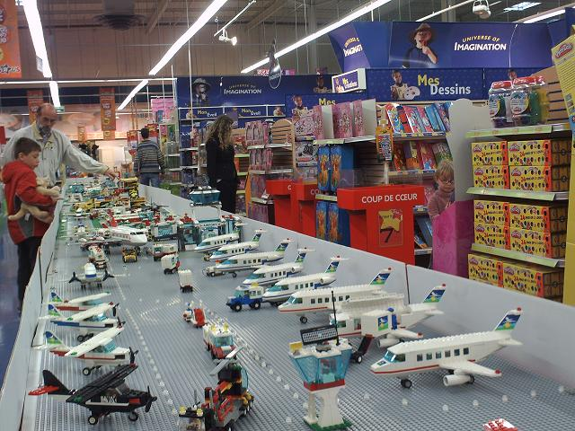
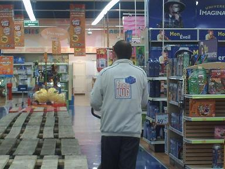
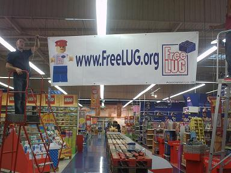
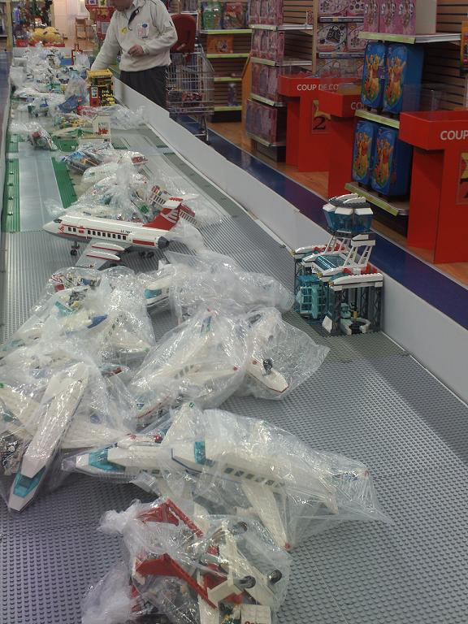
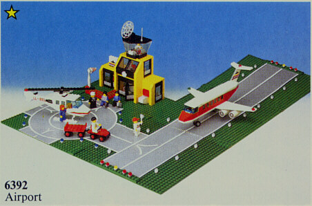
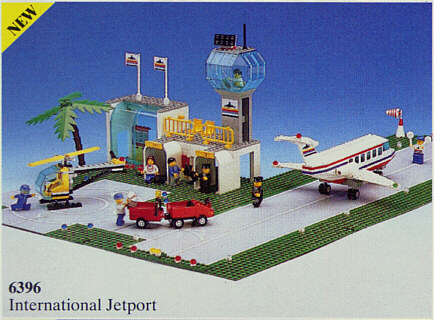
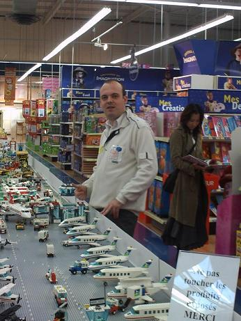

La fête des aéroports !!! Record à battre : 15m de pistes en longueur !!!

## En route pour une nouvelle aventure

Après le succès du 14 juillet 2007 au Toys’R’Us de Dijon, le directeur du magasin m’a sollicité pour participer au un an de rénovation du magasin de Dijon.

La date ayant été avancée d’un mois (au lieu du 29 octobre c’est passé au 29 septembre) je n’ai pas pu faire beaucoup de modification 15 jours après mon exposition de Chamblanc (le 16 septembre). Donc le thème est resté celui de l’aéroport et de cap cosmos. Cette fois-ci François n’était pas disponible pour venir m’aider, du coup c’est une amie (Oriana) qui est venue m’aider les 2 jours et elle découvrait le monde des legomen en vrai pour la première fois.

Je m’étais lancé un défi : faire ma plus longue exposition en solo : 15 mètres !

Le layout fut assez simple puisque je travaillais avec des dimensions limitées : 15.60m sur 0.80m.

Cependant le layout comme vous l’avez deviné était différents de celui de Chamblanc. Puisque pour cette exposition j’ai mis à l’honneur tous les aéroports que LEGO a sorti (sauf réédition) depuis 1985.

## J’adore quand un plan se déroule sans accroc

**La mauvaise surprise**

Le début ne s’est pas passé exactement comme c’était prévu. Il est 13h quand j’arrive avec ma cargaison de LEGO. Et la grosse surprise quand je rentre dans le magasin : le stand n’est pas en place. Et en effet rien d’aménagé au niveau du stand LEGO. Le chef de secteur Mickael est venu me voir quelques minutes après mon arrivée afin de me signaler que le camion qui devait livrer les palettes le matin était en retard et qu’il vient tout juste d’arriver en quai. Le stand ne sera pas mis en place avant cet après-midi 15h voire 16h. Un peu furieux à l’intérieur de moi-même pour m’être déplacé si tôt pour rien, très vite je décidais de m’activer et de les aider à monter mon stand.

**On se détend tout en rigolade**

Bien sûr il ne pouvait s’occuper de moi qu’épisodiquement quand le service le nécessitait, donc j’ai pris un trans-palette et je me suis mis au boulot. Soit mis 65 palettes Europe dans le sens de la longueur soit 13 palettes de long sur 5 de haut sur 1 de large. Ensuite 2 employés de chez Toys sont venu m’aider, l’un m’a aidé à en finir avec les palettes et un autre a commencé l’habillage des palettes. Mika le Mac Gyver de Toys Dijon avec une pointe d’humour est venu à son tour et a trouvé avec moi la meilleur façon pour mettre en évidence la banderole FreeLUG. Plus les minutes passent plus des liens étroits se créent entre eux et moi... le tutoiement se fait rapidement et les vannes et autres rigolades s’enchaînent. La bonne humeur règne alors et leur efficacité dans le montage est redoutable.

Video Player

[Vidéo de la publication d’origine](https://www.freelug.org/IMG/asf/Expo_dijon_2007_158.asf)

**mise en place de la banderole Freelug**

## Le montage

Il est 16h (vendredi) quand je pose mes premières plaques. Comme à Chamblanc j’ai d’abord posé les plaques puis mis sur la table l’ensemble des petits sets emballés en sachets pour pouvoir libérer les gros sets. A 19h le magasin ferme.  
Le lendemain matin 7h30 (Samedi) nous sommes revenus pour finir et à 10h tout était terminé et nous attendions plus que les gens arrivent. L’ouverture du magasin était à 9h et l’anniversaire du magasin commençait donc.

## le déroulement du samedi

Une petite peur au départ car le stand était grand et non protégé du public. Michael m’a donc fabriqué des panneaux signifiant de ne pas toucher les modèles exposés. Mais rien y fait quelques gamins font voler mes avions... mais je surveille dur. Il y a eu beaucoup beaucoup de monde pendant ces 2 jours, environ 3000 personnes si ce n’est plus. Les gens toujours impressionnés et souvent en famille. J’ai fait la connaissance d’un nouvel Afol en Bourgogne qui au départ pensait que j’étais un représentant LEGO... hihihi... il était un peu sur ses gardes vendredi mais il est revenu samedi et nous avons bien discuté. Il est même tombé amoureux de mon moc convoi exceptionnel. Il était tellement émerveillé qu’il me l’a acheté. Le public nombreux me demandait souvent conseil dans les boîtes LEGO... bref un vrai conseiller en jouet...

La journée passe assez vite et je ne manque pas de prendre des photos.  
Il est 18h15 et il est temps de ranger cet aéroport de 15 mètres. On a mis 1h30 pour tout bien ranger chaque set, chaque plaque et chaque élément supplémentaire.

Video Player

[Vidéo de la publication d’origine](https://www.freelug.org/IMG/asf/Expo_dijon_2007_159.asf)

**les 15 mètres**

## Tradilug

Je m’accroche dur à ce mouvement... pour cette exposition je vous invite à regarder, en bas de page du lien de Chamblanc, l’ensemble des sets exposés : [Récit de l’exposition de Chamblanc du 16 septembre 2007](/articles/recit-de-l-exposition-de-chamblanc-du-16-septembre-2007/).

voici les sets mis en valeur :

**–** set 6392 de 1985

**–** set 6396 de 1990

**–** [set 6597 de 1995](http://guide.lugnet.com/set/6597)

**–** [set 7894 de 2006](http://guide.lugnet.com/set/7894)

Soit au total plus de 100 sets d’exposés. Un article est en cours sur les aéroports de 1985 à 2006.

## Conclusion

J’étais aux anges, j’ai réussi à faire 15 mètres d’aéroport, j’ai réussi l’objectif du Tradilug en mettant plus de 100 sets sur le layout, la foule fut très nombreuse et a été séduite. Il y a même une famille de Besançon qui est venu spécialement me voir, et je les remercie pour cette visite : même en Bourgogne certains lisent le site FreeLUG :). Je n’attends plus que les retombés au niveau Toys’R’Us.

Leçon du jour : toujours rester cool même quand il y a des imprévus.

Je dédie cette exposition à Oriana car tout seul le montage et le démontage ainsi que la surveillance auraient été plus durs.

Spécial remerciement :  
**–** A Jac pour la banderole ;  
**–** A Fred d’Auxerre pour les plaques ;  
**–** A l’équipe de Toys’R’Us pour leur sympathie ;  
**–** A FreeLUG pour son soutien à développer la Bourgogne.

## Photos

[http://www.brickshelf.com/cgi-bin/g...](http://www.brickshelf.com/cgi-bin/gallery.cgi?f=282432)

