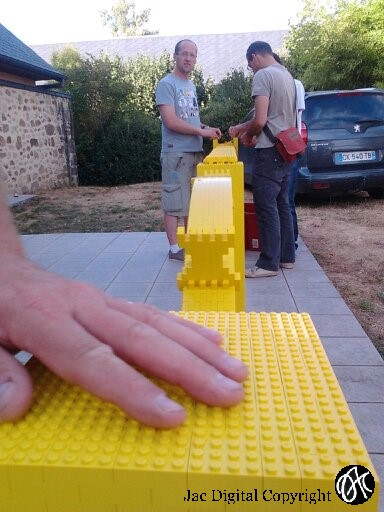
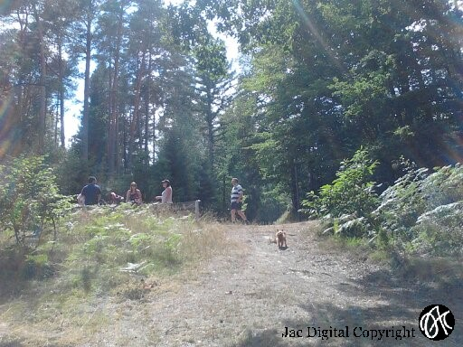
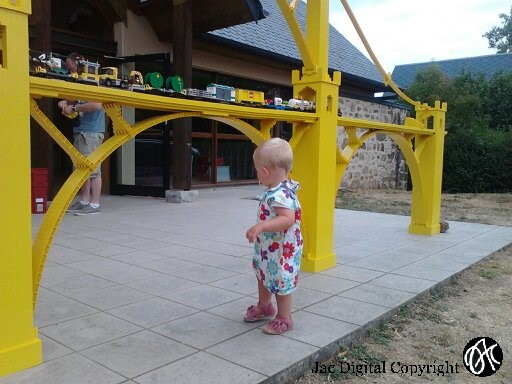

Pour cette année, la Rencontre Estivale FreeLUG avait rendez-vous au creux de la Corrèze. Voilà nos impressions sur cette excursion Legotique dans le centre de la France.

Pour cette nouvelle édition, Philippe nous propose de nous retrouver à Lamazière Basse, en Corrèze pour le weekend des 25 et 26 juillet 2015.

Pour notre part et celle aussi de Danielle et Alain, nous choisissons de réserver une chambre dans un gîte qui se trouve à l’entrée du petit village. Nous trouverons d’ailleurs très facilement le bâtiment qui fait partie d’un groupement de "bistrots" comme à l’ancien temps. L’accueil y a été excellent.

Nous retrouvons donc des FreeLUGiens à notre arrivée à la salle que Philippe avait réservé. Nous n’avons pas eu de mal à la trouver et l’espace était suffisamment grand pour nous recevoir. Un grand parc devant des locaux spacieux et nos caisses de briques jaunes.

Sur décision commune ou je ne sais pas, il fut entrepris la construction d’un pont au moins grand comme ça...et voilà le résultat, très amusant, solide ce qu’il faut pour le train et très technique, même avec des briques identiques.

Nous avons aussi profité d’une marche d’une bonne dizaine de kilomètres pour découvrir les lacs alentours.

Le dimanche matin, nous profitions d’un grand vide-grenier organisé par le village. Certains y ont fait de bons achats, mais les LEGO y étaient trop chers. En même temps, il n’y en avait pas à tous les coins de rues, juste à un stand.

Pour ma part, le seul regret c’est d’avoir oublié l’appareil photo. J’ai pris des clichés minuscules avec mon téléphone portable. Comme quoi, ça ne se remplace pas.

Tout le monde a passé un excellent weekend et on n’oubliera pas les enchères, le pont, les repas conviviaux, les sourires et le fromage du cru...

Merci à tous les organisateurs.

_Jac, Sève et Sélène._

* * *

Nous avons été très heureux de participer à cette REF 2015, le petit nombre de participants offrait une atmosphère presque familiale, en tout cas sympathique.

Philippe et Nadia, nous ont régalé de produits locaux, en particulier de superbes fromages, des pizzas et fougasses géniales du boulanger bio du village.

Merci au CA pour les diverses animations, dont une mémorable vente aux enchères descendantes.

Au concours "bois dans le futur" j’ai eu le plaisir de gagner un très beau set, ayant choisi une version pessimiste de la guerre du bois sur Endor, ma seule concurrente étant Marie qui avait réalisé une forêt  
colorée, paisible et féérique, celle des elfes qui a fait rêver toutes les petites filles présentes.

Nous avons apprécié la balade et la brocante qui avait lieu au village tout dimanche et à deux pas de la salle où nous étions.

Et bien sur bravo pour les concepteurs du pont en briques jaunes, où pour la première fois Alain (mon mari) a empilé des petites briques, suivant avec application les techniques des AFOLS chevronnés.

_mamy danny_

* * *

**Galerie photo :**  
**–** [JAC63](http://photos.freelug.org/main.php/v/JAC/REF/2014_001/)  
**–** [Seb toutouille](https://plus.google.com/photos/106570929441006535340/albums/6181065748223896849?authkey=CPbSuKCO-IyX1AE)  
**–** [Danielle](http://photos.freelug.org/main.php/v/dannylou/AG+et+REF/REF+2015/)
