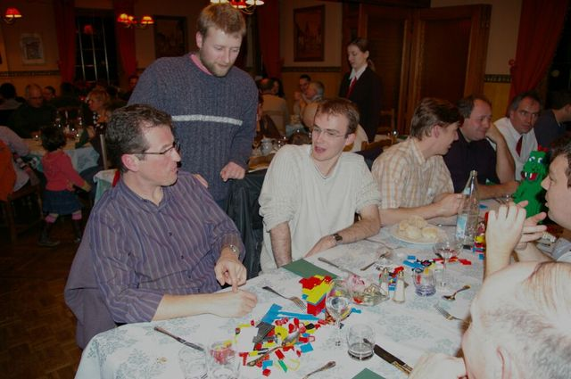
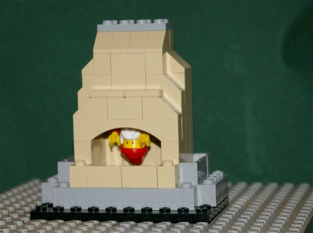
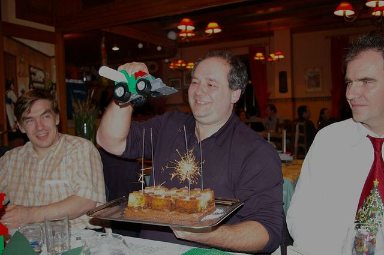
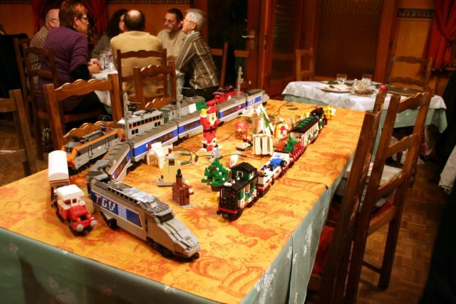
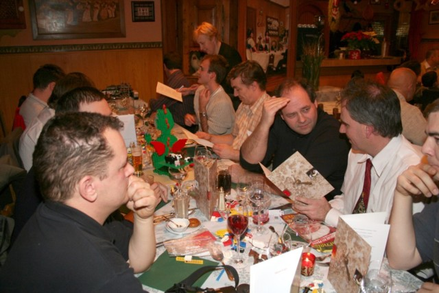
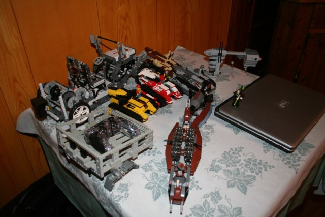
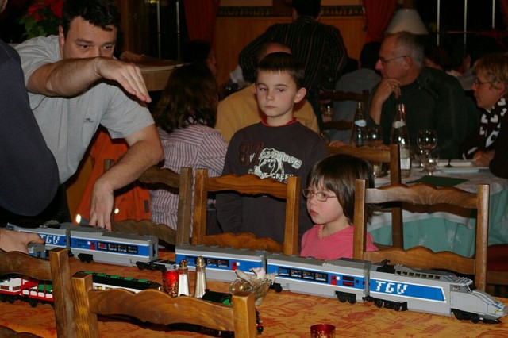

Trois départements réunis autour d’une même passion et d’une même table.

Ce fût dans l’Est, à Rosheim, ville de l’escargot et depuis peu du LEGO.

Nous avions choisi un restaurant de Rosheim pour cette soirée qui sentait les veilles de Noël. Déco de Noël et MOC de Noël égayaient notre table.

Quatorze, le quatorze... décembre. Quatorze et pas une femme. Bizarre...

Ma femme nous avait fait une petite surprise en disposant sur la table de vieilles briques et le magnifique dragon vert LEGO.

Le restaurant me faisait une surprise en apportant à la fin du repas un beau gâteau d’anniversaire pour mes 41 ans que j’avais consommé (pas le gâteau, les 41 ans) le soir d’avant.

L’ambiance était sympa, discussions animées, présentation de l’édition Fana’briques 2008, présentations des derniers MOC de chacun, etc ; nous évoquions notre passion sans gène.

Chose remarquable, pas une bouteille de vin ou d’alcool sur la table !

Nous avons passé 7 heures à n’évoquer que notre passion.  
Que c’est rare.

Vers 1H30 nous sommes rentrés voir si nos briques étaient encore à leur place.

Notre deuxième restaurant s’achevait. Jamais deux sans trois ... restaurant ou Fana’briques ? - les deux bien sûr !

Thierry

* * *

Lors de cette soirée, à l’initiative de Thierry, nous nous sommes retrouvés à une grande table dans une Winstub de Rosheim avec un menu spécial LEGO et des briques disposées sur la table pour ceux qui auraient été trop affamés pour attendre l’entrée. En ce qui me concerne, c’était ma première participation à ce genre de soirée et j’en suis sorti ravi. Thierry ayant déjà résumé l’ambiance et les temps forts de la soirée, je vais me contenter de donner quelques impressions pour compléter cet article.

A l’apéritif (où il y a quand même eu quelques bières), les MOC réalisés par les différents participants sur le thème de Noël ont circulé de mains en mains : des Père Noël debout, sur traîneau ou coincé dans une cheminée, un sapin de Noël, une cheminée avec chaussettes de circonstance, une guirlande de Noël, un classique train de Noël...

Des MOC sans rapport avec Noël autour de l’incontournable thème Star Wars, des trains et les tanks multi-thèmes de Sébastien (vous avez certainement déjà vu son Odysseus présenté à Fana’Briques 07) ont aussi fait l’objet de discussions.

Il est difficile de passer inaperçu lorsqu’une réunion de ce genre est organisée dans un restaurant - notamment lorsqu’il y a des enfants aux autres tables qui trouvent les LEGO bien plus intéressants que les discussions à leur table - et j’ai noté de l’amusement mais surtout de l’intérêt de la part des autres tables pour nos « jouets » d’adultes.

Au cours du repas, une bonne partie des discussions a tourné autour de l’édition 2008 de Fana’Briques. Thierry nous en a présenté les grandes lignes avec pour objectif de « faire » encore mieux qu’en 2007. Si toutes les difficultés n’ont pas encore trouvé de solution, la motivation de la majorité des participants pour contribuer à ce que cette troisième édition soit une réussite a été clairement exprimée.

La soirée s’est achevée en fêtant l’anniversaire (avec 2 jours de retard, vue l’heure matinale) de Thierry avec un délicieux gâteau en forme de brique géante témoignant de l’ambiance bon enfant de toute la soirée. Je suis certain que tout le monde a passé une excellente soirée en compagnie d’autres passionnés de la petite brique en plastique.

Je termine, et je pense parler au nom de tous les participants, en remerciant Thierry pour cette initiative qui ne demande qu’à être renouvelée.

Daniel
