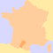
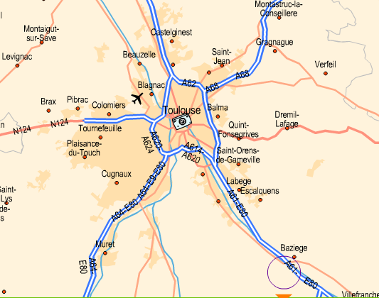
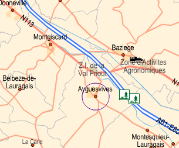

Après Rennes en 2003, Grenoble en 2004, Reims en 2005, c’est au tour de la région Sud-Ouest d’acceuillir la joyeuse troupe des fanas de la brique. La rencontre se passe du coté de Toulouse le long WE du 14 juillet.

Cet article reprend toutes les informations sur cet événement. Il est assez long, prenez le temps de tout lire. Ensuite les inscriptions se passent sur la [page wiki](http://wiki.ipsyn.net/tiki-index.php?page=Rencontre+Estivale+Freelug+%28ref2006%29) qui reprend toutes les sections présentées ici.

Cet article evoluera dans les prochains jours, soit parce qu’il nous manque certaines informations, soit par votre apport de suggestion ou d’informations.

Dernière mise à jour : samedi 1ier juillet 2006

## **Présentation**

La Rencontre Estivale Freelug 2006 s’inscrit dans la continuité de notre tour de France qui nous a fait découvrir la Bretagne en 2003, la région Rhone-Alpes en 2004 et l’Est l’an passé, nous voici sur la route de Toulouse pour l’édition de cette année. Apres quatre ans, l’engouement ne fait que grandir pour cette rencontre, les salles étant toujours trop petites, cette fois on voit grand : Un gymnase sur la commune d’[Ayguesvives](http://www.sicoval.fr/fiches/fiche-commune.php?id=4) (31450) les 14, 15 et 16 juillet 2006.

## La région et le lieu

**Localisation de l’évenement.**

Description de la région

**Position par rapport á Toulouse**

**details de la carte**

[Ayguesvives](http://fr.wikipedia.org/wiki/Ayguesvives) est une commune de 2125 habitants qui se trouve à une vingtaine de kilomètres de Toulouse dans le Lauragais. Il y a une poste, un tabac, une pharmacie, un café et un restaurant. Un supermarché avec station essence 24/24 se trouve à Montgiscard à 5 km environ et un autre à Ville Franche de Lauragais à 12-15km. Le canal du midi se trouve à 2 km avec possibilité d’y aller à pied de la salle. Il y un parcours cyclable le long du canal. La salle jouxte le collège Jean-Paul Laurens. Quelques [photos](http://www.festivocal.org/ayguesvives.php) de la commune.

Pour information, quelques distances kilomètriques pour aller à Toulouse :

|  |  |  |  |  |
| --- | --- | --- | --- | --- |
| Rennes | 700km |  | Paris | 700km |
| Lyon | 540km |  | Lille | 900km |
| Grenoble | 530km |  | Nice | 590km |

L’adresse exacte de la salle n’est pas encore connue. Elle sera communiquée ici dès que possible.

## Comment s’y rendre

**Train**

La gare de Toulouse Matabiau est la principale. Si vous venez en train, essayer de vous regrouper pour que l’on vienne vous chercher. Il semblerait qu’il y ai aussi un TER vers Ayguesvives (information à confirmer).

**Avion**

L’aéroport de [Toulouse Blagnac](http://www.toulouse.aeroport.fr/fr/default.asp) a de nombreux vols sur toute la France, prix attratifs avec EasyJet en provenance de Paris. L’aéroport se trouve à l’Ouest, donc pas forcément proche de Ayguesvives. Mais on peut toujours s’organiser pour venir récuperer les ouailles perdues ;) C’est aussi sur cet aèroport que l’A380 décolle régulièrement.

**Route**

Nous vous laissons le soin de consulter votre site d’itineraire préferé ([mappy](http://www.mappy.fr/) ou [via-michelin](http://www.viamichelin.fr/viamichelin/fra/tpl/hme/MaHomePage.htm))

_Périphérique de Toulouse_ : sortie 19 Labège prendre à droite au rond point direction Labège. Au premier rond point tout droit direction castanet, au second rond point tout droit (Vous passez à cotés du cinéma gaumont), au troisième tout droit direction Escalquens , Baziège. Au quatrième rond point à Gauche direction Escalquens , Baziège (D79). Vous rentrez dans Escalquens prendre à Droite au feux tricolore direction Baziège, Montlaur (D16). Prendre tout droit à l’autre feux ensuite vous sortirez d’Escalquens. Traversez le village de Montlaur. 2 ou 3 Km après Montlaur prendre à Droite direction Montgiscard. Vous rentrez dans montgiscard et passez le caanl du midi. Prendre à gauche aux feux direction Carcasonne, centre ville, Ayguesvives (RN113). Vous traversez Montgiscard et vous passez à cotés d’un intermarché/bricomarché.  
Ensuite en sortant de Montgiscard vous faites 2 km environ .  
Vous prenez à droite direction Ayguesvives.

**Attention** le périphérique toulousain est limité à 90 km/h durant tout l’été. Ca bouchonne généralement le matin entre 7h et 9h, et le soir à partir de 17h jusqu’à 19h (environ). Cela devrait se confirmer avec les départs en grand week-end du 14 juillet. Consulter le site du [Bison Fute](http://www.bison-fute.equipement.gouv.fr/).

plan détaillé d’acces à la salle.

## Hébergement

**Hôtels**

_LABEGE_ : Campanile , Première Classe, Innostar, Le Sextant, Bowling Center Hotel.

_RAMONVILLE_ : Formule 1, Confort Inn , Lidotel.

_BALMA_ : Fasthotel , Kyriad.

_VILLEFRANCE DE LAURAGAIS_ : Hotel de France (25€ à 35), Auberge de la Pradelle (25€ ) prix indicatif proviennant du guide du routard 2001).

_DONNEVILLE_ : Motel restaurant l’enclos.

Si certains d’entre vous choissisent l’hôtel pour soulager leur petit dos, faites le savoir. Cela permettra de vous regrouper dans le même hôtel. Attention, les nombreux hôtels de Toulouse se remplissent très vite, il faut donc réserver rapidement.

**Campings**

Un [site](http://www.guidevacances.com/campings/31.htm) recence les campings dans le 31. Mais en voici trois qui sont proches :

_LES PEUPLIERS_ petit camping 1 etoile de 16 emplacements sur la commune d’Ayguesvives. Tel : 05.34.66.47.30 ou 06.64.94.48.11. Il reste de la place mais il est conseillé de réserver.

_LES VIOLETTES_ \* \* à 10km sur la commune de DEYME (31450), Capacité : 92 places. Tél. 05 61 81 72 07. Sortie villefranche de Lauragais ou Toulouse-Labège (No 19).

_[PARC DE LA THESAUQUE](https://www.camping-thesauque.com/)_ \* \* \* sur les rives du lac de Nailloux à 10-15 min d’Ayguevives sur la commune de MONTGEARD (31560). Location de chalets possible. Prendre la sortie d’autoroute A66 Nailloux. Tel : 05.61.81.34.67

Il est conseillé aux campeurs de prendre contact avec ceux qui se sont deja inscrits (Erik, Jean, etc.) pour connaitre le camping choisi.

**Chez l’habitant**

Certains membres de FreeLUG ont de la place chez eux. Voir la liste directement sur le wiki. Toulousains ou habitants de la région, si vous avez de la place, faites le savoir.

## Activités

Afin d’avoir une gestion facile et savoir ce qui ce passe et où, voici l’emploi du temps de ce qui est prévu tout au long du week-end. Ce planning n’est pas définitif et evoluera en fonction des vos désirs/suggestion/envies.

| jour | 8h 10h | 10h 12h | 12h 14h | 14h 16h | 16h 18h | soirée |
| --- | --- | --- | --- | --- | --- | --- |
| jeudi | rien | rien | rien | rien | rien | premiers arrivés |
| vendredi | on s’installe dans la salle | installation | repas, buffet dans la salle ou autour | 14:30 Introduction à NQC |  | soirée Pizza dans un parc |
| samedi |  | préparation de la salle pour l’ouverture au public |  | Ouverture au public | Ouverture au public | soirée BBQ |
| dimanche |  |  |  |  |  |  |
| lundi |  |  |  |  |  |  |

**Description des activités**

Si vous voulez proposer une activité, dites le nous !

_Ouverture au public_ contact : Khan. Nous transformons notre rencontre en une exposition avec des visiteurs pendant l’après-midi du samedi. Les modalités exactes n’ont pas encore etes définies avec la mairie. C’est un point qui nous a permis de négocier la salle avec la commune car elle y voit un interêt. Pour nous cela nous permet de s’experimenter à l’organisation d’une exposition seul.  
Vous avez le droit de ne pas vouloir y participer, la salle sera organisée de façon à permettre un cloisonnement.

\__Presentation NQC_ par Khan. Une découverte en 2h de NQC avec application sur des robots préconstruits. L’initiation se fera sur des RCX. Amener son PC portable.

\__GBB_ contact :

\__Course folle_

\__SUMO_

\__BrickCiel_  
\_ _?_ a definir

**Plan d’occupation de la salle**

En fonction de vos inscriptions sur le wiki, un plan d’occupation de la salle sera établi. Cela permetra à tous de savoir où il est et d’avoir l’espace qu’il a réservé (pensez à bien remplir le wiki).

Pour le moment, nous ne savons pas de combien de tables nous pouvons bénéficier (p’tet 0).

Les photos de la salle et des environs sont visibles [ici](http://photos.freelug.org/main.php/v/FreeLUG/Evennements/ref2006/)

**Menus**

_Les midis (une participation sera demandée) :_

Salades : taboulé, riz/tomates/oeuf/thon, jambon, tomate nature, chips, fromage et fruits.

_vendredi soir (une participation sera demandée) :_

Soirée Pizza

_Samedi soir (repas offert par FreeLUG) :_

Barbecue avec saucisse de Toulouse, pommes de terre en papillotte, chips, le tout avec un apéro.

## Inscription et Particpants

Toutes les inscriptions sont sur la page du [wiki](http://wiki.ipsyn.net/tiki-index.php?page=Rencontre+Estivale+Freelug+%28ref2006%29).  
Si vous avez un souci à remplir les différentes rubriques, n’hésitez pas à nous contacter à l’adresse _ref2006 at freelug.org_.

## Visites

Parmi les vistes possibles (plus d’informations à venir)

_Cité de l’Espace_ Sur la commune de Toulouse, entre les sorties 17 et 18 du périphérique. La [cité de l’Espace](http://www.cite-espace.com/) se voit de loin avec sa fusée Ariane. Nous allons essayer d’organiser une visite de groupe.

_Carcassone, Albi_ Présence de nombreux châteaux Cathares ( à la base de l’inspiration de Denix pour ses [superbes créations LEGO](http://www.brickshelf.com/cgi-bin/gallery.cgi?m=Denix))

\__Andorre_ La principauté se trouve à 160km de Toulouse. Pour ceux qui veulent rester plus longtemps ou ne veulent pas être des notres un jour.

_visite de Toulouse_ Visite du centre ville, la célèbre place du Capitole, les bords de Garonne. La ville a ses origines qui remontent au temps des Romains. Elle a aussi été la capitale de l’empire Wisigoth. Des vélos sont en location au centre ville pour 1E la 1/2 journée.  
La gastronomie occupe une part importante dans la vie de la région : vins qui piquent, fromages qui puent, foies gras spécial régime, etc.  
Il est aussi possible de faire des randonnées cyclistes ou pédestres au bord du canal du midi.

_Plane Spotter_ allons voir le "gros" A380 d’Airbus en bord de piste. On pourra aussi voir les Belugas, avion cargo à la forme bien spéciale. A voir aussi du coté des visites des chaines de montage Airbus.

## Liens

Regroupement de sites Internet pouvant présenter un interêt.

[AyguesVives](http://www.sicoval.fr/fiches/fiche-commune.php?id=4)  
[Wikipedia sur Ayguesvives](http://fr.wikipedia.org/wiki/Ayguesvives)  
[Mairie de Toulouse](http://www.toulouse.fr/)  
[Tourisme midi Pyrenees](http://www.tourisme-midi-pyrenees.com/)  
[cité de l’Espace](http://www.cite-espace.com/)
