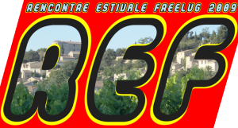

Cette année, la REF se déroulera les 11 et 12 juillet à Vénéjan (Gard).

Après Rennes en 2003, Grenoble en 2004, Reims en 2005, Toulouse en 2006, St Victor Montvianeix en 2007, Rosheim en 2008 (couplée à Fanabriques), la REF a lieu cette année dans le Gard à Vénéjan.

Cette rencontre est ouverte à tous les passionnés de LEGO, c’est l’occasion de se retrouver, de se rencontrer, de partager durant un week-end notre passion.

Pour de plus amples de détails, consultez le site dédié à la rencontre, [http://ref.freelug.org/](http://ref.freelug.org/). Il sera régulièrement mis à jour en fonction de l’avancement de la préparation.
