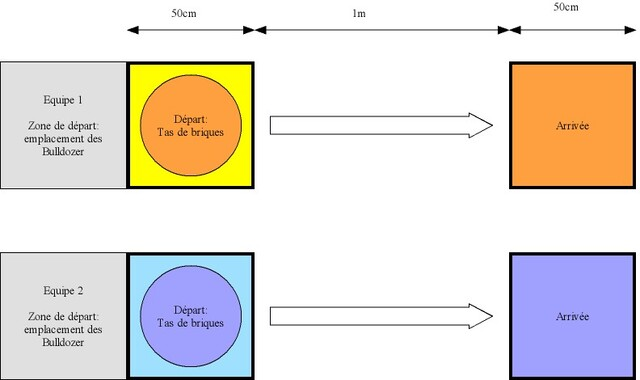

Comme déjà annoncé sur le site de Fana’briques...

La Rencontre Estivale FreeLUG (REF) se déroulera cette année pour la première fois en parallèle avec [Fana’briques](http://fanabriques.freelug.org/?menu=next&langue=fr). Donc rendez-vous à Rosheim le 28-29 juin prochain.

## Lieu

Nous avons à disposition une salle d’environ 80-100m2 au sous-sol (au calme et au frais). Un grand parking est disponible autour de la salle.  
La salle des fêtes se situe rue de l’église à Rosheim ( GPS : 48°29’38"N, 7°27’59"E ).  
**–** [Plan d’accès](http://www.rosheim.com/home/fr/office_tourisme/plan.php),  
**–** [Plan de la ville](http://www.rosheim.com/home/fr/plan/indexplan.php)

## Inscriptions

Pour toutes les inscriptions concernant l’hébergement, la restauration, les activités, les tournois, etc... merci de vous rendre sur la [page wiki REF2008](http://wiki.freelug.org/tiki-index.php?page=REF2008).

**La date limite des inscriptions, notamment pour les repas, est fixée au 15 mai à minuit**, afin de faciliter la gestion avec Fana’Briques. Merci de votre compréhension. Toutefois, vous pouvez toujours vous inscrire après cette date pour signaler votre présence à la rencontre, mais les repas seront de votre ressort.

La différence avec Fana’briques ? Fana’briques est une exposition, la REF est une rencontre. Il n’est donc pas obligé de venir avec quelque chose à exposer, et des activités sont proposées durant les deux jours.

## Restauration

Le samedi et dimanche, les petits déjeuners et déjeuners sont offerts par Fana’Briques et FreeLUG.  
Pour le repas du Samedi soir, une participation de 10 euros par adulte et 5 euros par enfant sera à payer le soir même.  
Les frais de repas seront à régler à votre arrivée à Rosheim.

## Hébergement

Plusieurs possibilités : dans la salle, camping chez l’habitant, gîtes, hôtels, camping.

**–** Logement chez l’habitant : Les Afols locaux se feront une joie de vous accueillir dans la limite des places disponibles. Il n’y aura peut-être pas de lit pour tout le monde, néanmoins nous pouvons vous proposer le cas échéant de dormir dans la salle d’exposition. Prévoyez donc des matelas.  
**–** Rosheim : [Hotels](http://www.rosheim.com/home/fr/office_tourisme/hotels.php)  
, [Campings](http://www.rosheim.com/home/fr/office_tourisme/campings.php),  
[Chambres d’hotes](http://www.rosheim.com/home/fr/office_tourisme/chambreshotes.php),  
[Gites](http://www.rosheim.com/home/fr/office_tourisme/gites.php),  
**–** Obernai (10km),[ici](http://www.obernai.fr/site/page_329.php)  
**–** Molsheim (10km), [ici](http://www.ot-molsheim-mutzig.com/)

## Animations / Activités

**Tournoi Bulldozer**

Le but du jeu est de déplacer un tas de briques d’une zone à une autre le plus rapidement possible à l’aide d’un [Bulldozer réf. 8275](http://technic.lego.com/fr-fr/Products/Construction/8275Construction.aspx). Deux pistes seront disponibles, une par joueur/équipe.

Description de la piste :

Une piste comporte deux zones, une de départ et une d’arrivée de dimensions 50x50cm et distantes de 1m. Elles seront délimitées par du ruban adhésif.

Dans la zone de départ sera disposé un tas de briques. Pour chaque piste, le nombre de briques et les dimensions seront identiques, mais de couleurs distinctes affecté à chaque piste.

Les Bulldozers seront placés dans la zone de départ, puis... Top Départ, que le meilleur gagne. Le vainqueur est celui qui aura transféré le premier toutes ses briques à l’intérieur de sa zone d’arrivée.

Suivant le nombre de participants, nous avons le choix entre 2 types de tournoi, et certaines restrictions seront nécessaires, à savoir :

**–** Tournoi à 3 ou 4 Bulldozer :  
Etant donné le nombre de canaux disponibles (4) sur les télécommandes, les griffes resteront en position haute, et la pelle sera mise en position basse. Le récepteur infrarouge contrôlant les griffes et la pelle sera désactivé. Un canal sera attribué par participant.

**–** Tournoi à 2 Bulldozer :  
Chaque participant se verra attribuer soit les canaux 1-2 ou les canaux 3-4. Vous aurez toute liberté d’utilisation des griffes ou de la pelle.

Pour ce concours, il nous faut 2 Bulldozers au minimum (4 maxi), de préférence avec des piles rechargeables. Tout le monde peut participer, et si vous n’avez pas de Bulldozer, on vous en prêtera un dans la limite des disponibilités.

**Tournoi SUMO**

Pour rappel, [le règlement du tournoi SUMO](/articles/regles-du-combat-de-sumo-mindstorms-freelug/).

Deux catégories vont concourir :  
**–** la catégorie robotisée : Les Sumo seront autonomes (NXT, Mindstorms,...)  
**–** la catégorie télécommandée : Les Sumo seront télécommandés par fil ou infrarouge.

Afin de faire participer le plus grand nombre de personnes, le nombre de sumos sera limité à 2 (1 par catégorie) par participant.  
Suivant le nombre de participants, un deuxième ring sera mis à disposition, afin d’éviter d’interminables manches.

**Activités autres :**

Le samedi matin : visite de la ville d’[Obernai](http://www.obernai.fr/site/page_329.php).

**Planning Activité :**

**–** Samedi :

**–** Dimanche :

Le planning est donné à titre indicatif, sous réserve de modifications.

**Tourisme :**

Comme l’Alsace est aussi une région à vocation touristique, je vous propose quelques liens vers des sites touristiques. Néanmoins, comme la liste est longue, je peux répondre à des renseignements spécifiques dans la mesure du possible.  
**–** [Alsace-tourisme](http://www.tourisme-alsace.com/fr)  
**–** [Alsace-passion](http://www.alsace-passion.com/avav.htm)  
**–** [Alsace-info](http://www.alsace-info.com/francais/index.html)  
**–** [Cigogne.net](http://www.cigogne.net/-Sortir-.html)  
**–** [Ville de Rosheim](http://www.rosheim.com/)

Pour ceux qui veulent visiter Strasbourg, je vous conseille vivement les [Parking Relais-Tram](http://www.cts-strasbourg.fr/Services/Parkingsrelais/tabid/61/language/fr-FR/Default.aspx), c’est un tarif unique (AR centre-ville+parking) par voiture quelque soit le nombre de passagers.
