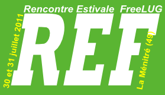

Cette année, la REF se déroule les 30 et 31 juillet à La Ménitré, dans le Maine-et-Loire.

Après Rennes en 2003, Grenoble en 2004, Reims en 2005, Toulouse en 2006, St Victor Montvianeix en 2007, Rosheim en 2008 (couplée à Fanabriques), Vénéjan en 2009, Domjean en 2010, la REF a lieu cette année dans les Pays de la Loire à La Ménitré.

Pour de plus amples de détails, consultez le site dédié à la rencontre, [http://ref.freelug.org/](http://ref.freelug.org/). Il sera régulièrement mis à jour en fonction de l’avancement de la préparation.
