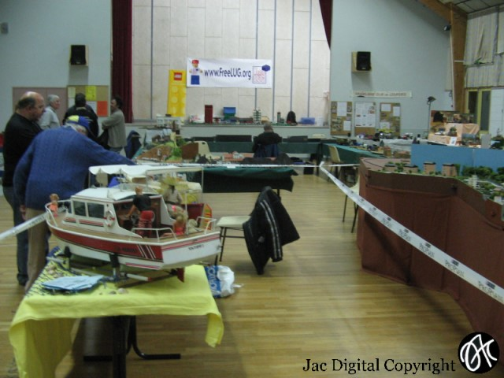

Les 17 et 18 Novembre 2007, il y avait plus de maquettes que d’habitants à Effiat...

J’exagère un petit peu dans la petite introduction de cet article. Pourtant Effiat est un grand village, et notre exposition a suscité la découverte d’une activité méconnue dans la région. C’était d’ailleurs le but de ce week-end, et c’est pour cela que j’ai été contacté ainsi que tous les participants avec leurs bateaux, un réseau à l’échelle N, des avions, des maquettes militaires, et tout ce que j’oublie !

Première étape de la journée, trouver la salle. C’est pas si facile que l’on croit, même dans un petit village. J’ai fini par demander ma route à l’organisateur et enfin, arriver sur place. La deuxième étape fut très marquante pour tous le monde : mes voisins exposants, l’organisateur et moi-même. Un réseau en briques LEGO peut être plus grand que ce que l’on pense, et il était impossible de nous mettre à 3 sur une petite scène. Mais nous nous en sommes rendu compte seulement, en plaçant les tables. Il n’y en avait jamais assez. Et la scène se remplissait, sans que l’on puisse faire le tour du réseau. Jusqu’à ce qu’une idée de génie germe, dans la tête d’une organisatrice : "_Pourquoi vous vous mettez pas là, par terre, sur les planches de la scène ?_". J’ai dis oui ! Et le montage a enfin pu commencer. Ce fut toutefois une remarque récurrente durant ces deux jours, Jac, connu pour remuer les tables !!!

**Vue d’ensemble**

Le réseau domine cette exposition......

Après une installation routinière, non pas que ça soit lassant, mais c’était ma quatrième exposition d’affilée, l’exposition s’est déroulée sans encombre. Et même avec domination puisque de la scène, j’étais au dessus de tous, avec le réseau plus haut que les tables, mais juste à la hauteur des yeux... Nous avons toujours autant de succès, et l’exposition LEGO s’est agrandie, avec l’apport de quelques Bionicle présentés par le fils de la "dame aux idées" !

Un accueil excellent, malgré une fréquentation moyenne le premier jour. Nous avons été reçus comme des rois, avec un très bon repas le Samedi soir, des discussions intéressantes entre nous. Et un repas sympathique le dimanche midi.

Nous avons montré dans ce village que des maquettistes passionnés construisent toutes sortes de choses, avec des moyens différents. Le but de l’organisation "Faites des chiens" a été atteint. Enfin je l’espère. En tous cas, nous sommes près à revenir à Effiat, pour replacer nos constructions en tout genre...

[Mes photos](http://gallery.freelug.org/main.php/v/JAC/Exposition/Effiat-2007/)
