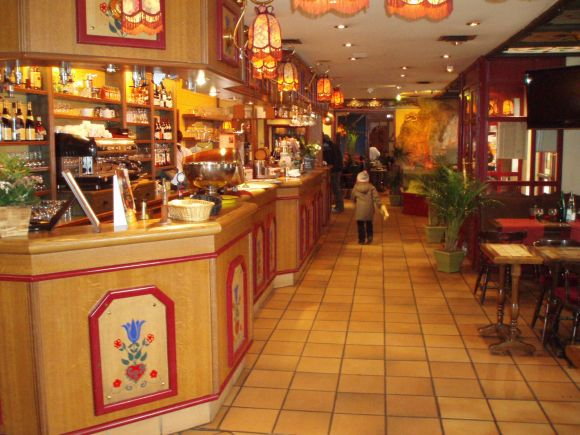

Organisation d’un repas entre AFOLs sur Lyon le 10 janvier

Pourquoi ne pas se retrouver pour fêter la nouvelle année et toutes ces belles briques reçues à Noël ?

Pour cela un repas est prévu en région lyonnaise le samedi 10 janvier au soir.

Le restaurant choisi est celui-ci :

**TAVERNE MIDI-MINUIT**

83 cours Charlemagne - 69002 LYON

Tel : 04 78 37 67 95 - Fax : 04 72 41 93 16

Le restaurant nous indique de transmettre avant le 5 janvier ce que nous mangerons, je vous invite donc à remplir le wiki avec le N° d’entrée, de plan et de dessert.

**MENU Brasserie 18 euros**

_Une entrée, au choix_

1.  Petit carpaccio de boeuf huile d’olive et parmesan
2.  Salade Lyonnaise(oeuf, lardons, croûtons, tomates)
3.  Salade mixte au chèvre chaud

_Un plat, au choix_

1.  Quenelle de brochet, sauce homardine
2.  Pièce du boucher, sauce béarnaise
3.  Cuisse de canard confite
4.  Choucroute Brasserie(Francfort, Montbéliard, poitrine fumée, saucisson à l’ail)

_Un dessert, au choix_

1.  Assiette de 3 fromages
2.  Coupe de glace et chantilly
3.  Moelleux au chocolat
4.  Île flottante

_Menu enfant à 7 euros (plat + dessert + boisson)_

Le choix de la taverne n’est pas anodin : il nous permet de nous retrouver plutôt sur les lieux, pour ceux qui ne souhaite pas y manger de juste passer boire un verre et même, pour les plus motivés, d’y manger le midi (attention si plus de 10 personnes il faut réserver).

[Page wiki](http://wiki.freelug.org/tiki-index.php?page=Restaurant+sur+Lyon).

**Inscriptions closes !**

## Programme prévisionnel

**–** Une virée au TRU de Bron est prévue vers les 15h00. N’oubliez pas vos chéquiers de réduction !

De 17h à 19h un de nos participants Didier E. alias SixStudS et Ambassadeur LEGO va faire :  
**–** une vente aux enchères de lots de pièces (principalement Technic), il doit faire de la place chez lui suite à un heureux évènement ;  
**–** Une démonstration du [Wedo set Dacta 9580](http://www.bricklink.com/catalogItemPic.asp?S=9580-1)
