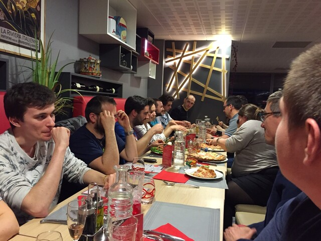
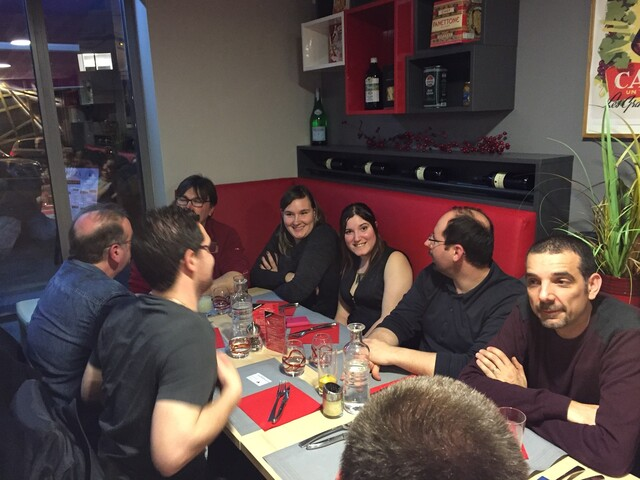

Repas au restaurant "L’Italien de Lyon" après l’AFOL Day d’Avril. Nous étions plus d’une vingtaine avec des nouveaux membres et quelques vieux briscards.

C’est le premier, c’est le plus beau, enfin fallait surtout commencer.  
Donc plus sérieusement premier restaurant LEGO du CoR RA (ou tout autre nom). Nous étions 25 pour ce premier rendez-vous.

Le restaurant choisi était un restaurant Italien du 7ème arrondissement de Lyon : L’italien de Lyon. A titre personnel j’ai beaucoup aimé.

Durant ce moment d’échange nous avons parlé Lego (ben c’est le but quand même) avec différents sujets comme l’éclairage des bâtiments, les nouveaux et anciens sets, Bricklink, la dernière Briqu’Convention, les expos à venir (BE 2017 entre autres), le site web de FreeLUG...  
Nous avons aussi accueilli Yves captaincalleway parmi les nouveaux adhérents du RA.

Un très bon moment entre AFOL (et pas que) à refaire rapidement.

Antoine

_\----------------------_

Bien mangé, bien attendu les retardataires, bien dit du mal d’à peu près tout le monde (surtout de ceux qui n’étaient pas là), bien profité de la pluie, bien attendu le bus pour rien, bien monté la côte à pied pour finir. Un samedi soir comme je les aime ! ;-)

Jérôme (jivé69)

_\----------------------_

Resto plutôt bon, bien arrivé en retard. Bien eu en retard mon apéro et mon dessert :)

N’oubliez pas de relancer Corentin pour qu’il s’inscrive ;) ça fait 2 restos qu’il fait déjà ;)

A refaire !

Matthieu (Kimka)

_\----------------------_

Petit restaurant sympa ! Nous étions (comme souvent) accompagnés des enfants qui ont (presque) réussi à rester sages ! Et en plus on était dans les premiers servis, donc rien à redire :-P

Mathieu (Tagstallion) et Géraldine

_\----------------------_

L’inconvénient des Resto Lego ce sont les grandes tablées, on ne discute qu’avec ses voisins. Mais cette fois c’était différent, les chaises ont un peu tourné et nous étions plusieurs à avoir traîné un peu sur la fin, c’était vraiment sympa. Le CoR prend forme et c’est toujours un plaisir de se retrouver. Restaurant italien bon et agréable en plus, nickel. A refaire.

Bertrand (Fa)

_\----------------------_

Le resto était sympa, même avec tous ces AFOL dedans :p  
C’est pour rire bien sûr, c’est toujours un plaisir de retrouver les anciens et d’accueillir des nouveaux adhérents !

Laurent
