Le 30 novembre dernier, nous nous sommes retrouvés à la Brasserie Debourg dans le quartier de Gerland. Ce fut pour moi l’occasion de revoir des habitués et de faire la connaissance de nouvelles personnes.

Et pourtant la soirée n’avait pas très bien commencée pour moi : retard, grosses difficultés pour me garer à proximité de la brasserie. Bref, je suis arrivé bon dernier, alors que tout le monde avait déjà commandé !

Je n’ai pas non plus choisi ma place à table, et je dois dire que ce fut une bonne chose, et l’occasion pour moi de me retrouver finalement à côté de personnes que je ne connaissais pas et ainsi faire connaissance, discuter de plein de choses, et notamment pour ma part de l’organisation de la [Briqu’Expo de Diémoz](https://www.freelug.org/spip.php?article1564) et partager sur les problématiques d’organisation avec les autres personnes.

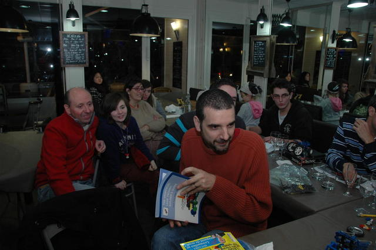

Le reste de la soirée s’est très bien passé, avec [l’élection de la scenette la plus sympathique suite au petit concours organisé pour l’occasion](https://www.freelug.org/spip.php?article1568).

Et c’est le MOC de Laurent "Superman vs Grand Ma" qui a été élu vainqueur !

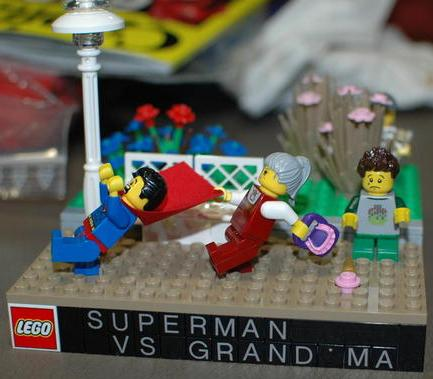

Un MOC bien réalisé et plein d’humour, qui va apparaitre sur une variante de l’affiche de la prochaine Briqu’Expo de la région :

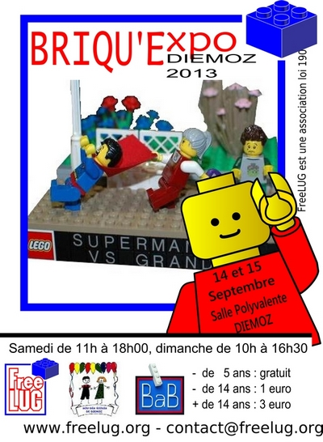

Enfin, la soirée s’est achevée sur le parking, pour la traditionnelle distribution de trucs commandés dernièrement, distribution effectuée par notre cher vice-président, à la lampe frontale !

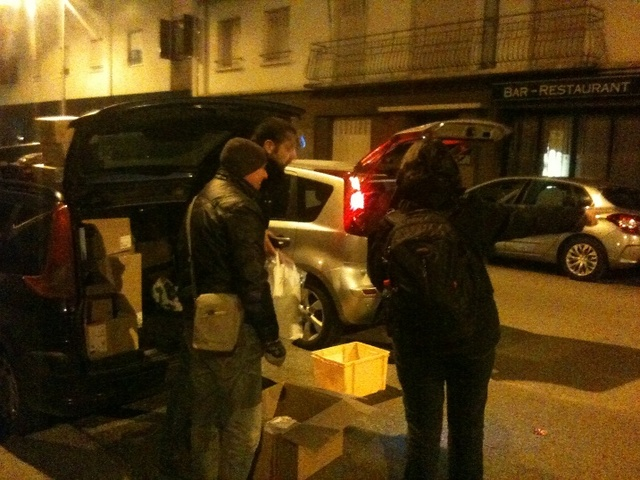

Très bonne soirée, à refaire !

_Yannick_

* * *

Pour ma part la soirée fut excellente de bout en bout. Arrivé le premier, je n’attendis que quelques instants pour trouver Laurent et prendre place (la meilleure : dans le coin en dessous du téléviseur) dans la salle de cette brasserie que je ne connaissais pas.

Très rapidement se joignit à nous Daniela - que je retrouvais avec grand plaisir - puis au fur et à mesure la plupart des autres convives. Yannick se faisant attendre :-p

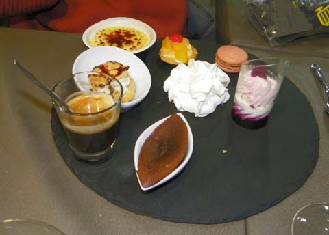

Tous, nous discutâmes et mangeâmes de façon roborative - je recommande vivement aux Lyonnais cette adresse à Debourg.

Merci aux participants pour cette rencontre chaleureuse.

_Didier_

* * *

Effectivement une très belle soirée entre AFOLs. Comme il se doit pour un restolego, nous avons mis pleins de LEGO partout sur les tables. C’était avec plaisir que j’ai retrouvé les Lyonnais et moi je n’avais pas de soucis pour me garer puisque je suis venu en métro.

Voici les trois autres scénettes qui ont participé au concours et quelques photos de l’ambiance générale.

[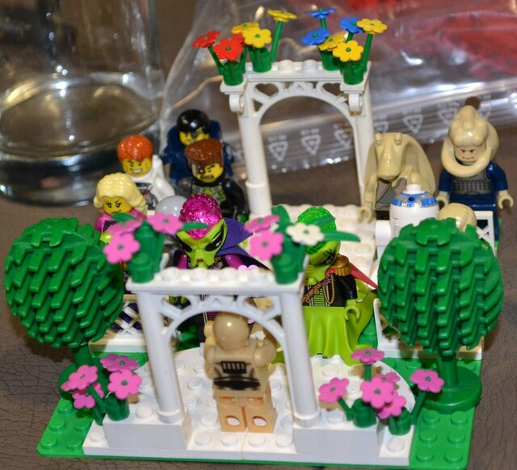](https://www.freelug.org/IMG/jpg/DSC_0208.jpg)

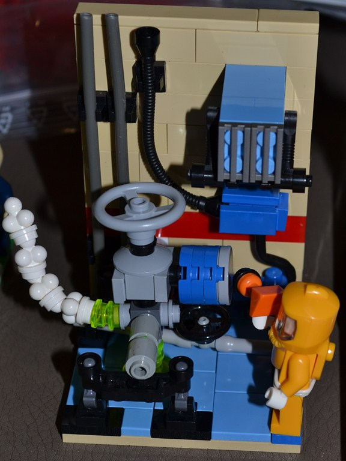

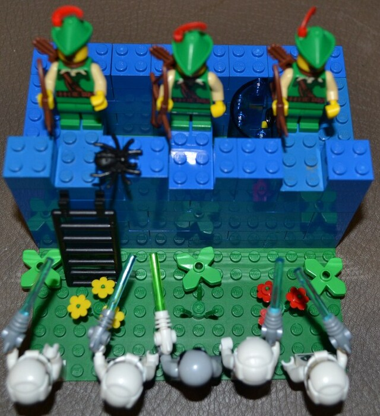

Merci pour cette organisation, et à très vite pour une prochaine édition du restolego Lyon.

_Daniela_

— -

Un resto sur Lyon.... j’en suis ! Comme ça, j’en profiterai pour faire de la distribution (bulk, commande groupée, minifig ; ce n’est pas ça qui manque).

Super soirée et encore merci aux organisateurs.

_Xavier livreur de LEGO... la nuit_

[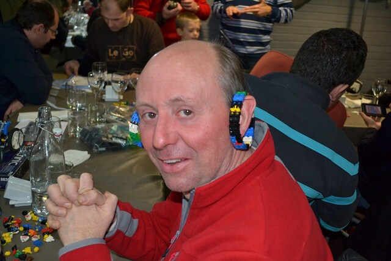](https://www.freelug.org/IMG/jpg/DSC_0226.jpg)

[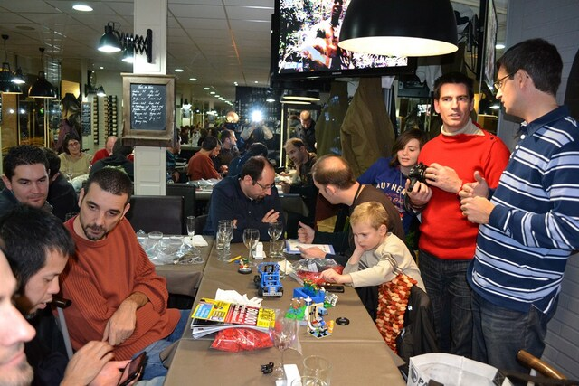](https://www.freelug.org/IMG/jpg/DSC_0227.jpg)

[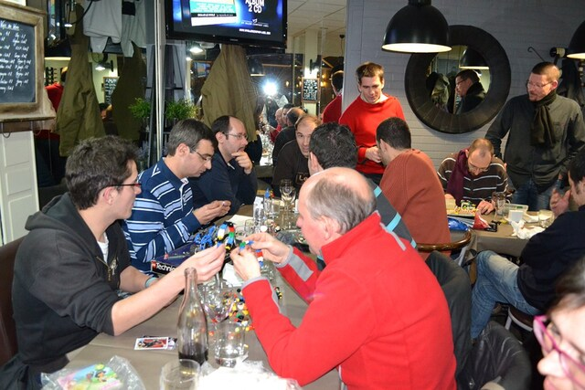](https://www.freelug.org/IMG/jpg/DSC_0224.jpg)
