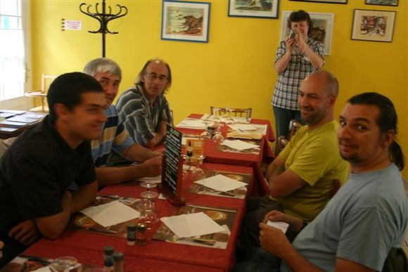

Suite au passage estival de Pierre, des familles Duvert et Eury dans notre région, j’ai organisé le 14 août un restolego dans une créperie à Port-Launay sur les bords de l’Aulne prés de Chateaulin (29).

En plus des personnes citées plus haut, j’ai invité Mickael de Brest, passionné LEGO, initiateur d’un projet de restauration d’un thonier de Camaret et maquettiste naval (il termine la reproduction du thonier cité ci dessus, 1.50m de long), Dominick de Brest également, modérateur du forum Legopirate, et mon collègue de la maquette.

L’ambiance fut excellente et conviviale.

Nous avons parlé des projets futurs avec les petites briques...

Xavier nous a fait une démonstration de Techball.

En conclusion, les convives m’ont demandé de renouveler ces rencontres plus souvent.

[Quelques photos](http://photos.freelug.org/main.php/v/barr__/rencontres/Restolego_aout2009/)

_Jean-Marc_

* * *

Premier restolego d’Alain et Brigitte.

Une seule envie : RECOMMENCER.

Pouvoir bavarder à tout va (dés 10h) de nos briques, imaginez comme le temps passe vite.

Nous avons parcouru à plusieurs le guide Collector LEGO (ref 810003) prêté par Jean Marc, observé les bambins avec les Toollo.

Alain était heureux de piloter le Techball de Xavier. Certains ont fini au camping avec nous avant de reprendre la route.

Port-Launay, un joli coin et nous avons eu un très bon accueil de la part des restaurateurs.

Merci aux initiateurs de cette rencontre estivale.

_[Alain et Brigitte](http://photos.freelug.org/main.php/v/EURY/TROMBI/)_

* * *

Et bien ce fut un plaisir de partager ce repas avec d’autres Afols. Qui plus est avec de nouvelles têtes... Ces rencontres autour d’un repas permet de vivre notre passion différement qu’en expo ou chacun de notre côté...

C’est dans des moments comme ça qu’on regrette que la France soit si grande.... ;-)

Vivement mon prochain voyage en pays Breton...!

Pierre L.  
(Pierrolego)
