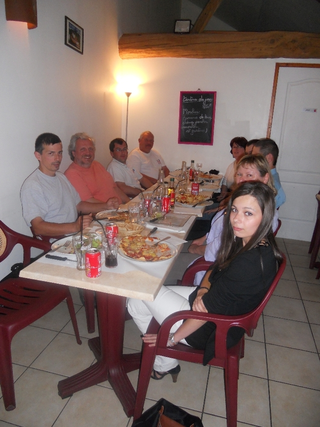

Le 28 mai 2010 était organisé un restolego sur Orléans comme il en est fait d’en d’autres régions.

Nous étions donc 10 Freelugien(ne)s a nous retrouver dans un restaurant de l’agglomération orléanaise pour évoquer nos chères petites briques. Nous étions une majorité du secteur d’Orléans avec un nouveau venu : David. Rendez-vous était donné vers 20 heures au restaurant. Nous étions tous à l’heure sauf Jean-Claude et sa famille, qui venant de Paris pouvait difficilement prévoir son heure d’arrivée. Cela nous a permis de parler de l’organisation de [l’exposition de Modélisme d’Orléans](/articles/exposition-de-modelisme-ferroviaire-a-orleans-6-et-7-novembre/), qui aura lieu les 6 et 7 novembre prochain, en l’attendant.

**restolego\_28-05-2010\_orleans**

A la prochaine lors d’une rencontre FreeLUG
