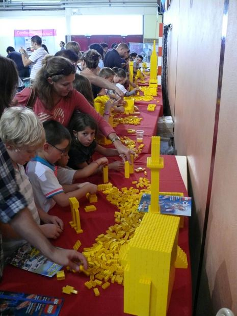
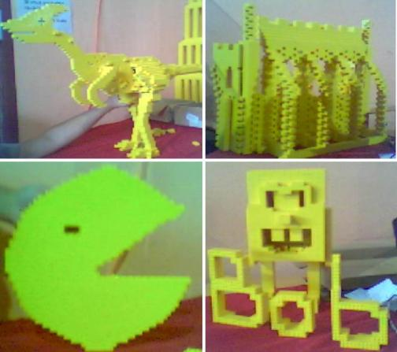
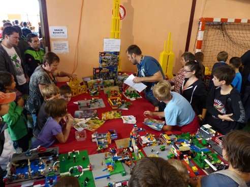

Pour cette première exposition à Diemoz, de nombreux jeux et concours ont été organisés. En attendant le compte rendu détaillé du week-end, voici les résultats des principales animations.

**Résultats pour le tirage au sort avec le questionnaire :**

-   Pierre Vigreux gagne la boite 6860 the batcave
-   Christian Meunier gagne la boite 41015 Dolphin Cruiser
-   Lydie Gauthier gagne la boite 76003 Superman™ : Battle of Smallville
-   Daniel Carod gagne la boite jeu Star Wars

**Résultats pour la Tombola de Dimanche :**

-   Neto gagne la boite 75020 Jabba’s Sail Barge™
-   Humbert gagne la boite 79105 Baxter Robot Rampage
-   Brevet gagne la boite jeu Star Wars
-   Serre gagne un porte-clés Hulk et un goddies [Muttpop](http://www.muttpop.fr/)

**Résultats pour la Tombola de Samedi :**

-   Mortier gagne la boite 10233 Horizon Express
-   Mendez gagne la boite 75004 Z-95 Headhunter™
-   Mathevet gagne la boite jeu Star Wars
-   Del Bello gagne un porte-clés Hulk et un goddies [Muttpop](http://www.muttpop.fr/)

**Résultat pour le concours Briques Jaunes + de 10 ans de Dimanche :**

**Les enfants en pleine construction**

Photo prise par Papa et Geek à la fois

-   Tafforeau Paul gagne la boite 76008 Iron Man™ vs. The Mandarin™ : Ultimate Showdown
-   Garnier Sylvain gagne un porte-clés Batman

**Résultat pour le concours Briques Jaunes - de 10 ans de Dimanche :**

-   Parola Johann gagne la boite 6858 Catwoman Catcycle City Chase
-   Rostaing Flavie gagne la boite 41013 Emma’s Sports Car

**Résultat pour le concours Briques Jaunes + de 10 ans de Samedi :**

-   Radesil David gagne la boite 76002 Superman™ : Metropolis Showdown
-   Hourtane Maxime gagne un porte-clés Tortues Ninja

**Résultat pour le concours Briques Jaunes - de 10 ans de Samedi :**

**Quelques constructions primées**

-   Tournoud Louis gagne la boite 50006 LEGO® Legends of Chima™
-   Chamfray Clement gagne la boite 79100 Kraang Lab Escape

**Résultat pour le concours questionnaire (retrouver les 10 R2D2) de Dimanche :**

-   Mathieux Salvetat gagne la boite 76006 Iron Man™ : Extremis™ Sea Port Battle
-   Hugo Gravel gagne une boite de Creationary

**Résultat pour le concours questionnaire (retrouver les 10 R2D2) de Samedi :**

-   Mercier Calypso gagne la boite 76004 Spider-Man™ : Spider-Cycle Chase
-   Pavalier gagne une boite de Creationary

**Concours "Que font les Super Héros lorsqu’ils ne sauvent pas le monde :**

Dimanche matin, les enfants ont amené leurs construction pour le concours organisé avec [BrickHeroes](http://www.brickheroes.com/). Tous les détails du concours sont [ici](http://www.brickheroes.com/2013/07/briquexpo-diemoz-un-concours-pour-les-grands-et-les-petits/).

Pour ce concours, les résultats ont été communiqués le jour même et les lots remis directement aux vainqueurs.

**Remise des lots offerts par le site Brickheroes**

Photo prise par Brickheroes
