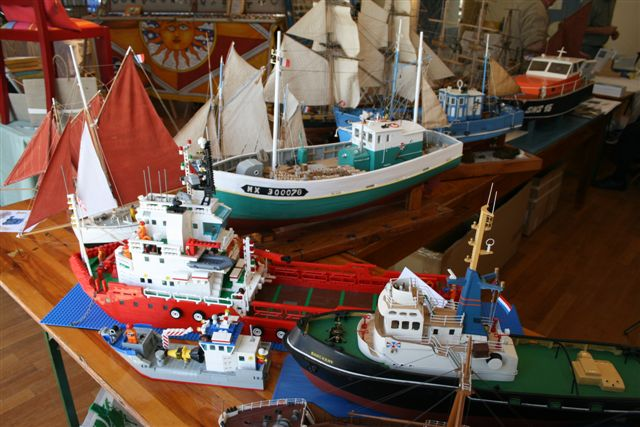

Chercher l’intrus de ce salon.

Parmi les vins d’Alsace, du Midi, les produits de la mer comme les fameuses huitres de Carantec (des creuses), les sociétés comme la SNSM (sauvetage en mer), les artisans locaux, les organisateurs avaient invité mon club de la maquette pour leur salon qui s’est tenu les 26 et 27 avril derniers .

Cette manifestation mettait en évidence nos maquettes traditionnelles et en LEGO.

Elle permettait aussi de rappeler au public qu’un salon se tiendra prochainement à Morlaix (17 et 18 mai 2008).  
Pour ma part, et ce n’est pas une surprise, le bouche à oreille a fonctionné pour voir mes modèles au milieu des maquettes.

Certains enfants avaient carrément demandé à leurs parents d’acheter mes bateaux : NEIN, NON, NO, NIET...

[Galerie de photos](http://photos.freelug.org/main.php/v/barr__/expositions/carantec2008/)

Maintenant, avez-vous vu les intrus ?

jean marc
