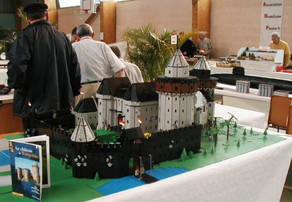
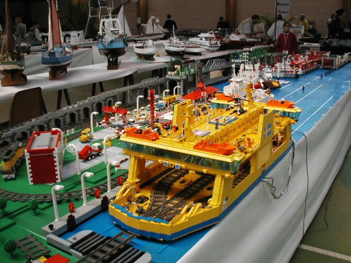
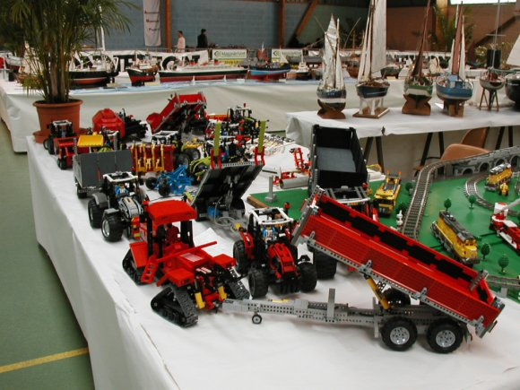

Nous étions trois à nous être déplacés à Ploulec’h, dans les Côtes d’Armor, pour participer au Salon du Maquettisme de Ploulec’h du 26 au 28 mai 2007.

Tout d’abord, je suis triplement heureux.

A l’occasion de la nouvelle édition du Salon de la Maquette qui s’est tenue à Ploulec’h (22) sur 3 jours, j’ai eu la joie de recevoir deux FreeLUGiens importants qui m’ont fait l’amitié de venir, et d’exposer leurs modèles au public :  
**–** Le "Comte Erik de Amzallag", alias Brickerik, Grand Seigneur du Château de Tonquédec qui a réveillé bien des souvenirs chez les gens du coin. Son ensemble médiéval est impressionnant avec beaucoup de prouesses techniques.

  
**–** Rémi Lancien, alias Darkbaron, notre concessionnaire "heureux" d’engins agricoles en tout genre, son domaine a connu parfois des discussions interminables et intéressées, pas vrai, Rémi !!!!

Jean marc, heureux de retrouver son réseau qui a bien fonctionné malgré quelques imperfections au niveau des tables.

Le public, grand et petit, malgré la tempête du moment, était aux anges. Signalons que le stand FreeLUG avait une longueur de 11m x 1,60m et surtout placé au centre de l’exposition, la banderole du club est difficile à placer dans ces conditions (trop haute par rapport aux tables, pas de filin au dessus, je vais réfléchir là-dessus).

Notons au passage la présence de notre jeune adhérent Edwin le petit rigolo, un des fils de Rémi, qui s’est bien amusé avec mes trains.

En conclusion, ce fut un évènement unique, exceptionnel, dans notre région de voir des créations legotiques et j’espère de tout coeur que d’autres FreeLUGiens me rejoindront au milieu de l’hospitalité bretonne.

Votre serviteur

Le Legoman Breton CIRCUS

* * *

Jean-Marc est venu avec ses ferries qui ont déjà arpenté de nombreux salons bretons. Son diorama a toujours rencontré le même succès, il faut dire qu’il ne rechigne pas à la besogne, le Jean-Marc ! Dès qu’il y a quelqu’un devant le stand, les ferries naviguent, les locomotives manoeuvrent et les trains voyagent tantôt sur rail, tantôt sur eau.

Rémi accompagné de son fils Edwin a apporté de nombreux tracteurs qui ont attiré les passionnés du genre ainsi que des agriculteurs. Il faut dire que la table était richement garnie avec les nombreuses déclinaisons du [set 8284](http://www.brickset.com/detail.aspx?Set=8284-1) attelées de différents équipements, pour certains motorisés, pour d’autres avec système pneumatique.

De mon côté, je suis venu avec le château de Tonquédec, monument local, qui a été reconnu et apprécié. C’était pour certains visiteurs la première fois qu’ils découvraient le château, pour d’autres l’occasion de se remémorer qu’il y avait encore peu, le château était à l’abandon et que le travail de restauration actuel est loin d’être fini.

Le jeune public intéressé était invité à participer à la manoeuvre des trains. Pour Jean-Marc, la présence des autres FreeLUGiens a permis aux collègues de son club de maquette de se reposer et de ne pas devoir courir après les régulateurs de vitesse et autres aiguillages :)

Autour de nous, beaucoup de maquettes de bateaux, un peu de trains ou quelques réalisations plus inhabituelles (temple égyptien en bouchons de liège par exemple).

Enfin, nous n’avons plus l’exclusivité de vues aériennes puisqu’un dirigeable télécommandé prenait également une vidéo des différentes tables et du bassin nautique.

Erik

Galeries de photos :  
**–** [Photos de Jean-Marc](http://photos.freelug.org/main.php/v/barr__/expositions/ploulech2007/)  
**–** [Photos d’Erik](http://photos.freelug.org/main.php/v/brickerik/expositions/2007/ploulech2007/)
