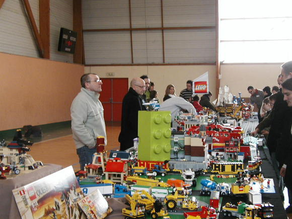
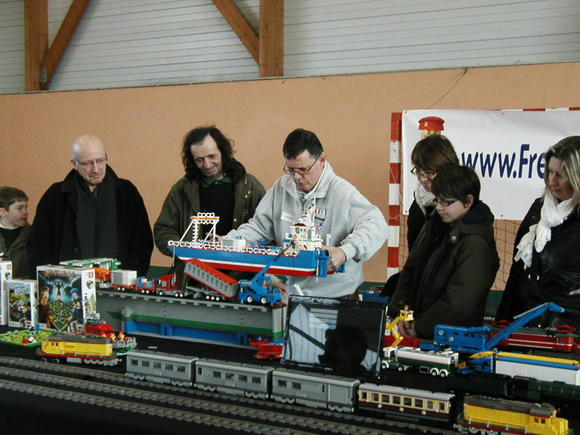
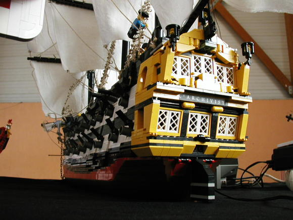
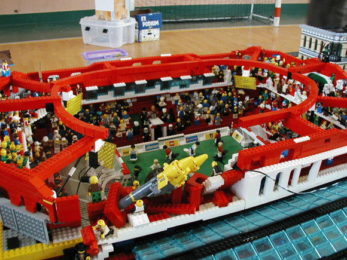
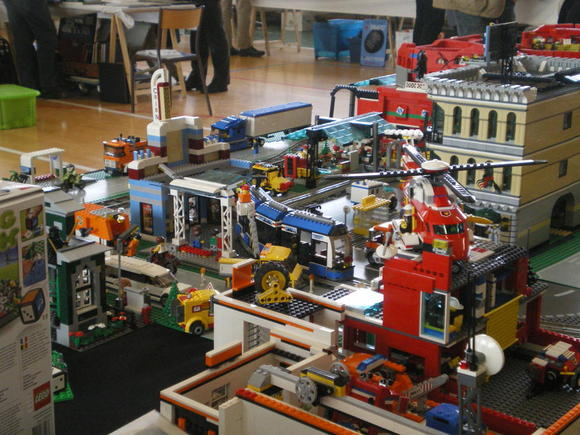
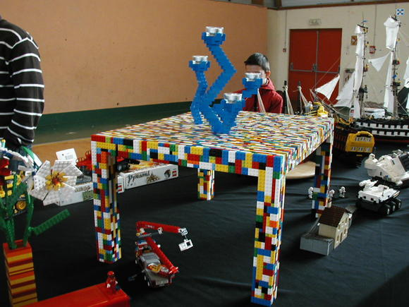
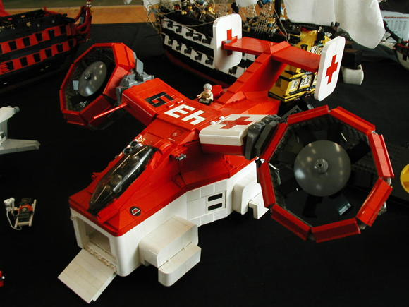
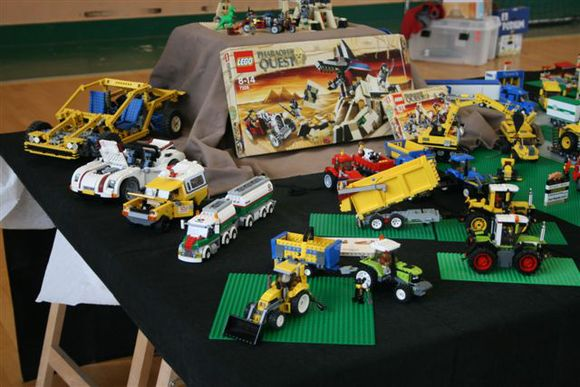

C’est par l’intermédiaire de Boris et Maxime lors du salon de Montfort sur Meu que FreeLUG a été invitée à présenter au public de la Chapelle des Fougeretz, prés de Rennes, une partie de sa collection legotique le 6 février 2011.

Après une route très très matinale avec Laurent et Bruno, une installation en cinquième vitesse, le stand tenu par Bruno, Laurent, Cyril, Damien et Mickael est fin prêt pour accueillir les premiers visiteurs à 9h et des poussières.

Notre présence étant signalée par voie de presse locale, le public a été agréablement surpris de nous voir et s’est longtemps attardé sur nos MOCS.

Certaines personnes, en coulisses, se lamentaient de ne plus voir LEGO, c’est chose faite.

Pour mémoire, le [dernier stand LEGO sur Rennes remonte en 2003 par les premiers AFOLs du club](/articles/expo-de-betton-compte-rendu/) dont Erik le prez qui a bien voulu honorer de sa présence en qualité de visiteur.

Avec 600 visiteurs, ce fut une journée excellente, accueil, organisation, tout a été parfait.

Saluons au passage les nouveaux exposants Laurent, Bruno, Cyril et Damien qui ont appris des trucs, astuces pour leurs futurs salons.

Pour ma part, j’avais un oeil vigilant sur mes trains, ma barge animée et sur un certain mick...

J’ai beaucoup conversé avec l’organisateur et ses enfants qui étaient aux anges.

Merci à tous pour cette belle journée.

_Jean-Marc_

* * *

Ce premier salon s’annonçait bien ; le voyage promettait, quant à lui, d’être catastrophique.

Après avoir constaté plusieurs fragilités imprévues sur une partie du stade et des navires de ligne que j’avais chargés dans le fourgon de mon papa la veille au soir, nous avons pris la route très tôt dans la matinée pour récupérer Jean-Marc à Morlaix, et nous rendre à Rennes, où nous avons été chaleureusement reçus par Fabien, l’organisateur, à la salle des sports de la Chapelle-des-Fougeretz, qui nous avait réservé la place d’honneur de son exposition, histoire de marquer le retour de la brique en pays rennais.

Sitôt après avoir préparé l’installation du stand, l’heure était déjà à constater les dégâts, conséquents pour un premier salon sous la bannière de FreeLUG. Une grande partie de mon stade était endommagée et demandait des réparations avant d’être intégré au diorama de Cyril, un de mes vaisseaux de ligne avait complètement démâté dans le fourgon, et un autre avait subi des dommages structurels.

Une grosse partie de ma matinée a donc été consacrée à bricoler une à une les tribunes de mon stade pour le faire provisoirement tenir debout, à retaper mes bateaux, mais surtout à faire plus ample connaissance des Freelugiens qui prenaient part à l’évènement. Cyril et Mickbatto étaient là pour assurer l’ambiance sur le stand depuis le début de la journée, puis Damien est venu me donner main forte, d’abord pour me prêter l’un de ses vaisseaux spatiaux qui m’a permis d’improviser une scène de crash sur une tribune impossible à réparer, puis pour consolider la structure du stade et rétablir le courant dans les projecteurs.

Les créations présentées étaient toutes très intéressantes, chacun a eu sa part de succès, et aucun MOC n’a été boudé par les félicitations du public. La visite d’Erik était elle aussi très intéressante, mais il n’a pas eu autant de succès que les LEGO auprès du public... C’était super gentil quand même d’être venu Monsieur le Président ;)

Ce qui m’a le plus impressionné, c’est la philosophie de Jean-Marc par rapport au stand, dont les manettes sont toutes laissées libres aux enfants. Que ce soit pour les trains, pour l’éclairage, ou pour mes créations steampunk, tous les commutateurs 9v étaient laissés aux jeux des enfants (et même du public en général), ce qui a assuré le spectacle et l’émerveillement des petits et des grands durant toute la journée, et, à l’exception d’un wagon qui a fait un tout droit avant de terminer par terre après un virage, tout s’est très bien passé.

Les enfants ont donc eu le droit de jouer, mais ce n’est pas pour autant que les Freelugiens se sont ennuyés ! Mick s’est bien amusé avec les trains de Jean-Marc, Cyril a écoulé son stock de bonbons mais n’a pas séduit une seule nana avec sa grosse brique, et l’ambiance était assurée dans les rues de notre petite ville. Les minifgs se sont toutes promenées autour du stand au moins trois fois, de bonnes barres de rire nous ont rassemblés autour des scènes que nous avons improvisées, et, bien entendu, le démontage du stand ne pouvait se faire sans procéder à la démolition de mon stade, qui était devenu parfaitement inutilisable. Sous les yeux incrédules mais hilares du public, la pelleteuse de Jean-Marc a donc traversé la ville pour entamer la destruction de l’édifice, qui s’est d’ailleurs joyeusement terminée à la main. A cet égard, l’éclat enfantin d’une extase primaire dans l’oeil ravi de Mick, restera mon plus beau souvenir sur ce salon ;)

Depuis lors, mes bateaux ont été dotés de mâts amovibles et renforcés pour sécuriser le transport, et agrémentés de plusieurs surprises qui seront mises en exposition à Parigné ! Le stade quant à lui est retourné à l’état de briques détachées, et ne sera de nouveau prêt dans sa nouvelle version que pour l’exposition de Mespaul.

Merci à tous pour ce grand moment que j’espère renouveler, partager et enrichir à l’avenir, avec toute l’expérience qu’il me reste encore à acquérir !

_LaurentB_

* * *

Présent lors du salon de Montfort-sur-Meu, j’y ai fait la connaissance de Boris et Maxime. C’est toujours un plaisir de parler avec d’autres passionnés. Lorsque Jean-Marc m’a proposé (via le forum LEGOPIRATE) de participer à l’exposition multi-collection de la Chapelle des Fougeretz, j’ai accepté de suite !

J’ai donc préparé avec Laurent un layout (à la dernière minute puisque je lui ai envoyé la veille à minuit pour lire sa réponse le lendemain à 6H !). Arrivé juste à temps à la salle, j’ai déchargé rapidement mes quelques caisses. Pas de problème de mon coté, le voyage s’était bien passé. J’ai donc pu pleinement profiter du salon et parler LEGO avec les autres. J’ai découvert d’autres façon de penser la brique (vraiment comme un travail ou plutôt comme un jouet). Je me souviendrais longtemps des yeux d’un gamin à qui les parent ont dit : « Ne touche pas c’est fragile » quand Mike leur à répondu : « Si, Si, chez nous on touche avec les yeux et on regarde avec les doigts ! » Bon, du coup j’ai passé ma journée à courir après des figurines qui ce promenaient toutes seules, mais elles sont toutes rentrées avec moi !

Je tiens à m’excuser encore une fois au près de Jean-Marc pour n’avoir pas vu son train qui arrivait à grande vitesse pendant que je remontais encore une fois un bout du stade. Mais c’était beau, la loco qui bloque contre moi, le premier wagon qui ce suicide et les suivants qui viennent recoller pour que le train soit prêt à repartir !  
Je remercie les autres pour cette bonne journée et les organisateurs pour leur travail. Surtout le cuistot pour ses galettes saucisses !

Je suis venu en freelance, la rencontre avec Erik m’a fait sauter le pas, je suis reparti en FreeLUG !

Avis à ceux qui ne pourront être à l’AG et qui veulent voir comment c’est, je recommence le 20 mars à Malville !

_Cyril « DURGE »_

* * *

Pour ma part, je suis passé en visiteur, pour y rencontrer de nouvelles têtes :) Après tout, Rennes "n’est qu’à" 3h30 de route de chez moi...

Au delà de la bonne humeur qui règne toujours sur ces expositions, j’ai été agréablement surpris par la diversité des créations proposées.

Je savais déjà à quoi m’attendre avec les bateaux de Jean-Marc et de Laurent, mais j’ai aussi découvert les accessoires de Damien (table, fleurs, bougeoirs) ainsi que ses chouettes vaisseaux.

Quant à Mickael, il était venu avec une panoplie de tracteurs.

Tout ce petit monde a constitué une équipe fort sympathique qui promet encore de bons moments à [Briqu’Expo Parigné](https://www.freelug.org/spip.php?article1275) !

_Erik_

* * *

## Galeries photos

**–** [Galerie de Jean-Marc](http://photos.freelug.org/main.php/v/barr__/expositions/2011/LaChapelleFougeretz/)  
**–** [Galerie de Laurent](http://photos.freelug.org/main.php/v/Laurent+B/La+Chapelle+des+Fougeretz/)  
**–** [Galerie de Cyril](http://photos.freelug.org/main.php/v/DURGE/MANIFESTATIONS/La+chapelle+des+fougeretz/)  
**–** [Galerie d’Erik](http://photos.freelug.org/main.php/v/brickerik/expositions/2011/LaChapelleFougeretz/)
